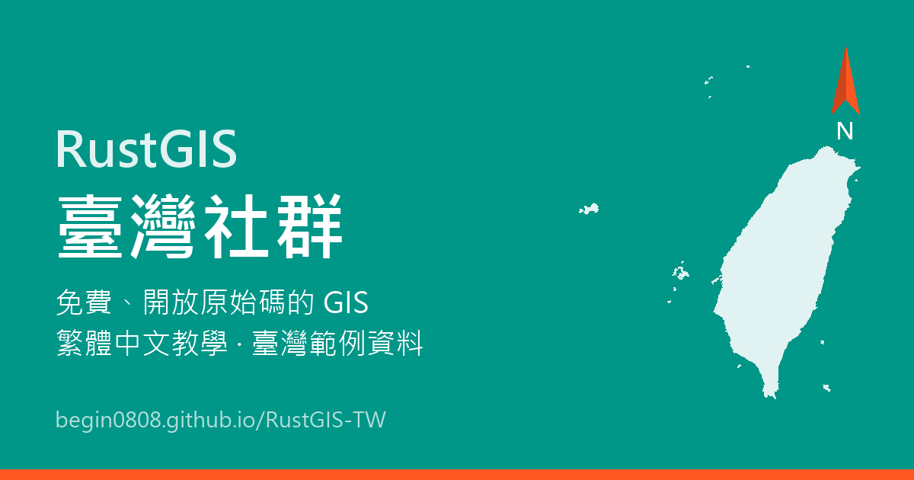

# RustGIS 臺灣教學網（RustGIS-TW）

用臺灣的開放資料，一步一步學會 [RustGIS](https://github.com/opengeos/RustGIS)。

**網站：<https://begin0808.github.io/RustGIS-TW/>**

[](https://begin0808.github.io/RustGIS-TW/)

RustGIS 是一套免費、開放原始碼的地理資訊系統（GIS），打開瀏覽器就能用，不用安裝、不用註冊，資料也不會上傳。它的介面已經有繁體中文（臺灣），用詞依照國家教育研究院樂詞網的「地理資訊系統名詞」。

這個網站整理 RustGIS 的繁體中文教學，以及可以直接拿來練習的臺灣範例資料。

## 網站內容

### 入門教學

| 課次 | 內容 |
|---|---|
| [1. 開啟網頁版](https://begin0808.github.io/RustGIS-TW/tutorials/01-open-web-app/) | 打開 RustGIS、切換成繁體中文、認識畫面 |
| [2. 載入縣市界](https://begin0808.github.io/RustGIS-TW/tutorials/02-load-boundaries/) | 開啟縣市界線的 Shapefile、坐標參考系統、儲存專案 |
| [3. 屬性表與選取](https://begin0808.github.io/RustGIS-TW/tutorials/03-attribute-table/) | 屬性表、依屬性選取 |
| [4. 符號與標註](https://begin0808.github.io/RustGIS-TW/tutorials/04-symbols-labels/) | 依欄位分色、標上縣市名稱、透明度 |
| [5. 環域分析](https://begin0808.github.io/RustGIS-TW/tutorials/05-buffer/) | 臺北市周圍 10 公里、依位置選取 |
| [6. 匯出地圖](https://begin0808.github.io/RustGIS-TW/tutorials/06-export-map/) | 匯出 PNG、A4 地圖 PDF、匯出圖徵 |

### 進階教學

| 課次 | 內容 |
|---|---|
| [7. 鄉鎮人口密度圖](https://begin0808.github.io/RustGIS-TW/tutorials/07-choropleth/) | 連結欄位、計算欄位、分級設色與分級法 |
| [8. 點位與空間統計](https://begin0808.github.io/RustGIS-TW/tutorials/08-points/) | 捷運出入口 CSV 轉成點、範圍內彙總 |
| [9. 國土測繪中心電子地圖](https://begin0808.github.io/RustGIS-TW/tutorials/09-wmts/) | 用 WMTS 加入臺灣通用電子地圖和正射影像 |
| [10. 地形分析](https://begin0808.github.io/RustGIS-TW/tutorials/10-terrain/) | 玉山一帶的數值地形模型、暈渲、坡度 |
| [11. 3D 地形](https://begin0808.github.io/RustGIS-TW/tutorials/11-3d-terrain/) | 立體地形、傾斜與旋轉、高度誇大、地形剖塊圖、立體航照 |
| [12. 時間滑桿](https://begin0808.github.io/RustGIS-TW/tutorials/12-time-slider/) | 臺灣十年來的地震、比例型符號、依年和月播放 |

### 參考資料

- [臺灣範例資料](https://begin0808.github.io/RustGIS-TW/data/)：行政區界、點位、統計、地形網格、WMTS，附來源和授權。
- [GIS 術語對照表](https://begin0808.github.io/RustGIS-TW/glossary/)：臺灣用語和英文對照。
- [常見問題](https://begin0808.github.io/RustGIS-TW/faq/)：網頁版和桌面版的差別、檔案大小、中文亂碼、匯出問題等。

## 特色

- **免安裝**：全部課程都在 [RustGIS 網頁版](https://web.rustgis.app)完成，學校電腦教室不用申請安裝軟體。
- **臺灣的資料**：用政府資料開放平臺、國土測繪中心的開放資料，例如縣市界、鄉鎮人口、捷運出入口、20 公尺數值地形模型。
- **對照 108 課綱**：首頁列出國中、高中地理科可以搭配的學習內容，包含高中選修「空間資訊科技」。
- **實際操作驗證**：每一課的步驟都在網頁版實際做過，課文裡的數字也用原始資料重新算過。
- **臺灣用語**：圖徵、網格、環域、套疊、坐標……和國內教科書、考試的用詞一致。

## 回報錯誤

- 網站每一頁最下面都有「回報本頁勘誤」，點了會開好一則 [issue](https://github.com/begin0808/RustGIS-TW/issues)。
- RustGIS 介面翻譯的問題，請回報到[官方專案](https://github.com/opengeos/RustGIS/issues)；繁體中文翻譯檔是 `crates/ui-egui/src/i18n/zh-tw.tsv`。

## 相關的開源貢獻

RustGIS 的繁體中文（臺灣）介面，是這個網站的作者翻譯並送回官方專案的：

| PR | 內容 |
|---|---|
| [opengeos/RustGIS#2083](https://github.com/opengeos/RustGIS/pull/2083) | 新增繁體中文（臺灣）介面 |
| [opengeos/RustGIS#2110](https://github.com/opengeos/RustGIS/pull/2110) | 改用臺灣標準字形與臺灣用語 |
| [opengeos/RustGIS#2141](https://github.com/opengeos/RustGIS/pull/2141) | 正確辨認 TWD97 坐標系統 |
| [opengeos/RustGIS#2242](https://github.com/opengeos/RustGIS/pull/2242) | 補翻 209 條介面文字，語言選單改成「臺灣」 |
| [opengeos/RustGIS#2243](https://github.com/opengeos/RustGIS/pull/2243)、[#2272](https://github.com/opengeos/RustGIS/pull/2272)、[#2304](https://github.com/opengeos/RustGIS/pull/2304) | 網頁版匯出地圖時正確顯示中文 |

## 本機預覽

網站用 [Zensical](https://zensical.org/) 製作。

```sh
python -m venv .venv
.venv/Scripts/pip install zensical   # macOS / Linux：.venv/bin/pip
.venv/Scripts/zensical serve         # 開啟 http://localhost:8000
```

推送到 `main` 後，GitHub Actions 會自動建置並發布到 GitHub Pages。

| 路徑 | 內容 |
|---|---|
| `docs/` | 網站內容（Markdown）、圖片、範例檔、JavaScript、CSS |
| `overrides/` | 版面模板：分享卡片的 meta 標籤、頁尾 |
| `zensical.toml` | 網站設定與導覽 |

## 授權

| 內容 | 授權 |
|---|---|
| 教學文字與圖片 | [創用 CC 姓名標示 4.0 國際](https://creativecommons.org/licenses/by/4.0/deed.zh-hant)（CC BY 4.0），全文見 [`LICENSE`](LICENSE)。轉載、改編都可以，請註明出處 |
| 網站程式碼：`docs/javascripts/`、`docs/stylesheets/`、`overrides/`、`zensical.toml` | MIT 授權，見 [`LICENSE-CODE`](LICENSE-CODE) |
| 範例資料，例如 `docs/data/files/` 的 DTM 範例檔 | 依各提供機關的授權條款（政府資料開放授權條款），詳見[臺灣範例資料](https://begin0808.github.io/RustGIS-TW/data/) |

截圖裡的底圖仍依原本的授權條款，例如國土測繪中心的電子地圖和正射影像、OpenStreetMap 與 OpenFreeMap 的街道圖。轉載這些截圖時，請一併標示底圖來源。RustGIS 的介面截圖依 RustGIS 的 Apache-2.0 授權使用。

## 致謝

- [RustGIS](https://github.com/opengeos/RustGIS)：由 opengeos 開發維護。本站不是 RustGIS 官方網站。
- 資料提供機關：內政部國土測繪中心、內政部戶政司、內政部、臺北大眾捷運股份有限公司。
- 網站由 [Zensical](https://zensical.org/) 建置。

© 2026 [Studio0808 智造實驗室](https://begin0808.github.io/studio0808/)
