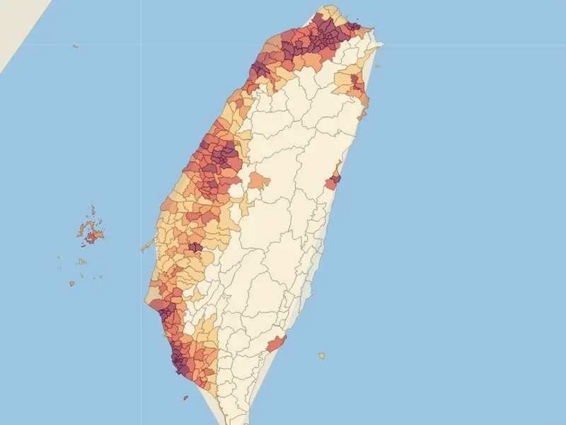
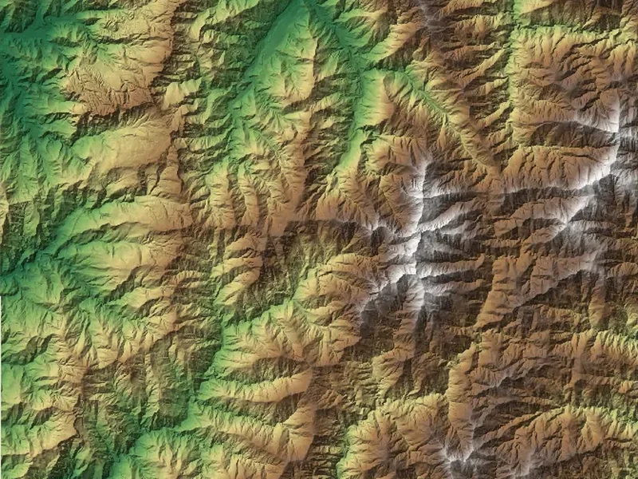
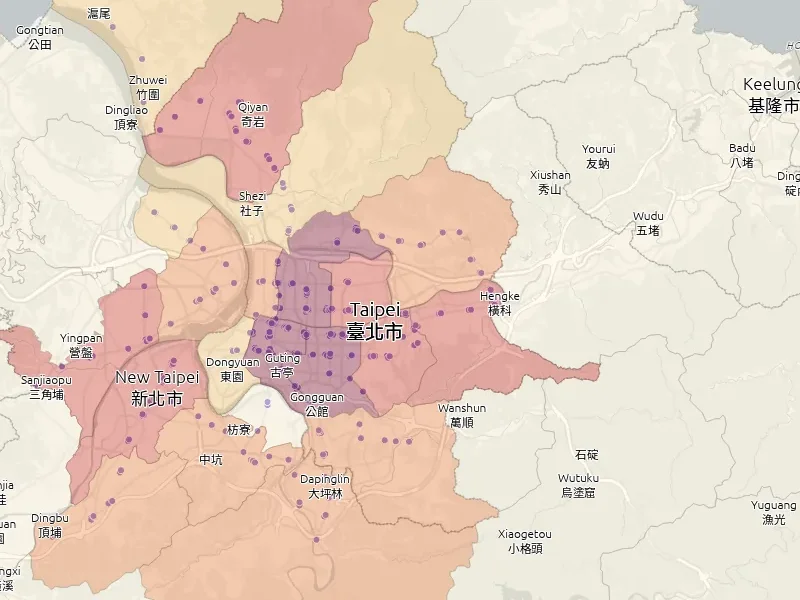
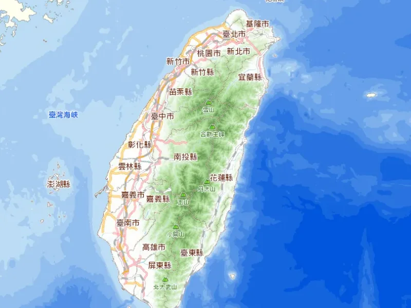

# RustGIS 臺灣教學網

[RustGIS](https://rustgis.app) 是一套免費、開放原始碼的地理資訊系統（GIS）。打開瀏覽器就能用，不用安裝、不用註冊帳號；也有 Windows、macOS、Linux 的桌面版。介面已經有**繁體中文（臺灣）**，用詞依照國家教育研究院樂詞網的「地理資訊系統名詞」。

這個網站用臺灣的開放資料，一步一步教你用 RustGIS 做出自己的地圖。

[從第 1 課開始](tutorials/01-open-web-app.md){ .md-button .md-button--primary }
[打開 RustGIS 網頁版](https://web.rustgis.app){ .md-button }

## 學完可以做出這些地圖 { #showcase }

-   

    **人口密度圖**：把人口統計表接到鄉鎮界線上，用顏色深淺表示人口疏密。

    [第 7 課 →](tutorials/07-choropleth.md)

-   

    **立體地形圖**：開啟數值地形模型，做出暈渲和坡度，看出玉山山塊的起伏。

    [第 10 課 →](tutorials/10-terrain.md)

-   

    **空間統計**：把捷運出入口的經緯度變成點，統計每個行政區有幾個。

    [第 8 課 →](tutorials/08-points.md)

-   

    **政府線上圖資**：疊上國土測繪中心的臺灣通用電子地圖和航空照片。

    [第 9 課 →](tutorials/09-wmts.md)

## RustGIS 能做什麼？ { #features }

| 功能 | 可以做什麼 | 本站教學 |
|---|---|---|
| **開啟各種資料** | Shapefile（含 ZIP）、GeoJSON、KML、GeoPackage、有經緯度的 CSV 和 Excel、GeoTIFF 網格 | [第 2 課](tutorials/02-load-boundaries.md)、[第 8 課](tutorials/08-points.md)、[第 10 課](tutorials/10-terrain.md) |
| **屬性表與查詢** | 查看、排序、篩選資料；依屬性或位置選取；用運算式計算新欄位 | [第 3 課](tutorials/03-attribute-table.md)、[第 7 課](tutorials/07-choropleth.md) |
| **符號與標註** | 單一符號、唯一值、分級設色（7 種分級法，也可以手動設定級距）；加上文字標註 | [第 4 課](tutorials/04-symbols-labels.md)、[第 7 課](tutorials/07-choropleth.md) |
| **空間分析** | 環域、融合、裁切、交集、範圍內彙總、連結欄位，還有 1,000 多個進階工具 | [第 5 課](tutorials/05-buffer.md)、[第 8 課](tutorials/08-points.md) |
| **網格與地形** | 數值地形模型的分層設色、暈渲、坡度、坡向 | [第 10 課](tutorials/10-terrain.md) |
| **線上圖資** | 加入 WMTS、WMS 等圖資服務，例如國土測繪中心的電子地圖和正射影像 | [第 9 課](tutorials/09-wmts.md) |
| **圖面配置與輸出** | 加上標題、圖例、比例尺、指北標，匯出 PNG 或 PDF | [第 6 課](tutorials/06-export-map.md) |

RustGIS 還有 3D 地球、時間滑桿、模型建置器、AI 助理、Python 套件等功能，本站之後會陸續介紹。完整功能請見[官方說明](https://rustgis.app)（英文）。

## 對國中、高中地理課有幫助嗎？ { #school }

有。108 課綱的地理科，從國中到高中都有要用到地圖和地理資訊的內容。本站的課程可以這樣搭配：

| 學習階段 | 課綱學習內容 | 可以搭配的課 |
|---|---|---|
| 國中 | 地 Aa-Ⅳ-1 全球經緯度座標系統 | [第 2 課](tutorials/02-load-boundaries.md)：經緯度和坐標系統；[第 8 課](tutorials/08-points.md)：用經緯度把地點畫到地圖上 |
| 國中 | 地 Ab-Ⅳ-2 臺灣主要地形的分布與特色 | [第 10 課](tutorials/10-terrain.md)：玉山、阿里山一帶的地形 |
| 國中 | 地 Ad-Ⅳ-1 臺灣的人口成長與分布 | [第 7 課](tutorials/07-choropleth.md)：各鄉鎮市區的人口密度 |
| 高中必修 | 地 Ab-Ⅴ-2 地理資訊系統的功能 | [第 3 課](tutorials/03-attribute-table.md)～[第 5 課](tutorials/05-buffer.md)：查詢、套疊、環域 |
| 高中必修 | 地 Ac-Ⅴ-1 地圖本質與要素、地 Ac-Ⅴ-2 地圖種類及其用途 | [第 6 課](tutorials/06-export-map.md)：標題、圖例、比例尺、指北標 |
| 高中選修「空間資訊科技」 | 地 Ea-Ⅴ-2 網路圖資服務平台 | [第 9 課](tutorials/09-wmts.md)：國土測繪中心的 WMTS |
| 高中選修「空間資訊科技」 | 地 Eb-Ⅴ-2 空間資料的分析 | [第 7 課](tutorials/07-choropleth.md)、[第 8 課](tutorials/08-points.md) |
| 高中選修「空間資訊科技」 | 地 Eb-Ⅴ-5 問題探究：針對特定地理議題繪製主題地圖，進行議題討論 | [第 7 課](tutorials/07-choropleth.md)、[第 8 課](tutorials/08-points.md)：做出主題地圖，再討論分級法和統計結果 |

在學校使用的好處：

- **電腦教室不用安裝軟體**：學生打開瀏覽器就能上課，不用申請安裝權限，也不用帳號。
- **免費**：沒有授權費，學生回家也能用自己的電腦或平板繼續做。
- **資料不上傳**：檔案只在瀏覽器裡處理，不會傳到別的伺服器。
- **用詞和課本一致**：圖徵、網格、環域、套疊、坐標……都是臺灣的用語。

!!! note "課綱出處"
    課綱學習內容引自《十二年國民基本教育課程綱要 國民中小學暨普通型高級中等學校 社會領域》（教育部，107 年 10 月）。

## 和其他工具有什麼不同？ { #compare }

**Google 地圖**、**國土測繪圖資服務雲**這類地圖網站，主要是用來**查看**別人做好的地圖。**GIS** 則可以載入**自己的資料**，做查詢、統計和分析，再畫成自己的地圖。

常見的 GIS 軟體：

| | RustGIS | QGIS | ArcGIS Pro | ArcGIS Online |
|---|---|---|---|---|
| 費用 | 免費 | 免費 | 付費訂閱 | 付費訂閱 |
| 原始碼 | 開放 | 開放 | 不開放 | 不開放 |
| 使用方式 | 瀏覽器或桌面版 | 桌面版 | 桌面版（只有 Windows） | 瀏覽器 |
| 資料存放 | 你的電腦 | 你的電腦 | 你的電腦或公司的資料庫 | Esri 的雲端 |

RustGIS 的特色是**網頁版和桌面版是同一套程式**：在學校用瀏覽器學會的操作，換到桌面版也一樣。兩者在檔案大小、匯出格式和 Python 外掛等方面有些差別，詳見[常見問題](faq.md#web-or-desktop)。已經會 QGIS 或 ArcGIS 的人，大部分概念都相通，可以參考 [GIS 術語對照表](glossary.md)。

比較內容整理自 RustGIS 官方的[比較頁](https://rustgis.app/comparison/)（英文，2026 年 10 月）。

## 從這裡開始 { #start }

- **[入門教學](tutorials/index.md)**

    6 堂課，從打開網頁版開始，載入臺灣的縣市界、查看屬性表、設定符號、做環域分析、匯出地圖。

- **[進階教學](tutorials/advanced.md)**

    人口密度圖、捷運出入口統計、國土測繪中心電子地圖、玉山地形分析。

- **[臺灣範例資料](data/index.md)**

    整理好的臺灣開放資料，附上來源和授權說明，下載後就能在 RustGIS 開啟。

- **[GIS 術語對照表](glossary.md)**

    臺灣用語和英文對照，和課本、考試的用詞一致。

- **[常見問題](faq.md)**

    網頁版和桌面版的差別、檔案大小限制、中文亂碼、匯出問題等。

- **[關於本站](about.md)**

    本站的授權方式，以及怎麼回報錯誤、補充教學或分享範例資料。

!!! note "本站不是 RustGIS 官方網站"
    RustGIS 由 [opengeos](https://github.com/opengeos/RustGIS) 開發維護。本站是臺灣使用者自發整理的教學資源，官方說明請見 [rustgis.app](https://rustgis.app)（英文）。
