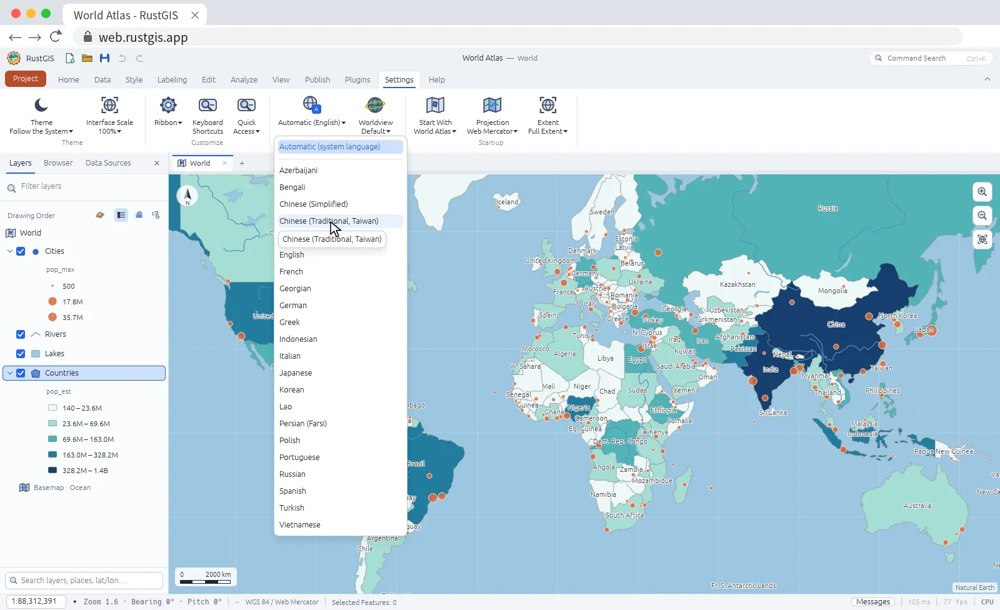
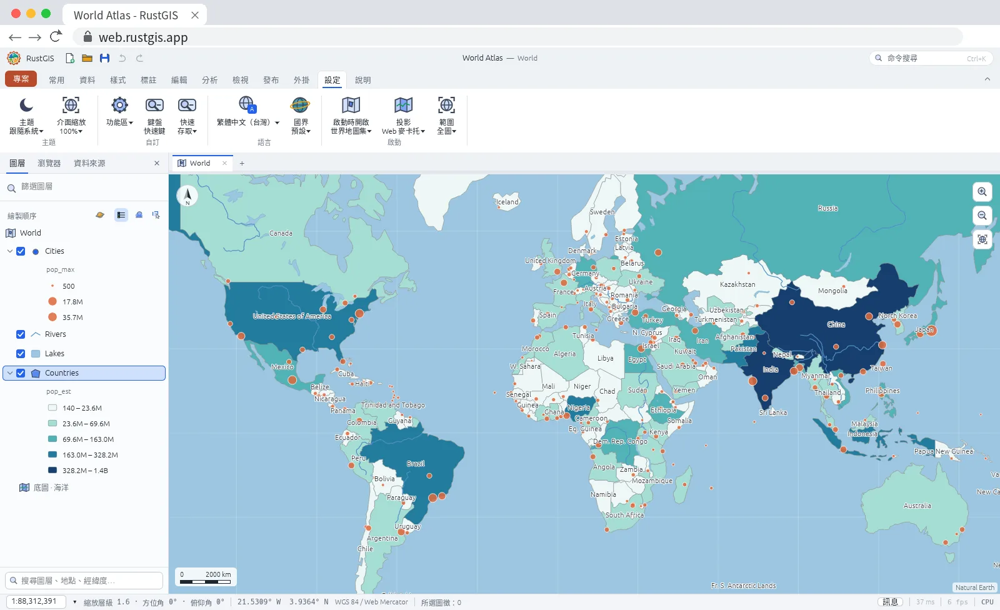
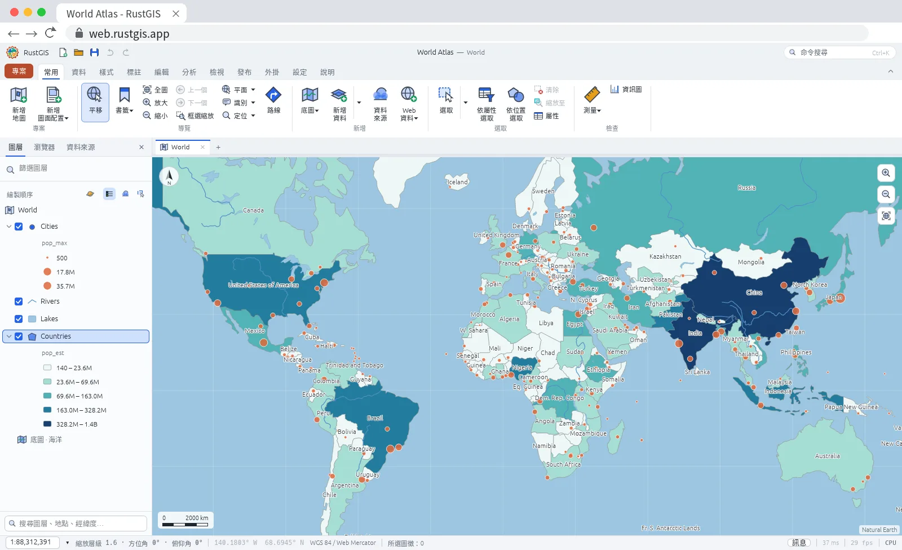

# 1. 開啟網頁版

這一課會打開 RustGIS 網頁版，把介面切換成繁體中文，並認識畫面上的各個區塊。

**需要的時間**：約 10 分鐘
**需要的東西**：一台電腦和較新的瀏覽器（Chrome、Edge、Firefox 或 Safari）

## 打開網頁版

在瀏覽器開啟 **[web.rustgis.app](https://web.rustgis.app)**。

第一次開啟需要下載程式，大約要等十幾秒。載入完成後會看到一張世界地圖，這是 RustGIS 內建的範例專案「World Atlas」。

!!! tip "資料不會上傳"
    網頁版是在你的瀏覽器裡執行的。你開啟的檔案只在自己的電腦上處理，不會上傳到 RustGIS 的伺服器。

## 切換成繁體中文

如果瀏覽器的語言是繁體中文（台灣），RustGIS 會自動顯示繁體中文。若畫面是英文，可以這樣切換：

1. 點上方的 **Settings** 頁籤。
2. 在 **Language** 群組，點語言按鈕（上面寫著「Automatic (English)」）。
3. 在選單中選 **Chinese (Traditional, Taiwan)**。

    英文介面下，選單裡的語言名稱也是英文，所以要找「Chinese (Traditional, Taiwan)」，不是「繁體中文」。

第一次切換時，網頁版會下載一套台灣標準字形的字型（約 5.7 MB），等幾秒就會換好。

選單裡的「**自動**」表示跟隨瀏覽器的語言。直接選「繁體中文（台灣）」的話，不管瀏覽器設定為何都會顯示繁體中文。

## 認識畫面

| 區塊 | 位置 | 用途 |
|---|---|---|
| **功能區** | 最上方 | 依頁籤分組的各種功能：常用、資料、樣式、標註、編輯、分析… |
| **圖層面板** | 左側 | 列出地圖上的圖層。勾選方塊可以顯示或隱藏圖層，上下拖曳可以調整繪製順序 |
| **地圖** | 中間 | 用滑鼠滾輪縮放、按住左鍵拖曳平移；右上角也有放大、縮小按鈕 |
| **狀態列** | 最下方 | 比例尺、縮放層級、坐標參考系統，以及「所選圖徵」的數量 |

範例地圖有四個圖層：

- **Cities**（城市，點）
- **Rivers**（河流，線）
- **Lakes**（湖泊，面）
- **Countries**（國家，面）

圖層名稱和地圖上的國名是英文，因為它們來自範例資料本身；RustGIS 只翻譯介面，不會改動資料的內容。下一課會載入屬性是中文的台灣資料。

## 找不到功能時

按 ++ctrl+k++（macOS 為 ++cmd+k++）打開右上角的**命令搜尋**，輸入功能名稱就能找到。中文、英文都可以，例如輸入「環域」，就會打開環域分析工具。

## 小結

- 網頁版不用安裝，打開 [web.rustgis.app](https://web.rustgis.app) 就能使用。
- 介面語言在 **設定 › 語言** 切換。
- 畫面分成功能區、圖層面板、地圖和狀態列。

下一課：[2. 載入縣市界](02-load-boundaries.md)
