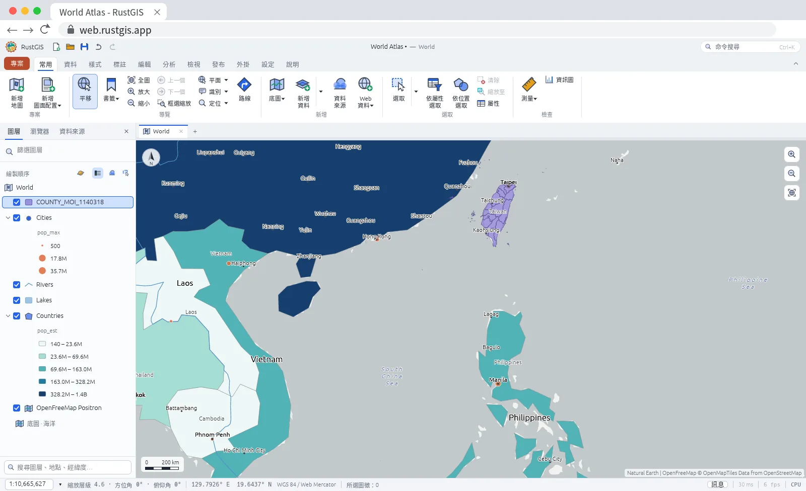
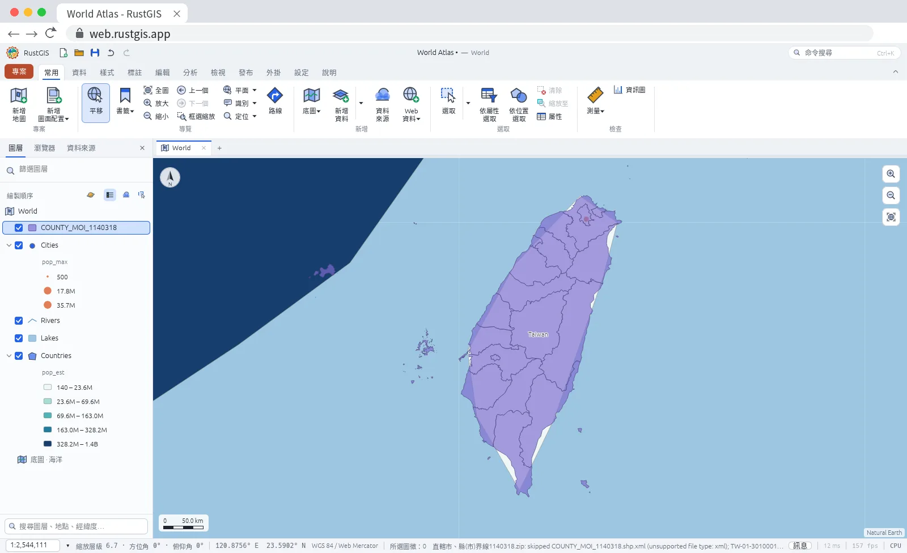
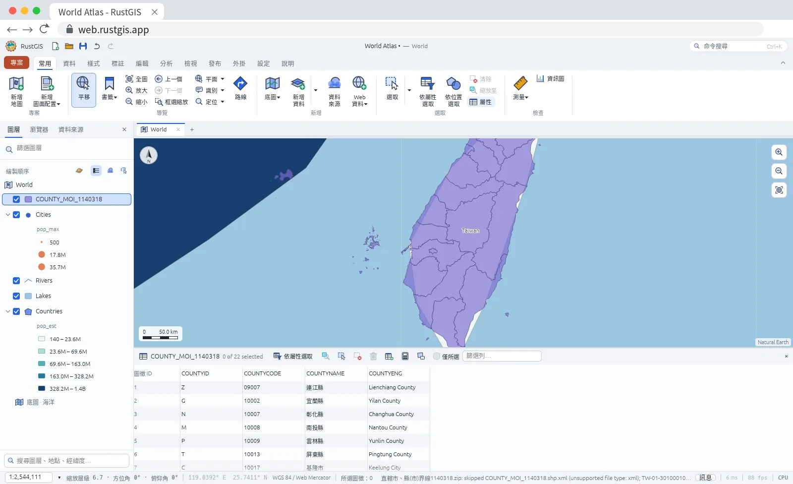

# 2. 載入縣市界

這一課會下載內政部國土測繪中心的縣市界線，在 RustGIS 開啟，並認識 Shapefile 格式和坐標參考系統。

**需要的時間**：約 15 分鐘

## 下載資料

1. 開啟政府資料開放平臺的[直轄市、縣市界線(TWD97經緯度)](https://data.gov.tw/dataset/7442)。
2. 在「資料資源」找到格式為 **SHP** 的項目，按下載。
3. 會得到一個 ZIP 檔，例如「直轄市、縣(市)界線1140318.zip」，大小約 3.7 MB。檔名中的數字是資料版本日期（民國 114 年 3 月 18 日）。

!!! info "Shapefile 是什麼？"
    Shapefile 是最常見的 GIS 向量資料格式。它不是一個檔案，而是一組**主檔名相同**的檔案：

    | 副檔名 | 內容 |
    |---|---|
    | `.shp` | 圖徵的形狀（點、線、面） |
    | `.shx` | 形狀的索引 |
    | `.dbf` | 屬性表 |
    | `.prj` | 坐標參考系統 |
    | `.cpg` | 屬性表的文字編碼（這份資料是 UTF-8） |

    缺了 `.shp` 或 `.dbf` 就開不起來，所以 Shapefile 通常會打包成 ZIP 檔提供。

## 在 RustGIS 開啟

1. 打開 [web.rustgis.app](https://web.rustgis.app)。
2. 在 **常用** 頁籤的「新增」群組，按 **新增資料**。
3. 選剛才下載的 ZIP 檔，**不用解壓縮**。

    也可以把 ZIP 檔直接拖曳到地圖上。

圖層面板最上方會多出一個名為 `COUNTY_MOI_1140318` 的圖層。

!!! note "圖層名稱的數字可能不一樣"
    `1140318` 是撰寫教學時的資料版本日期。國土測繪中心會不定期更新縣市界線，如果你下載到較新的版本，圖層名稱後面的數字會不同，例如 `COUNTY_MOI_1150101`。這不是下載錯檔案。之後的教學寫到 `COUNTY_MOI_1140318` 的地方，請改選你畫面上的縣市界線圖層。

!!! tip "只要載入一次"
    每按一次「新增資料」就會多一個圖層。重複載入時，第二個會叫 `COUNTY_MOI_1140318 (2)`。多出來的圖層可以按右鍵選「移除」。

## 縮放到資料

地圖不會自動移到新的圖層。在圖層面板的 `COUNTY_MOI_1140318` 上**按右鍵**，選 **縮放至圖層**：



### 為什麼地圖沒有剛好對準臺灣？

這份資料除了臺灣本島、澎湖、金門、馬祖，還包含**東沙島**和**南沙太平島**（屬於高雄市）。圖層的範圍從北緯 10 度延伸到 26 度，所以縮放到整個圖層時，臺灣只佔畫面的一角。

## 換一個詳細的底圖

範例專案的底圖是 Natural Earth 的全世界小比例尺輪廓，臺灣只用很少的點描出來。看整個世界沒問題，但放大到臺灣時，海岸線會和縣市界線差好幾公里，看起來像沒對齊。這不是資料的問題，是底圖太粗略。

換成詳細的底圖：

1. 在 **常用** 頁籤按 **底圖**。
2. 在「Web 底圖」選 **OpenFreeMap Positron**。

用滑鼠滾輪放大到臺灣附近，縣市界線和底圖的海岸線就對齊了：



OpenFreeMap 的底圖來自 OpenStreetMap，全世界都很詳細，放大到鄉鎮也會和縣市界線吻合。底圖上的英文地名（例如 Taichung）是底圖本身的文字，不是我們的資料。接下來的課程都用這個底圖。

!!! tip "其他詳細的底圖"
    「Web 底圖」裡還有 **OpenFreeMap Liberty**、**Bright** 等彩色地圖，以及 **USGS Imagery** 衛星影像。USGS Imagery 是美國的服務，美國以外只有看全臺灣這種比例尺的影像，再放大就沒有了；第 4 課最後會用它做出完整的地圖。

## 看看屬性表

在圖層面板點選 `COUNTY_MOI_1140318`，再按 **常用 › 選取 › 屬性**，下方會出現屬性表：



| 欄位 | 內容 | 例子 |
|---|---|---|
| `COUNTYID` | 縣市代碼（英文字母） | `A`（臺北市） |
| `COUNTYCODE` | 行政區代碼 | `63000` |
| `COUNTYNAME` | 縣市名稱 | 臺北市 |
| `COUNTYENG` | 英文名稱 | Taipei City |

一共有 22 列，就是臺灣的 22 個縣市。在屬性表的表格中，**欄**是直的（每個欄位），**列**是橫的（每個縣市）。

## 坐標參考系統

這份資料的 `.prj` 寫著 `GCS_TWD97[2020]`，表示坐標是 **TWD97 經緯度**（以度為單位的經度、緯度）。

| 坐標參考系統 | EPSG 代碼 | 單位 | 常見用途 |
|---|---|---|---|
| TWD97 經緯度 | EPSG:3824 | 度 | 全國性的資料、跨縣市的範圍 |
| TWD97 二度分帶（TM2，中央經線 121°） | EPSG:3826 | 公尺 | 量距離、算面積、測量與地籍 |
| WGS 84 | EPSG:4326 | 度 | GPS、網路地圖 |

RustGIS 會自動把資料**重新投影**到地圖的坐標系統。狀態列顯示的「WGS 84 / Web Mercator」是地圖本身的投影，跟資料原本的坐標系統不同也沒關係。

## 右下角出現的英文訊息

開啟這份 ZIP 檔時，右下角會跳出一則英文訊息，狀態列也會顯示。它**不影響使用**：

```text
直轄市、縣(市)界線1140318.zip: skipped COUNTY_MOI_1140318.shp.xml (unsupported file type: xml); …
```

ZIP 檔裡除了 Shapefile，還有詮釋資料（`.xml`）和一份修正清單（`.xlsx`）。RustGIS 只讀取 Shapefile，其他檔案會略過並列出檔名。

修正清單的中文檔名可能顯示成亂碼（例如 `�y��M��_11403.xlsx`）。這是因為 ZIP 檔裡的檔名用的是舊的 Big5 編碼，不影響縣市資料。

!!! note "以前還有一則坐標系統的提醒"
    以前開啟這份資料時，還會出現「the datum D_TWD_1997 has no conversion to WGS 84」的提醒，說位置可能有幾百公尺的誤差。其實 TWD97 和 WGS 84 幾乎重合，差距不到 1 公尺。本站作者向 RustGIS 提出了[修正](https://github.com/opengeos/RustGIS/pull/2141)，已在 2026 年 11 月合併，現在不會再出現這則提醒。

## 小結

- Shapefile 是一組檔案，可以直接用 ZIP 檔開啟。
- **常用 › 新增資料** 可以開啟資料，也可以把檔案拖到地圖上。
- TWD97 經緯度（EPSG:3824）以度為單位；測量、地籍等需要公尺的工作，常用 TWD97 二度分帶（EPSG:3826）。

## 資料來源

本課使用內政部國土測繪中心「直轄市、縣市界線(TWD97經緯度)」開放資料，依[政府資料開放授權條款－第 1 版](https://data.gov.tw/license)提供。

下一課：[3. 屬性表與選取](03-attribute-table.md)
