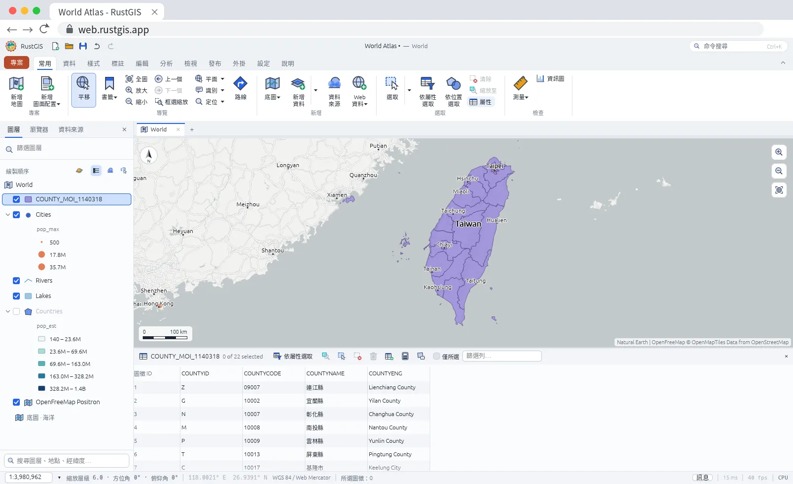
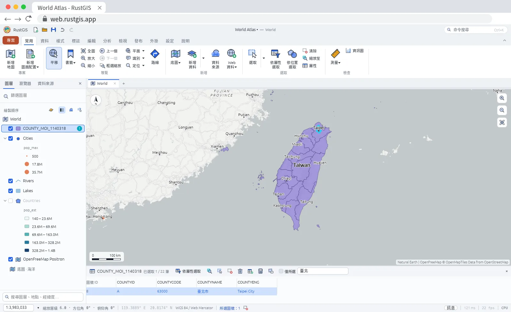
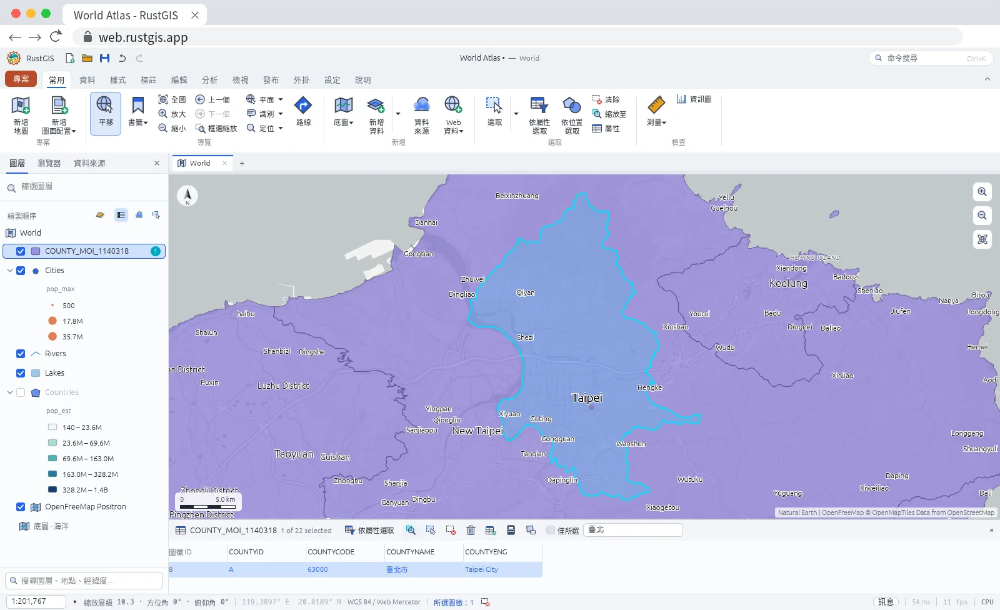
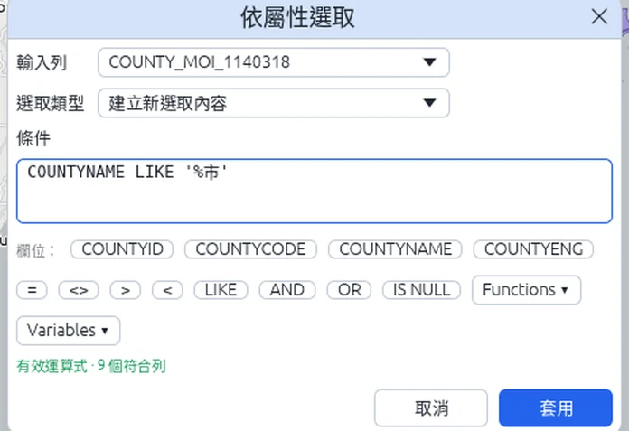
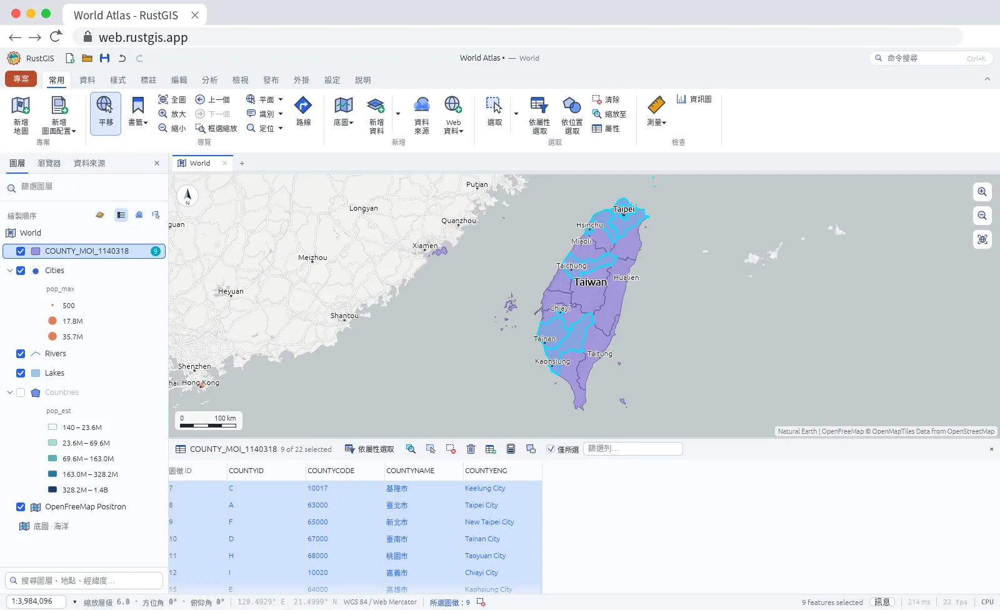
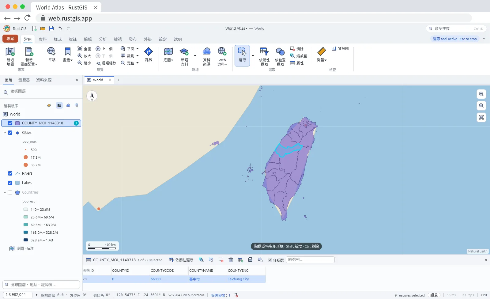

# 3. 屬性表與選取

這一課會打開縣市界線的屬性表，用表格、條件和滑鼠找出想要的縣市。

**需要的時間**：約 20 分鐘
**需要的東西**：完成[第 2 課](02-load-boundaries.md)，在 RustGIS 開好 `COUNTY_MOI_1140318` 圖層，底圖換成 OpenFreeMap Positron。如果關掉過網頁，請照第 2 課再新增一次資料。

!!! tip "先隱藏國家圖層"
    範例專案的 **Countries** 圖層也畫在臺灣上。在圖層面板取消勾選 **Countries**，地圖會比較清楚，也不會點到別的圖層。

## 打開屬性表

1. 在圖層面板點選 `COUNTY_MOI_1140318`。
2. 按 **常用 › 選取 › 屬性**。

    也可以在圖層上按右鍵，選 **屬性表**。

地圖下方會出現屬性表：



- **每一列是一個縣市**，也就是地圖上的一個圖徵，一共 22 列。
- **每一欄是一個欄位**：`COUNTYID`、`COUNTYCODE`、`COUNTYNAME`、`COUNTYENG`。
- 最左邊的 **圖徵 ID** 是 RustGIS 給每個圖徵的編號，不是資料本身的欄位。
- 表格上方的 **0 of 22 selected** 表示「22 筆中選取了 0 筆」。這段文字目前還沒有翻譯。

點欄位名稱可以排序。例如點 `COUNTYCODE`，欄名旁會出現 ↑，表格依行政區代碼由小到大排列。

## 篩選並選取一個縣市

### 篩選列

在屬性表右上角的 **篩選列…** 輸入「臺北」，表格就只剩名稱有「臺北」的那一列。

!!! warning "是「臺」不是「台」"
    內政部的資料一律寫「臺」，例如「臺北市」「臺中市」。輸入「台北」會找不到。

篩選只改變表格**顯示**哪些列，不會選取任何縣市。

### 點選一列

點表格中「臺北市」那一列：



- 這一列變成藍色，表示**被選取**了。
- 地圖上的臺北市出現藍色外框。
- 表格上方變成 **1 of 22 selected**，圖層名稱旁也出現選取數量 ①。

按屬性表工具列的 **縮放至所選內容**（放大鏡圖示），地圖會放大到臺北市：



看完後，做三件事回到原來的狀態：

1. 按屬性表工具列的 **清除選取**（紅色叉叉圖示）。
2. 刪掉篩選列裡的「臺北」。
3. 按 **常用 › 導覽 › 上一個**，地圖回到剛才的範圍。

## 依屬性選取

如果要選的不只一個縣市，一列一列點太慢，可以改用條件選取。這一節要一次選出所有名稱是「○○市」的縣市。

1. 按屬性表工具列的 **依屬性選取**。
2. 「輸入列」是 `COUNTY_MOI_1140318`，「選取類型」保持 **建立新選取內容**。
3. 在「條件」輸入：

    ```sql
    COUNTYNAME LIKE '%市'
    ```

    也可以點下方的欄位按鈕（`COUNTYNAME`）和運算子按鈕（`LIKE`）把條件組出來。

4. 下方出現 **有效運算式 · 9 個符合列**，表示條件寫對了，有 9 筆符合。按 **套用**。

{ width="480" }

條件的意思是：

| 部分 | 意思 |
|---|---|
| `COUNTYNAME` | 看「縣市名稱」這一欄 |
| `LIKE` | 依樣式比對文字 |
| `'%市'` | `%` 代表任意長度的文字，所以 `'%市'` 就是「以市結尾」 |

!!! tip "文字要加半形單引號"
    條件裡的文字要用半形單引號 `'…'` 括起來，例如 `'臺中市'`。用中文輸入法時，小心別打成全形的「’」。

套用後，地圖上有 9 個縣市被選取。勾選屬性表工具列的 **僅所選**，表格就只列出被選取的縣市：



這 9 個就是 6 個直轄市（臺北、新北、桃園、臺中、臺南、高雄），加上基隆市、新竹市、嘉義市。

## 在地圖上點選

也可以直接在地圖上點選縣市：

1. 按 **常用 › 選取 › 選取**。
2. 在地圖上點一個縣市，例如臺中市。



使用選取工具時，地圖下方會出現操作提示：**點選或拖曳矩形框 · Shift 新增 · Ctrl 移除**。

- 按住 ++shift++ 再點，可以**加選**其他縣市。
- 按住 ++ctrl++ 再點，可以把縣市從選取中**移除**。
- 用完按 ++esc++ 結束選取工具。

因為剛才勾選了「僅所選」，屬性表只會列出你在地圖上點到的縣市。

## 清除選取

按 **常用 › 選取 › 清除**，或屬性表工具列的 **清除選取**，所有選取都會取消。

!!! note "還沒翻譯的英文訊息"
    選取時會看到幾段英文，例如表格上方的「9 of 22 selected」、右下角的「9 features selected」、選取工具的「tool active · Esc to stop」，以及對話框的「Functions」「Variables」按鈕。這些是 RustGIS 還沒納入翻譯的文字，不影響操作，之後會補上翻譯。

## 練習

用 **依屬性選取** 試試下面的條件。每題做完，記得先清除選取。

1. 選出所有「縣」，應該有幾筆？
2. 只選出臺中市。
3. 六個直轄市的 `COUNTYCODE` 都是 6 開頭。用這一點選出六都。

??? success "答案"
    1. `COUNTYNAME LIKE '%縣'`，共 13 筆。13 個縣加上 9 個市，正好是 22 筆。
    2. `COUNTYNAME = '臺中市'`，1 筆。也可以寫 `COUNTYID = 'B'`。
    3. `COUNTYCODE LIKE '6%'`，6 筆：臺北市、新北市、桃園市、臺中市、臺南市、高雄市。

## 小結

- 屬性表的**一列是一個圖徵、一欄是一個欄位**。
- **篩選列**只改變表格顯示的內容；**選取**會同時標示在表格和地圖上。
- **依屬性選取**用條件一次選出多筆。`LIKE` 搭配 `%` 可以比對開頭或結尾。
- **選取工具**可以在地圖上點選，Shift 加選、Ctrl 移除。

下一課：[4. 符號與標註](04-symbols-labels.md)
