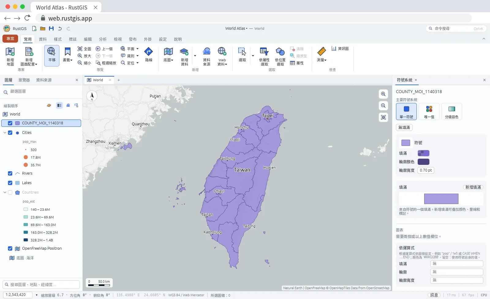
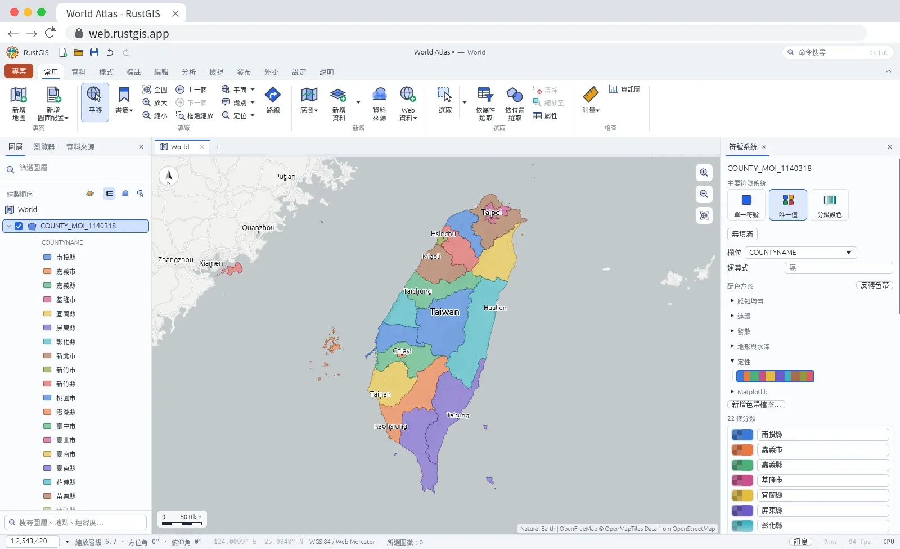
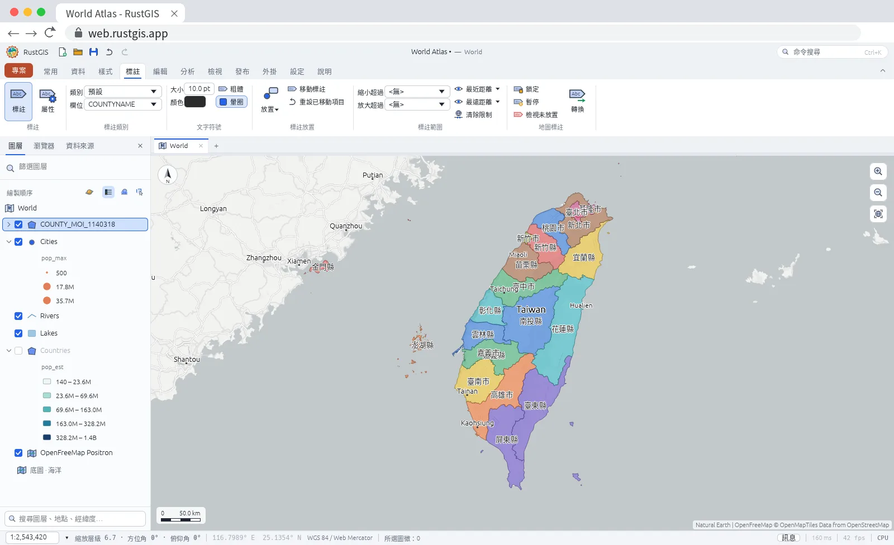
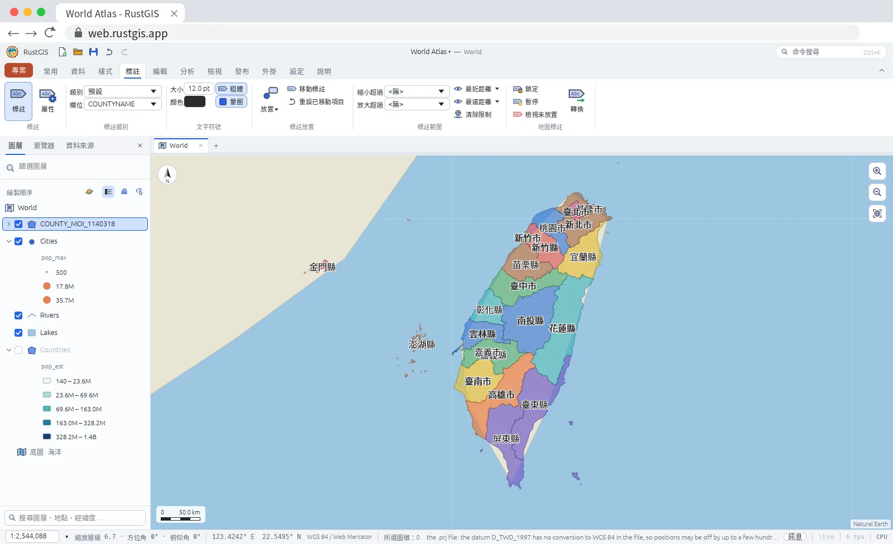
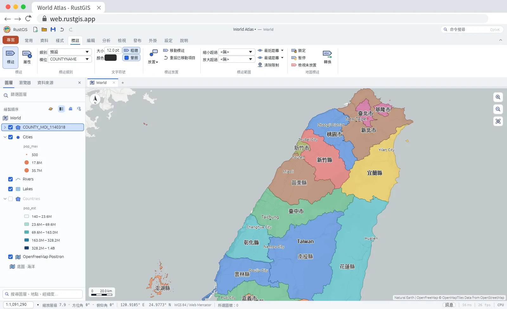
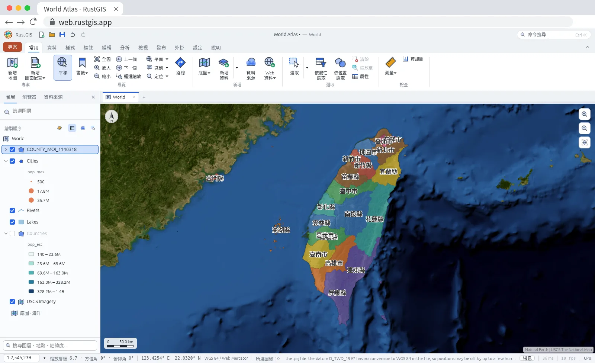

# 4. 符號與標註

這一課會依縣市名稱替每個縣市塗上不同顏色，再把名稱標在地圖上，做出一張看得懂的臺灣縣市地圖。

**需要的時間**：約 15 分鐘
**需要的東西**：完成[第 2 課](02-load-boundaries.md)，在 RustGIS 開好 `COUNTY_MOI_1140318` 圖層。建議也照[第 3 課](03-attribute-table.md)的提示，取消勾選 **Countries** 圖層。

## 符號系統

**符號系統**決定圖徵在地圖上長什麼樣子，例如填滿什麼顏色、邊框多粗。

在圖層面板的 `COUNTY_MOI_1140318` 上按右鍵，選 **符號系統**。右側會打開「符號系統」面板：

最上方的「主要符號系統」有三種：

| 符號系統 | 意思 | 適合的資料 |
|---|---|---|
| **單一符號** | 所有圖徵用同一種符號（目前的設定） | 只想看位置和範圍 |
| **唯一值** | 欄位裡每個不同的值各給一種顏色 | 類別，例如縣市名稱、土地使用分區 |
| **分級設色** | 把數值分成幾級，用深淺表示大小 | 數量，例如人口、面積 |

目前是單一符號，所以 22 個縣市都是同一個紫色。在「符號」區可以調整 **填滿** 顏色、**輪廓顏色** 和 **輪廓寬度**。

## 依縣市名稱分色

1. 按 **唯一值**。
2. 「欄位」預設是 `COUNTYID`，改成 **COUNTYNAME**。
3. 按欄位右邊的 **套用**。

每個縣市都換成不同的顏色：

- 面板下方列出 **22 classes**，也就是 22 個縣市名稱，各配一種顏色。
- 圖層面板的圖層下方也出現圖例，列出每個顏色代表哪個縣市。
- 顏色來自「配色方案」裡的 **定性** 色帶。定性色帶的顏色彼此差異大、沒有深淺順序，適合用來區分類別。展開其他色帶，可以換一組顏色試試看。

!!! question "為什麼用 COUNTYNAME，不用 COUNTYID？"
    兩個欄位都是一個縣市一個值，都能分出 22 種顏色。差別在**圖例**：用 `COUNTYNAME`，圖例會寫「臺北市」；用 `COUNTYID`，圖例只會寫「A」，讀地圖的人看不懂。

調整好後，按面板右上角的 **×** 關閉面板。

## 標上縣市名稱

**標註**是把欄位的內容寫在圖徵上。

1. 點上方的 **標註** 頁籤。
2. 確認圖層面板選的是 `COUNTY_MOI_1140318`，按最左邊的 **標註**。

縣市名稱馬上出現在地圖上。「欄位」已經自動選好 `COUNTYNAME`，不用另外設定：

### 調整文字

在「標註」頁籤的 **文字符號** 群組，可以直接調整文字：

1. 點 **大小**，改成 `12`，按 ++enter++。
2. 按 **粗體**。
3. **暈圈** 預設是開的。它會在文字周圍加一圈白邊，讓文字在彩色的底圖上也看得清楚，建議保留。

!!! tip "更多標註設定"
    在圖層上按右鍵選 **標註屬性…**，可以打開完整的「標註」面板，分成 **內容**、**符號**、**位置**、**範圍** 四頁，例如設定字型、字間距、標註的位置，或只在某個比例尺範圍內顯示。

### 名稱擠在一起怎麼辦？

看全臺灣時，臺北市和基隆市、嘉義市和嘉義縣的範圍很小，名稱會疊在一起。用滑鼠滾輪放大，名稱就會分開：

## 換一個底圖

範例專案的底圖比較粗略（見[第 2 課](02-load-boundaries.md#_3)的說明）。換成衛星影像，地圖會更好看：

1. 回到 **常用** 頁籤，按 **底圖**。
2. 在「Web 底圖」選 **USGS Imagery**。

USGS Imagery 底圖上沒有文字，所以不會和縣市名稱混在一起。海岸線也和縣市界線對得很準。

## 練習

1. 換成「配色方案」裡的其他色帶，例如 **Matplotlib** 底下的色帶，看看哪一組顏色最容易區分相鄰的縣市。
2. 把標註的 **大小** 改成 `16`，看看名稱擠在一起的情況有什麼變化。
3. 關掉 **暈圈**，比較有沒有暈圈時文字清不清楚。

## 小結

- **符號系統**決定圖徵的外觀：**單一符號**看位置，**唯一值**分類別，**分級設色**看數量。
- 用 **唯一值** 依 `COUNTYNAME` 分色，圖例會直接寫縣市名稱。
- 用 **標註** 頁籤一鍵標上名稱，並在「文字符號」調整大小、粗體和暈圈。
- 名稱擠在一起時放大地圖；想要更好看的地圖，可以換一個底圖。

下一課：[5. 環域分析](05-buffer.md)
