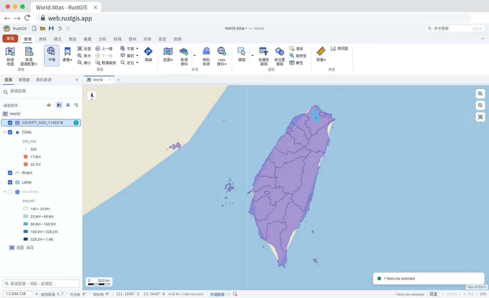
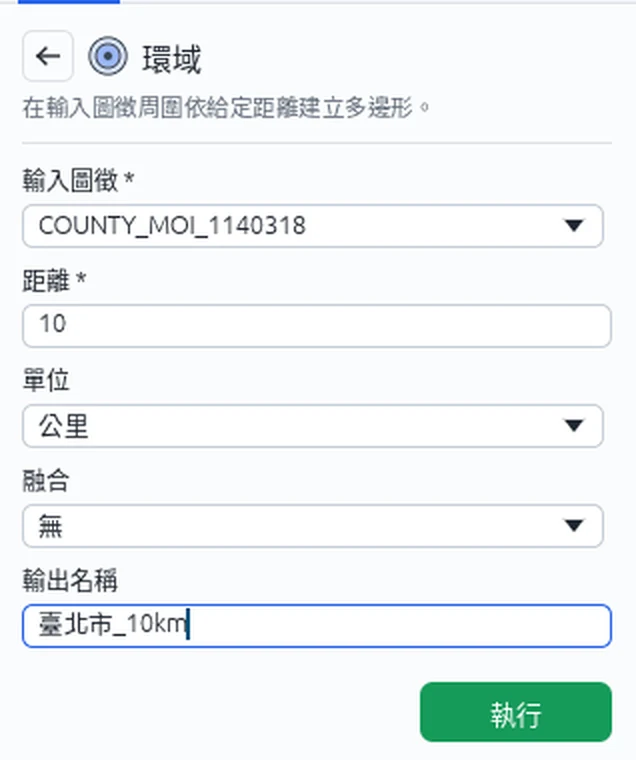
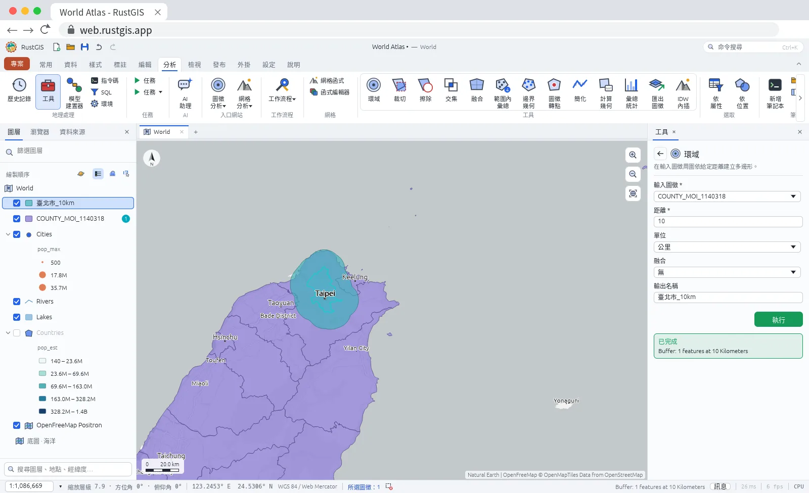
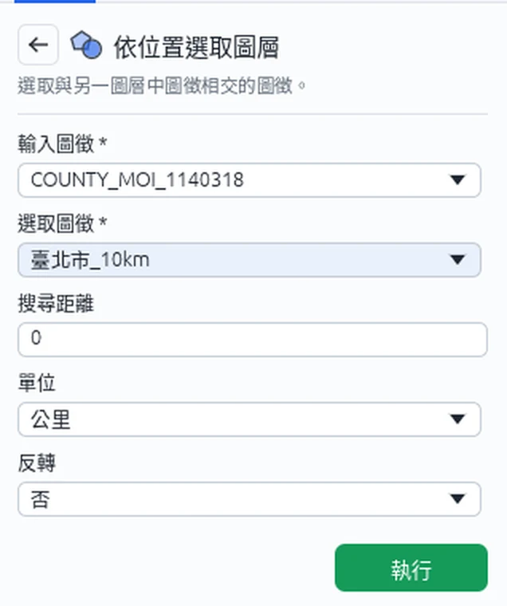
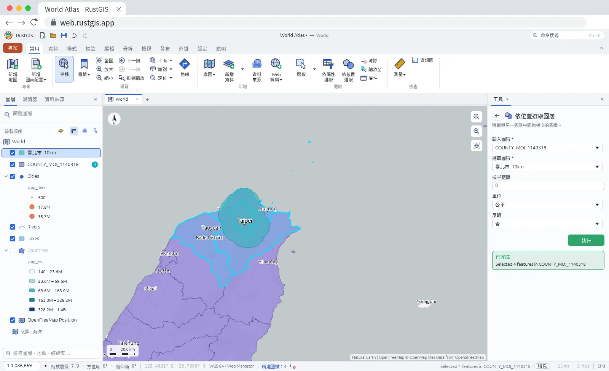
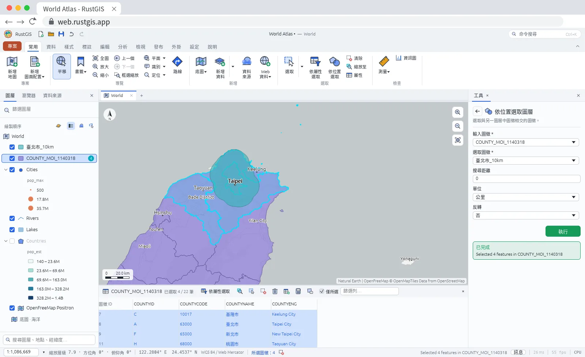

# 5. 環域分析

這一課會畫出臺北市周圍 10 公里的範圍，再找出哪些縣市碰到這個範圍。

**需要的時間**：約 20 分鐘
**需要的東西**：完成[第 2 課](02-load-boundaries.md)，在 RustGIS 開好 `COUNTY_MOI_1140318` 圖層，底圖換成 OpenFreeMap Positron，並取消勾選 **Countries** 圖層。會用到[第 3 課](03-attribute-table.md)的「依屬性選取」。

## 環域是什麼？

**環域**（buffer）是一個圖徵周圍、固定距離以內的範圍。

- 點的環域是一個圓，例如「學校方圓 500 公尺」。
- 線的環域是一條帶狀，例如「河川兩側 100 公尺」。
- 面的環域是把面往外擴，例如「臺北市界外 10 公里」。

環域常用來回答「某個東西附近有什麼」，例如捷運站步行範圍內有哪些住宅、焚化爐周圍幾公里內有哪些學校。

## 選出臺北市

環域工具只會處理**選取的圖徵**；沒有選取時，會處理整個圖層的所有圖徵。這裡只要臺北市，所以先選取它：

1. 在圖層面板點選 `COUNTY_MOI_1140318`。
2. 按 **常用 › 選取 › 依屬性選取**。
3. 在「條件」輸入下面這行，按 **套用**：

    ```sql
    COUNTYNAME = '臺北市'
    ```

地圖上的臺北市出現藍色外框，圖層名稱旁顯示 ①：



!!! warning "忘了選取會怎樣？"
    如果沒有選取，環域工具會替 22 個縣市**全部**做環域，結果會蓋住整個臺灣。發生的話，在圖層面板的結果圖層上按右鍵選 **移除**，選好臺北市再做一次。

## 執行環域

1. 點上方的 **分析** 頁籤，在「工具」群組按 **環域**。

    也可以按 ++ctrl+k++，輸入「環域」，按 ++enter++。

2. 右側會打開「環域」工具。依下表填寫：

    | 欄位 | 填寫 | 說明 |
    |---|---|---|
    | 輸入圖徵 | `COUNTY_MOI_1140318` | 要做環域的圖層 |
    | 距離 | `10` | 預設是 100，改成 10 |
    | 單位 | 公里 | 也可以選公尺、英里等 |
    | 融合 | 無 | 有多個圖徵時，要不要把環域合成一塊（見下方說明） |
    | 輸出名稱 | `臺北市_10km` | 結果圖層的名稱，可以自己取 |

    { width="320" }

3. 按 **執行**。

下方出現綠色的「**已完成**」，底下寫著 `Buffer: 1 features at 10 Kilometers`（分析工具的結果訊息目前還是英文，意思是「對 1 個圖徵做了 10 公里的環域」）。圖層面板最上方多了一個 `臺北市_10km` 圖層。放大到北部，就能看到臺北市外圍 10 公里的範圍：



環域的形狀跟著臺北市的邊界往外擴，所以不是一個圓。

!!! info "不用換坐標系統嗎？"
    這份資料的坐標是經緯度，單位是「度」，不是公尺。在許多 GIS 軟體裡，要先把資料轉成以公尺為單位的坐標系統（例如 TWD97 二度分帶，EPSG:3826），環域的距離才會正確。

    RustGIS 的環域是**測地環域**（geodesic）：直接在地球表面量距離，所以經緯度資料也能直接輸入「10 公里」，不用先轉換坐標系統。

!!! tip "「融合」選「無」和「全部」的差別"
    這次只選了臺北市一個圖徵，所以「融合」選什麼都一樣。如果同時選了臺北市和新北市：

    - **無**：每個縣市各做一個環域，結果有 2 個圖徵。兩個環域重疊的地方會疊在一起。
    - **全部**：把所有環域合併成 1 個圖徵，重疊的地方只算一次。

    之後如果要計算環域的**面積**，記得選「全部」；選「無」的話，重疊的部分會被重複計算。

## 找出碰到環域的縣市

有了環域範圍，就可以問：「臺北市周圍 10 公里內，涵蓋了哪些縣市？」這要用 **依位置選取**。

1. 按 **常用 › 選取 › 依位置選取**。右側會打開「**依位置選取圖層**」工具。
2. 依下表填寫：

    | 欄位 | 填寫 | 說明 |
    |---|---|---|
    | 輸入圖徵 | `COUNTY_MOI_1140318` | 要從哪個圖層選 |
    | 選取圖徵 | `臺北市_10km` | 用哪個圖層的範圍來選 |
    | 搜尋距離 | `0` | 0 表示只選真的碰到的 |
    | 單位 | 公里（預設） | 搜尋距離的單位。距離是 0 時選什麼都一樣；要找「距離某圖層 500 公尺內」時，就要改成公尺 |
    | 反轉 | 否 | 選「是」會反過來，選出**沒有**碰到的 |

    { width="320" }

    「輸入圖徵」預設是剛做好的 `臺北市_10km`，記得改成 `COUNTY_MOI_1140318`。

3. 按 **執行**。

結果顯示「Selected 4 features in COUNTY_MOI_1140318」（分析工具的結果訊息目前還是英文，意思是「在 COUNTY_MOI_1140318 選取了 4 個圖徵」），地圖上有 4 個縣市被選取：



打開 `COUNTY_MOI_1140318` 的屬性表，勾選 **僅所選**，就能看到是哪 4 個：



答案是**基隆市、臺北市、新北市、桃園市**。臺北市本身當然在裡面；新北市把臺北市整個圍住；基隆市和桃園市離臺北市界都不到 10 公里。

## 練習

每題做之前，先按 **常用 › 選取 › 清除**。

1. 把距離改成 **5 公里**，重新做一次環域和依位置選取。哪一個縣市不見了？
2. 對**臺中市**做 10 公里的環域，會碰到幾個縣市？
3. 在依位置選取把 **反轉** 改成「是」。選出來的是哪些縣市？

??? success "答案"
    1. 剩 3 個：基隆市、臺北市、新北市。**桃園市**不見了，它離臺北市界超過 5 公里。
    2. 7 個：臺中市、苗栗縣、新竹縣、彰化縣、南投縣、宜蘭縣、花蓮縣。臺中市的和平區一路延伸到中央山脈，所以東邊的宜蘭縣和花蓮縣也碰得到。
    3. 其他 18 個縣市，也就是 22 個減去碰到環域的 4 個。

## 小結

- **環域**是圖徵周圍固定距離以內的範圍；點變成圓，面往外擴。
- 環域工具只處理**選取的圖徵**，沒有選取時會處理整個圖層。
- RustGIS 的環域直接在地球表面量距離，經緯度資料也能直接用公里、公尺計算。
- **依位置選取**可以找出和另一個圖層相交的圖徵。和環域一起用，就能回答「某地附近有什麼」。

下一課：[6. 匯出地圖](06-export-map.md)
