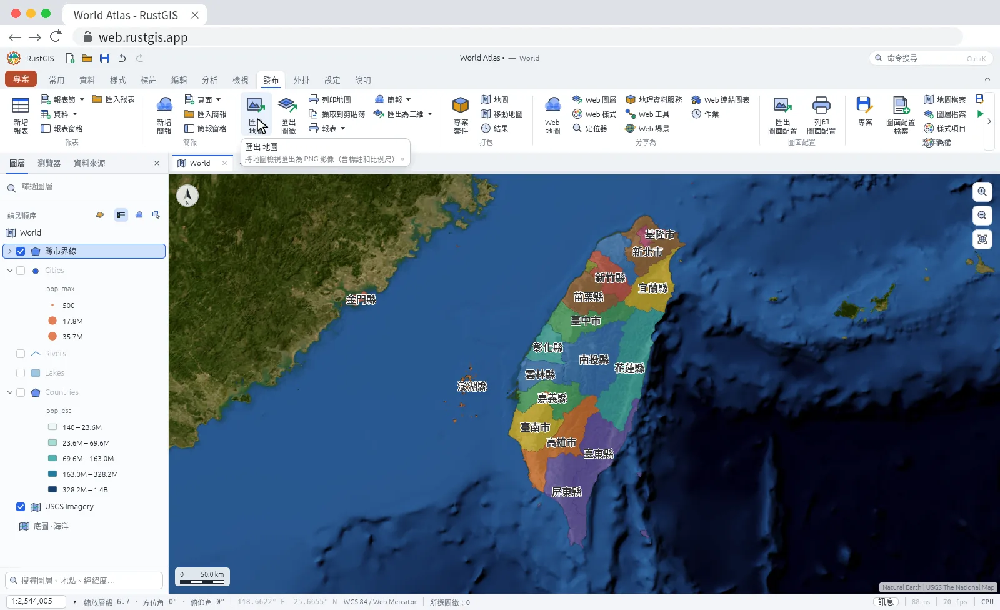
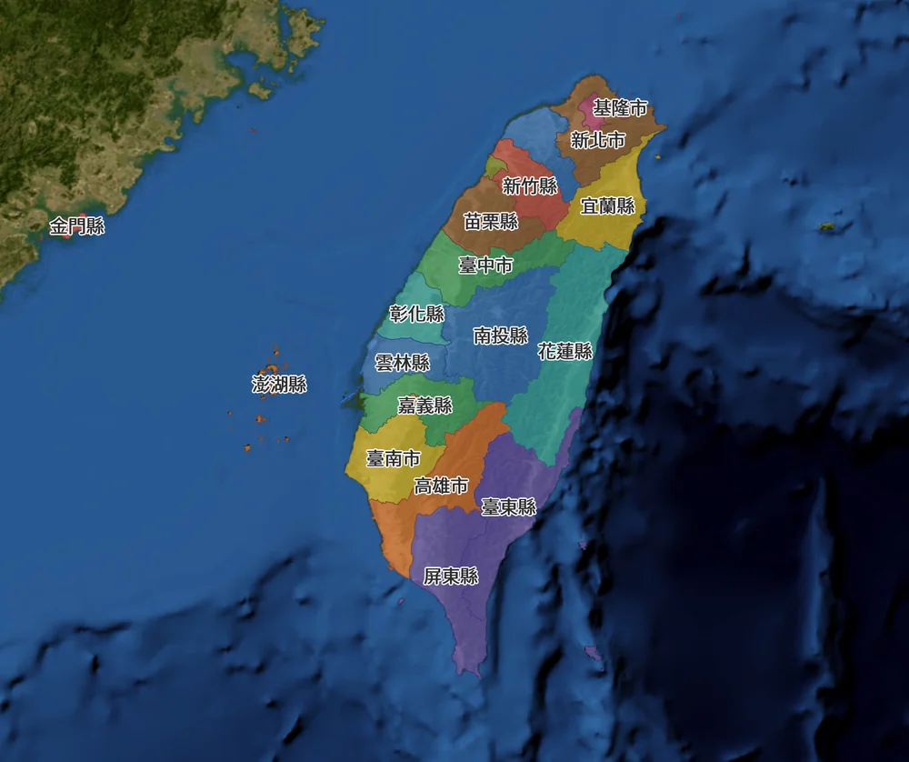
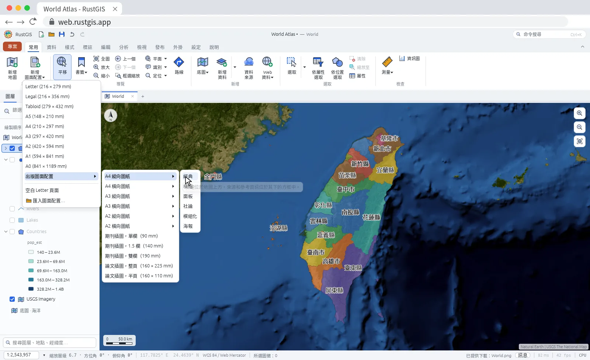
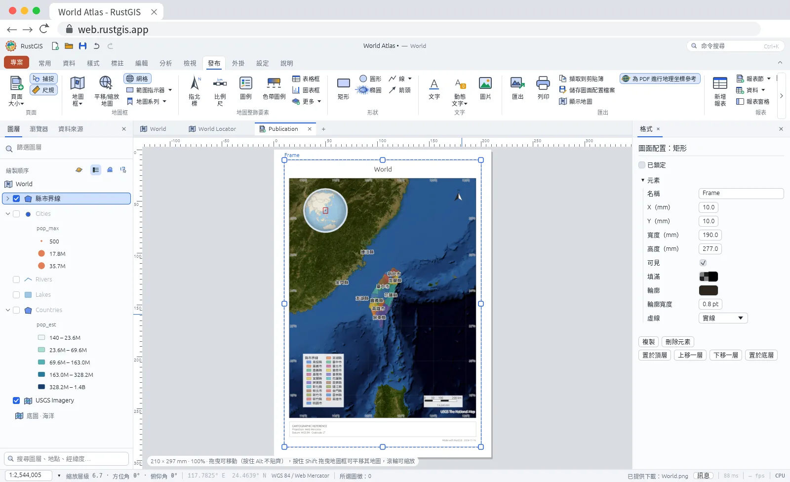
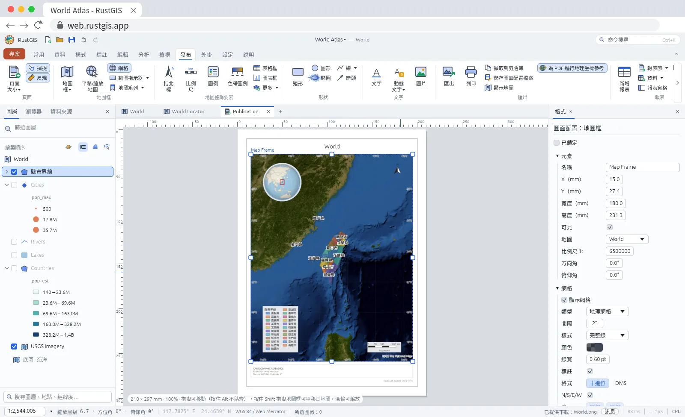
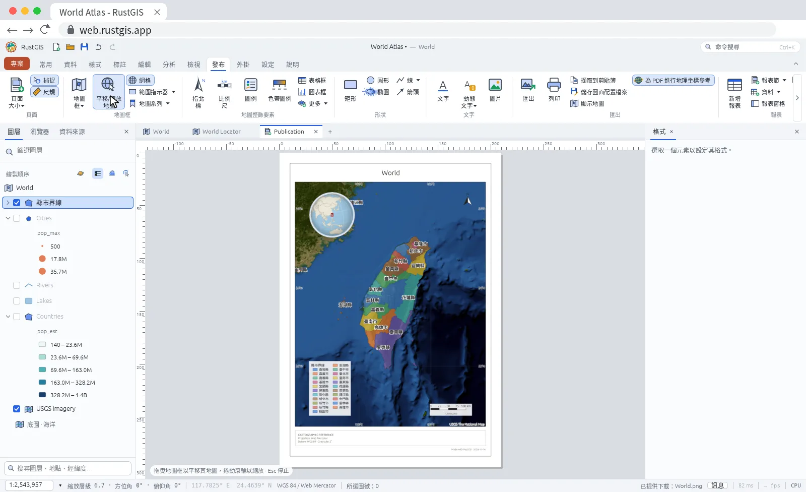
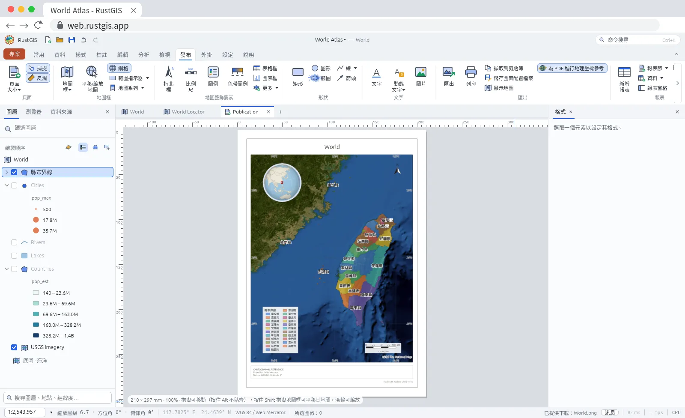
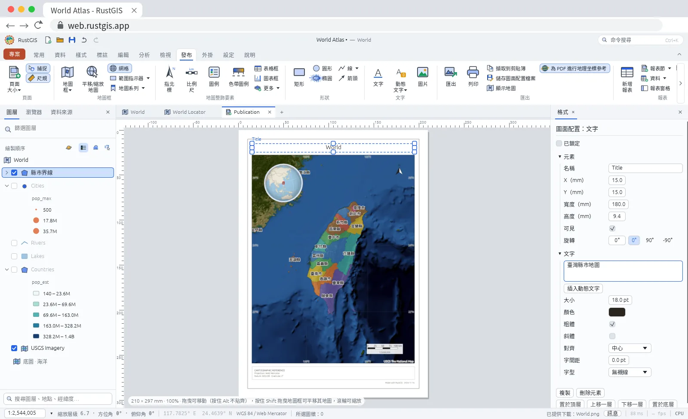
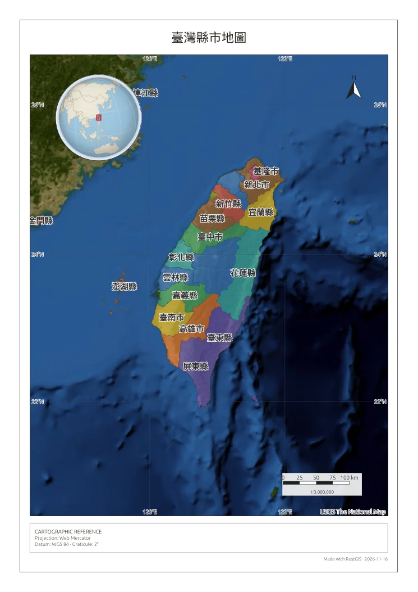

# 6. 匯出地圖

這一課會把做好的臺灣縣市地圖存成圖片，再用**圖面配置**排成一張有標題、比例尺、指北標的 A4 地圖，匯出成 PDF。

- **需要的時間**：約 25 分鐘
- **需要的東西**：完成[第 4 課](04-symbols-labels.md)的地圖：縣市依名稱分色、標上名稱、底圖是 USGS Imagery。建議在第 4 課做完時按 ++ctrl+s++ [存成專案檔](02-load-boundaries.md#save-project)，這一課就能直接打開接著做。

!!! note "等中文字型下載好再匯出"
    網頁版匯出圖片和 PDF 時，中文字要用下載的中文字型。不論介面是什麼語言，地圖上一出現中文字，網頁版就會自動下載字型，並顯示「正在下載字型」的提示。等地圖重新畫好、中文字出現後再匯出；字型還沒下載完就匯出，匯出檔裡的中文字會是空白。介面已經設成繁體中文的話，字型在[第 1 課](01-open-web-app.md)就下載好了。

## 準備地圖

開始前先整理一下圖層：

1. 在圖層面板，取消勾選 **Cities**、**Rivers**、**Lakes** 和 **Countries**，只留下縣市界線和 USGS Imagery 底圖。
2. 把縣市界線圖層改一個好懂的名字：在 `COUNTY_MOI_1140318` 上按右鍵，選 **重新命名…**，輸入「縣市界線」，按 **重新命名**。

圖層名稱會出現在圖例裡，取一個看得懂的名字比較好。

## 匯出地圖畫面（PNG）

最簡單的方法是把目前地圖畫面直接存成圖片。

1. 點上方的 **發布** 頁籤。
2. 在「輸出」群組按 **匯出地圖**。

    

瀏覽器會下載一張 PNG 圖片，檔名是地圖的名稱，例如 `World.png`。圖片解析度是 192 dpi，比螢幕上看到的清楚，左下角會附上比例尺。



## 圖面配置

**圖面配置**（layout）是一張「紙」：把地圖放在紙上，再加上標題、圖例、比例尺、指北標等元素，排成可以列印或交作業的地圖。

### 用範本新增 A4 圖面配置

RustGIS 內建多種出版用範本。臺灣是南北長的島，用 A4 直式最合適：

1. 回到 **常用** 頁籤，按 **新增圖面配置**。
2. 選 **出版圖面配置 › A4 縱向圖紙 › 經典**。

    

地圖區多了一個 **Publication** 分頁，裡面是一張 A4 紙，範本已經放好這些元素：


| 元素 | 位置 | 用途 |
|---|---|---|
| 標題 | 最上方 | 地圖的名稱，目前是「World」 |
| 地圖框 | 中間 | 顯示地圖，四周有經緯度格線 |
| 位置圖 | 左上角的地球 | 用紅框標出地圖在世界上的位置 |
| 指北標 | 右上角 | 標出北方。指北標就是一般常說的「指北針」，RustGIS 介面依國家教育研究院樂詞網的用詞，寫作「指北標」 |
| 圖例 | 左下角 | 說明每個顏色代表什麼 |
| 比例尺 | 右下角 | 地圖上的長度對應實際距離 |
| 製圖資訊 | 最下方 | 投影、資料基準等說明。範本的內容是英文，可以改成中文（見最後的練習） |

上方的功能區也換成「發布」頁籤，可以新增更多元素，例如 **文字**、**圖片**、**比例尺**、**指北標**。

### 選取地圖框

在紙上點一下，會選取那個位置的元素，右側的 **格式** 面板會顯示它的設定。

這個範本最外圈有一個「Frame」外框，蓋在地圖上面，所以點地圖時，選到的會是外框：



在 **格式** 面板最下方按 **置於底層**，把外框移到最下層。再點一次地圖，就會選到 **地圖框**：



### 放大地圖框裡的地圖

範本的比例尺是 1:6,500,000，臺灣只佔地圖框的一小塊。在 **格式** 面板把 **比例尺 1:** 改成 `3000000`，按 ++enter++，臺灣就會放大。

!!! tip "比例尺的數字越小，地圖放得越大"
    1:3,000,000 表示地圖上 1 公分代表實際 30 公里。1:6,500,000 則代表 65 公里，同樣大小的紙能畫的範圍比較大，但東西比較小。

### 把臺灣移到地圖框中央

放大是以地圖框的中心為準，所以放大後，最西邊的**金門縣**會被地圖框左邊切掉，北邊的**連江縣**（馬祖）也會擠到左上角的位置圖旁邊。要把整個臺澎金馬移到地圖框中央：

1. 在 **發布** 頁籤的「地圖框」群組，按 **平移/縮放地圖**。下方會出現提示「拖曳地圖框以平移其地圖，捲動滾輪以縮放 · Esc 停止」。

    

2. 在地圖框裡，把地圖**往右下方拖曳**一小段，邊拖邊看，直到金門縣和連江縣都完整出現在框內。拖曳只會移動框裡的地圖，地圖框本身不會動。
3. 按 ++esc++ 結束。



!!! tip "不用按按鈕的快速方法"
    不按 **平移/縮放地圖** 也可以：按住 ++shift++ 再拖曳地圖框，就會平移框裡的地圖。畫面下方的提示列也寫著「按住 Shift 拖曳地圖框可平移其地圖，滾輪可縮放」。

!!! question "為什麼看不到臺北市的名稱？"
    仔細看，地圖上沒有**臺北市**、**桃園市**、**新竹市**、**嘉義市**和**南投縣**的名稱。RustGIS 會自動避免標註文字互相重疊：在 1:3,000,000 的比例尺下，這幾個縣市的名稱會和旁邊縣市的名稱撞在一起，所以被自動隱藏了。

    - 把標註字級調小，例如從第 4 課的 12 pt 改成 10 pt，**南投縣**就會出現；但臺北市等面積很小的市，還是要放大比例尺才放得下。
    - 這張 A4 地圖的重點是全臺灣的縣市分布，少數名稱被隱藏是正常的取捨。如果一定要每個縣市都有名稱，可以另外做一張只有北部的地圖（見最後的練習）。

### 刪掉圖例

用唯一值分色的圖例會列出 22 個縣市名稱，又長又佔位置。地圖上已經標了縣市名稱，這次先把圖例刪掉：

1. 點左下角的圖例，在 **格式** 面板按 **刪除元素**。
2. 原處還留著一個白色方框，這是圖例的底框「Legend Box」。點它，再按一次 **刪除元素**。

### 修改標題

1. 點最上方的標題「World」。
2. 在 **格式** 面板的「文字」框，把 `World` 改成 `臺灣縣市地圖`。

    

完成的圖面配置：


## 匯出 PDF

在 **發布** 頁籤的「匯出」群組按 **匯出**。

網頁版會直接下載 PDF，檔名是圖面配置的名稱，例如 `Publication.pdf`。打開來看：

{ width="480" }

!!! info "網頁版和桌面版的差別"
    - 網頁版的 **匯出** 一律下載 PDF（150 dpi）。
    - 桌面版會讓你選擇 PDF、PNG 或 SVG，解析度也比較高。
    - 想印出來的話，按 **列印**，會產生 300 dpi 的 PDF。

!!! tip "匯出的 PDF 帶有坐標"
    **發布** 頁籤「匯出」群組裡的 **為 PDF 進行地理坐標參考** 預設是開啟的（按鈕是藍底）。這時匯出的 PDF 是 GeoPDF：地圖框帶有經緯度坐標，用支援 GeoPDF 的地圖 App 打開，可以顯示目前位置、量距離。不需要坐標時，再按一次把它關掉。

## 匯出資料本身

前面匯出的 PNG、PDF 都是「圖片」。如果要把縣市界線交給同學或用其他 GIS 軟體（例如 QGIS）處理，要匯出的是**資料**：

1. 在圖層面板的縣市界線上按右鍵，選 **匯出圖徵…**。
2. 在「匯出圖徵」對話框的 **格式** 選擇檔案格式（預設是 GeoJSON，也可以選 CSV、Shapefile 等），按 **下載**。

網頁版可以匯出大部分向量格式，Shapefile 會打包成一個 ZIP 檔；GeoPackage 和 FlatGeobuf 只有桌面版能匯出。

## 加上資料來源

使用政府開放資料，必須標示提供機關（見[臺灣範例資料](../data/index.md)）。用 **發布 › 文字** 在紙上加一段文字，例如：

> 資料來源：內政部國土測繪中心（政府資料開放授權條款第 1 版）

## 練習

1. 試試 **A4 橫向圖紙** 的其他範本，例如 **面板** 或 **海報**，看看版面有什麼不同。
2. 用 **發布 › 文字** 加上資料來源，放在製圖資訊上方。
3. 在 **格式** 面板把地圖框的 **比例尺** 改成 `1500000`，再用 **平移/縮放地圖** 拖曳地圖框，只顯示北部。這時臺北市、桃園市的名稱會出現嗎？
4. 把最下方的製圖資訊改成中文：點選「Projection: Web Mercator」那兩行文字，在 **格式** 面板的「文字」框改成例如：

    ```text
    投影：Web 麥卡托
    大地基準：WGS 84 · 地理網格：2°
    ```

## 小結

- **發布 › 匯出地圖** 把目前的地圖畫面存成 PNG。
- **圖面配置**是一張紙，可以放地圖框、標題、圖例、比例尺、指北標。用 **出版圖面配置** 範本最快。
- 點選元素後，在 **格式** 面板調整；地圖框的 **比例尺** 決定地圖放多大，**平移/縮放地圖**（或按住 Shift 拖曳）調整框裡顯示的位置。
- **發布 › 匯出** 在網頁版下載 PDF。
- 網頁版會自動下載中文字型；等地圖上的中文字出現再匯出，圖片和 PDF 就能顯示中文。

恭喜你完成入門教學！接著可以看看[進階教學](advanced.md)，例如把底圖換成[繁體中文的國土測繪中心電子地圖](09-wmts.md)。
