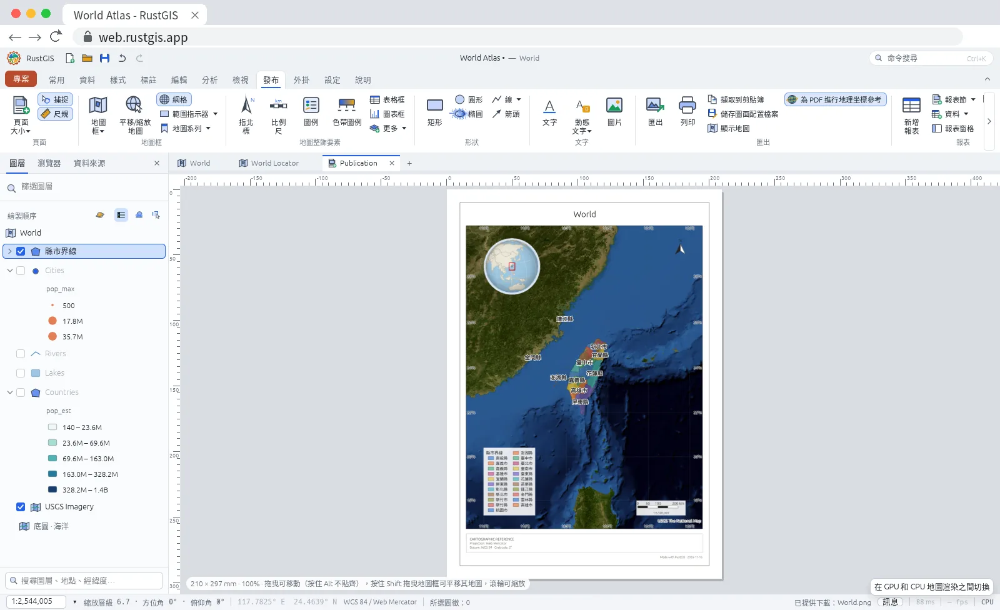
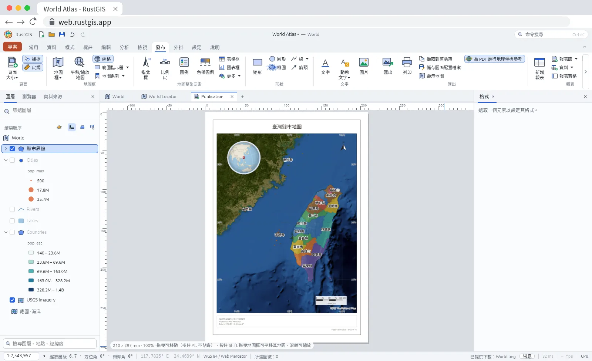

# 6. 匯出地圖

這一課會把做好的臺灣縣市地圖存成圖片，再用**圖面配置**排成一張有標題、比例尺、指北針的 A4 地圖，匯出成 PDF。

**需要的時間**：約 25 分鐘
**需要的東西**：完成[第 4 課](04-symbols-labels.md)的地圖：縣市依名稱分色、標上名稱、底圖是 USGS Imagery。

!!! note "介面要用繁體中文"
    網頁版匯出圖片和 PDF 時，中文字用的是介面下載的中文字型。照[第 1 課](01-open-web-app.md)把介面設成繁體中文，匯出的縣市名稱和標題就會是中文。如果介面是英文，匯出檔裡的中文字會是空白。

## 準備地圖

開始前先整理一下圖層：

1. 在圖層面板，取消勾選 **Cities**、**Rivers**、**Lakes** 和 **Countries**，只留下縣市界線和 USGS Imagery 底圖。
2. 把縣市界線圖層改一個好懂的名字：在 `COUNTY_MOI_1140318` 上按右鍵，選 **重新命名…**，輸入「縣市界線」，按 **重新命名**。

圖層名稱會出現在圖例裡，取一個看得懂的名字比較好。

## 匯出地圖畫面（PNG）

最簡單的方法是把目前地圖畫面直接存成圖片。

1. 點上方的 **發布** 頁籤。
2. 在「輸出」群組按 **匯出地圖**。

    

瀏覽器會下載一張 PNG 圖片，檔名是地圖的名稱，例如 `World.png`。圖片解析度是 192 dpi，比螢幕上看到的清楚，左下角會附上比例尺。

## 圖面配置

**圖面配置**（layout）是一張「紙」：把地圖放在紙上，再加上標題、圖例、比例尺、指北針等元素，排成可以列印或交作業的地圖。

### 用範本新增 A4 圖面配置

RustGIS 內建多種出版用範本。臺灣是南北長的島，用 A4 直式最合適：

1. 回到 **常用** 頁籤，按 **新增圖面配置**。
2. 選 **出版圖面配置 › A4 縱向圖紙 › 經典**。

    

地圖區多了一個 **Publication** 分頁，裡面是一張 A4 紙，範本已經放好這些元素：

| 元素 | 位置 | 用途 |
|---|---|---|
| 標題 | 最上方 | 地圖的名稱，目前是「World」 |
| 地圖框 | 中間 | 顯示地圖，四周有經緯度格線 |
| 位置圖 | 左上角的地球 | 用紅框標出地圖在世界上的位置 |
| 指北針 | 右上角 | 標出北方 |
| 圖例 | 左下角 | 說明每個顏色代表什麼 |
| 比例尺 | 右下角 | 地圖上的長度對應實際距離 |
| 製圖資訊 | 最下方 | 投影、資料基準等說明 |

上方的功能區也換成「發布」頁籤，可以新增更多元素，例如 **文字**、**圖片**、**比例尺**、**指北針**。

### 選取地圖框

在紙上點一下，會選取那個位置的元素，右側的 **格式** 面板會顯示它的設定。

這個範本最外圈有一個「Frame」外框，蓋在地圖上面，所以點地圖時，選到的會是外框：

在 **格式** 面板最下方按 **置於底層**，把外框移到最下層。再點一次地圖，就會選到 **地圖框**：

### 放大地圖框裡的地圖

範本的比例尺是 1:6,500,000，臺灣只佔地圖框的一小塊。在 **格式** 面板把 **比例尺 1:** 改成 `3000000`，按 ++enter++，臺灣就會放大填滿地圖框。

!!! tip "比例尺的數字越小，地圖放得越大"
    1:3,000,000 表示地圖上 1 公分代表實際 30 公里。1:6,500,000 則代表 65 公里，同樣大小的紙能畫的範圍比較大，但東西比較小。

### 刪掉圖例

用唯一值分色的圖例會列出 22 個縣市名稱，又長又佔位置。地圖上已經標了縣市名稱，這次先把圖例刪掉：

1. 點左下角的圖例，在 **格式** 面板按 **刪除元素**。
2. 原處還留著一個白色方框，這是圖例的底框「Legend Box」。點它，再按一次 **刪除元素**。

### 修改標題

1. 點最上方的標題「World」。
2. 在 **格式** 面板的「文字」框，把 `World` 改成 `臺灣縣市地圖`。

    

完成的圖面配置：

## 匯出 PDF

在 **發布** 頁籤的「匯出」群組按 **匯出**。

網頁版會直接下載 PDF，檔名是圖面配置的名稱，例如 `Publication.pdf`。打開來看：

{ width="480" }

!!! info "網頁版和桌面版的差別"
    - 網頁版的 **匯出** 一律下載 PDF（150 dpi）。
    - 桌面版會讓你選擇 PDF、PNG 或 SVG，解析度也比較高。
    - 想印出來的話，按 **列印**，會產生 300 dpi 的 PDF。

## 加上資料來源

使用政府開放資料，必須標示提供機關（見[臺灣範例資料](../data/index.md)）。用 **發布 › 文字** 在紙上加一段文字，例如：

> 資料來源：內政部國土測繪中心（政府資料開放授權條款第 1 版）

## 練習

1. 試試 **A4 橫向圖紙** 的其他範本，例如 **面板** 或 **海報**，看看版面有什麼不同。
2. 用 **發布 › 文字** 加上資料來源，放在製圖資訊上方。
3. 在 **格式** 面板把地圖框的 **比例尺** 改成 `1500000`，再用 **平移/縮放地圖** 拖曳地圖框，只顯示北部。

## 小結

- **發布 › 匯出地圖** 把目前的地圖畫面存成 PNG。
- **圖面配置**是一張紙，可以放地圖框、標題、圖例、比例尺、指北針。用 **出版圖面配置** 範本最快。
- 點選元素後，在 **格式** 面板調整；地圖框的 **比例尺** 決定地圖放多大。
- **發布 › 匯出** 在網頁版下載 PDF。
- 介面設成繁體中文，匯出的圖片和 PDF 就能顯示中文。

恭喜你完成入門教學！回到[入門教學](index.md)，或看看[臺灣範例資料](../data/index.md)裡的其他資料。
