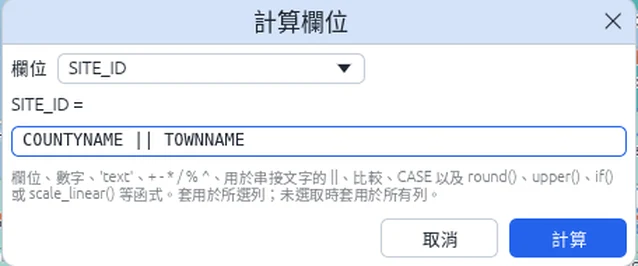
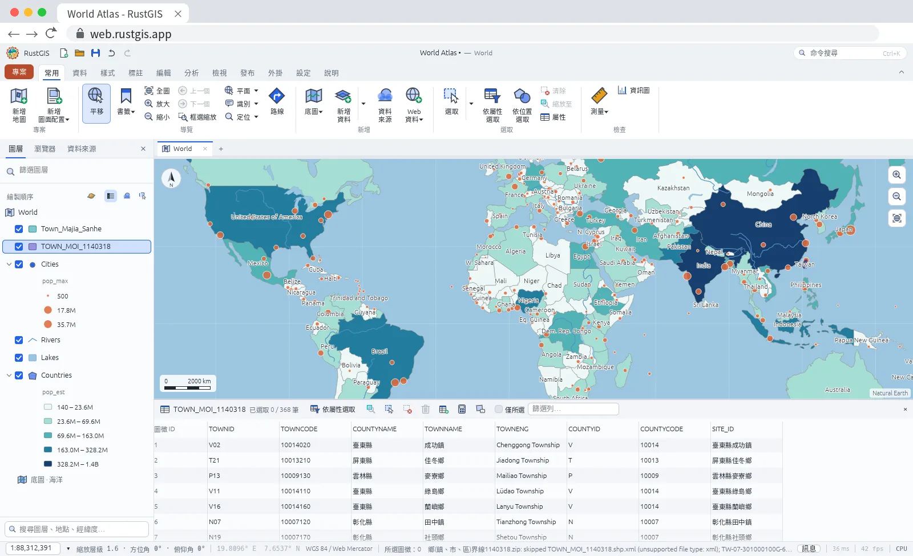
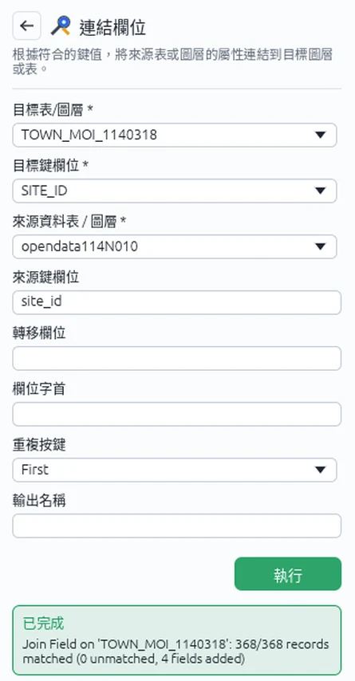
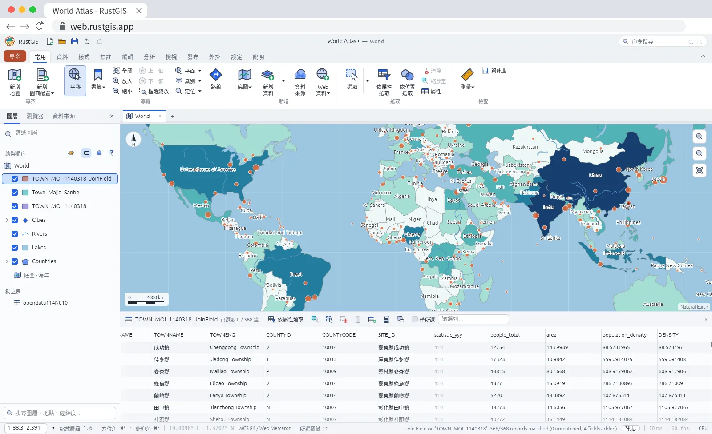
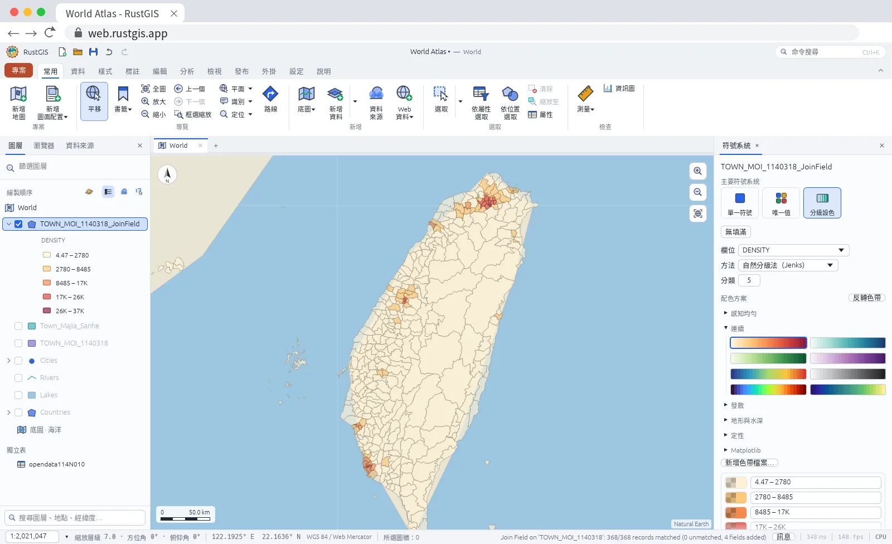
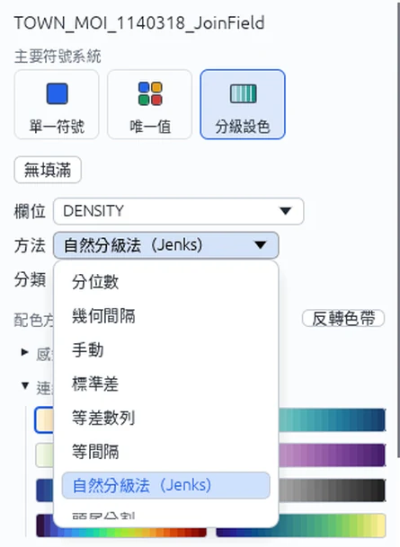
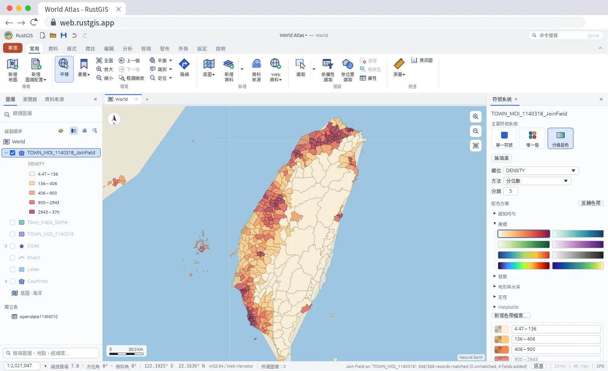

# 7. 鄉鎮人口密度圖（分級設色）

這一課會把戶政司的人口統計表**連結**到鄉鎮市區界線，再用**分級設色**畫出全臺 368 個鄉鎮市區的人口密度圖。這種依數值深淺上色的地圖，叫做**面量圖**（choropleth map）。

- **需要的時間**：約 30 分鐘
- **需要的東西**：會用屬性表（[第 3 課](03-attribute-table.md)）和符號系統（[第 4 課](04-symbols-labels.md)）。

## 下載資料

這一課要兩份資料：

| 資料 | 內容 | 下載 |
|---|---|---|
| 鄉鎮市區界線 | 368 個鄉鎮市區的範圍（Shapefile，約 12 MB） | [政府資料開放平臺 7441](https://data.gov.tw/dataset/7441)，下載 SHP 格式的 ZIP 檔；在臺灣以外下載不到時，改用[本站備份](../data/files/TOWN_MOI_1140318.zip)（見下方說明） |
| 各鄉鎮市區人口密度 | 每個鄉鎮市區的人口數、面積、人口密度（CSV） | [政府資料開放平臺 8410](https://data.gov.tw/dataset/8410)，下載「114年各鄉鎮市區人口密度」 |

!!! warning "在臺灣以外下載不到鄉鎮市區界線？"
    鄉鎮市區界線的檔案放在內政部的 TGOS 平臺，**只開放臺灣的網路連線**，在香港、澳門或其他國家會下載失敗（403 Forbidden）。請改用本站的備份：[TOWN_MOI_1140318.zip](../data/files/TOWN_MOI_1140318.zip)（13 MB，同一個版本）。人口密度的 CSV 在海外可以正常下載。

人口密度的 CSV 長這樣：

| statistic_yyy | site_id | people_total | area | population_density |
|---|---|---|---|---|
| 統計年 | 區域別 | 年底人口數 | 土地面積 | 人口密度 |
| 114 | 新北市板橋區 | 549762 | 23.1373 | 23760.85369 |
| 114 | 新北市三重區 | 382778 | 16.317 | 23458.8466 |

第一列是英文欄位名稱，第二列是中文說明，第三列開始才是資料。人口密度的單位是「人／平方公里」。

## 加入兩份資料

1. 打開 [web.rustgis.app](https://web.rustgis.app)，用 **常用 › 新增資料**（或拖曳）加入鄉鎮界線的 ZIP 檔。
2. 再用同樣的方法加入人口密度的 CSV 檔。

圖層面板會多出這些項目：

- **TOWN_MOI_1140318**：鄉鎮市區界線，這一課的主角。
- **Town_Majia_Sanhe**：ZIP 檔裡附的一小塊屏東縣瑪家鄉範圍，這一課用不到，取消勾選或按右鍵移除。
- 最下方的「**獨立表**」底下多了 **opendata114N010**：這就是人口 CSV。它只有表格、沒有位置，所以不會畫在地圖上。

名稱裡的 `1140318`、`114` 是資料的版本日期和年度。之後下載到更新的版本，名稱和數字會不一樣，照著實際的名稱操作就好。

## 做一個可以對照的欄位

要把人口表「接」到鄉鎮界線上，兩邊需要一個**內容相同的欄位**，叫做**鍵值**。

- 人口表的 `site_id` 是「縣市＋鄉鎮」連在一起的名稱，例如「新北市板橋區」。
- 鄉鎮界線的屬性表裡，縣市名稱 `COUNTYNAME` 和鄉鎮名稱 `TOWNNAME` 分在兩個欄位。

所以先在鄉鎮界線上做一個「縣市＋鄉鎮」的新欄位：

1. 在圖層面板點選 `TOWN_MOI_1140318`，按 **常用 › 選取 › 屬性** 打開屬性表（也可以在圖層上按右鍵，選 **屬性表**）。
2. 按屬性表工具列的 **新增欄位**。**欄位名稱** 輸入 `SITE_ID`，**資料類型** 選 **文字**，按 **新增**。
3. 按工具列的 **計算欄位**。上方的「欄位」選 `SITE_ID`，在運算式框輸入：

    ```sql
    COUNTYNAME || TOWNNAME
    ```

    `||` 的意思是把兩段文字接起來。

    { width="640" }

4. 按 **計算**。

表格最右邊的 `SITE_ID` 欄出現「臺東縣成功鎮」「屏東縣佳冬鄉」這樣的名稱，和人口表的寫法一樣了：



!!! question "為什麼不只用鄉鎮名稱？"
    因為鄉鎮名稱會重複。例如「東區」在臺中市、臺南市、新竹市、嘉義市都有，「大安區」在臺北市和臺中市都有，「中正區」在臺北市和基隆市都有。加上縣市名稱，每個名稱才會是唯一的。

## 連結人口資料

**連結欄位**工具會依照鍵值，把人口表的欄位複製到鄉鎮界線上。

1. 按右上角的 **命令搜尋**（++ctrl+k++），輸入「連結欄位」，按 ++enter++。右側會打開「連結欄位」工具。
2. 依下表填寫：

    | 欄位 | 填寫 | 說明 |
    |---|---|---|
    | 目標表/圖層 | `TOWN_MOI_1140318` | 要接上資料的圖層 |
    | 目標鍵欄位 | `SITE_ID` | 剛才做的欄位（在清單最下面） |
    | 來源資料表 / 圖層 | `opendata114N010` | 人口 CSV |
    | 來源鍵欄位 | `site_id` | 人口表裡對應的欄位，要自己輸入 |

    其他欄位不用填。

3. 按 **執行**。

{ width="320" }

結果訊息寫著「**368/368 records matched (0 unmatched, 4 fields added)**」：368 個鄉鎮全部對上，沒有對不上的，新增了 4 個欄位。圖層面板最上方多了一個 `TOWN_MOI_1140318_JoinField` 圖層，這是連結後的新圖層，原本的鄉鎮界線不會被改動。

!!! tip "看結果訊息確認有沒有對上"
    如果訊息寫著有幾筆 unmatched（沒對上），通常是名稱寫法不同，例如「臺」和「台」、全形和半形空白，或是行政區改名、合併。人口表最後還有「東沙群島」「南沙群島」兩列。這兩處在行政上屬於高雄市旗津區，鄉鎮界線把它們畫在旗津區的範圍裡，沒有單獨的圖徵，所以這兩列對不上，不會影響 368 個鄉鎮市區的結果。

## 把人口密度轉成數字

打開 `TOWN_MOI_1140318_JoinField` 的屬性表，往右捲，可以看到接過來的 `statistic_yyy`、`people_total`、`area`、`population_density` 四個欄位。

不過這時打開符號系統選「分級設色」，會出現「no numeric field is available」：**沒有可以用的數值欄位**。原因是 CSV 的第二列是中文說明（「人口密度」），最後兩列的數值是「…」，RustGIS 讀進來時就把整欄當成**文字**了。

用前面學過的方法，做一個數值欄位：

1. 在 `TOWN_MOI_1140318_JoinField` 的屬性表按 **新增欄位**。**欄位名稱** 輸入 `DENSITY`，**資料類型** 保留 **雙精度**（有小數的數字），按 **新增**。
2. 按 **計算欄位**，「欄位」選 `DENSITY`，運算式輸入：

    ```sql
    to_real(population_density)
    ```

    `to_real()` 會把文字轉成數字。

3. 按 **計算**。



## 分級設色

1. 在 `TOWN_MOI_1140318_JoinField` 上按右鍵，選 **符號系統**。
2. 在「主要符號系統」按 **分級設色**。
3. **欄位** 選 `DENSITY`。**方法** 預設是 **自然分級法（Jenks）**，**分類** 是 `5`。

在左下角的搜尋列輸入 `23.75, 120.95` 按 ++enter++，再縮小看整個臺灣：



圖例顯示 5 個級距，最淺的一級是 4.47～2,780 人／平方公里，最深的一級從約 2 萬 6 千到最高的 37,022（圖例把「千」簡寫成 K，例如 26K）。顏色深的只有臺北盆地、臺中和高雄市區的幾個區。

## 換一種分級法

自然分級法會找數值之間的「天然斷點」，讓同一級裡的數值盡量接近。但臺灣的人口密度差距非常大：最高的**新北市永和區**每平方公里 37,022 人，最低的**高雄市桃源區**只有 4.5 人。結果 368 個鄉鎮裡，有 291 個擠在最淺的那一級，看不出差別。

在 **方法** 換成 **分位數**：

{ width="320" }



**分位數**讓每一級的鄉鎮**數量一樣多**（368 ÷ 5，每級大約 74 個）。這張圖就看得出更多層次：西部平原和都會區偏深，中央山脈和東部偏淺。

| 方法 | 怎麼分 | 適合 |
|---|---|---|
| **自然分級法（Jenks）** | 找數值之間的天然斷點 | 想突顯少數特別高或特別低的地方 |
| **分位數** | 每一級的數量一樣多 | 數值差距很大、想看出整體的相對高低 |
| **等間隔** | 每一級的數值範圍一樣寬 | 數值分布比較平均的資料 |

!!! warning "同一份資料，不同分級法會畫出不同的地圖"
    分級法沒有對錯，但會影響讀者的印象。製作面量圖時，最好試試幾種方法，選一個最能表達你想說的重點的，並在圖例清楚標出級距。

## 練習

1. 把 **分類** 改成 `7`，看看地圖有什麼變化。
2. 把 **方法** 換成 **等間隔**，和自然分級法比較。為什麼等間隔的地圖幾乎整片都是同一個顏色？
3. 用 `people_total`（人口數）畫一張分級設色圖。先照「把人口密度轉成數字」的步驟做一個 `POP` 欄位，運算式寫 `to_int(people_total)`。人口數和人口密度的地圖，哪裡不一樣？

??? success "第 2、3 題的提示"
    2. 等間隔把 4～37,000 平均切成 5 段，每段約 7,400。368 個鄉鎮裡有 330 個（約 9 成）密度不到 7,400，全部落在第一級。
    3. 人口數只看「有多少人」，面積大的鄉鎮容易顯得人多；人口密度除以面積，比較的是「擁擠程度」。所以製作面量圖時，通常用**比率或密度**，而不是直接用人數。

## 小結

- **連結欄位**依鍵值把表格的欄位接到圖層上。兩邊的鍵值寫法要完全一樣，必要時先用 **計算欄位** 做一個（`||` 接起文字）。
- 看結果訊息的 **matched／unmatched** 數字，確認有沒有全部對上。
- 分級設色要用**數值欄位**。CSV 讀成文字時，用 `to_real()` 轉成數字。
- **分級設色**依數值深淺上色；**自然分級法**、**分位數**、**等間隔**會畫出不同的地圖。

## 資料來源

本課使用內政部國土測繪中心「鄉鎮市區界線(TWD97經緯度)」及內政部戶政司「各鄉鎮市區人口密度」開放資料，依[政府資料開放授權條款－第 1 版](https://data.gov.tw/license)提供。
