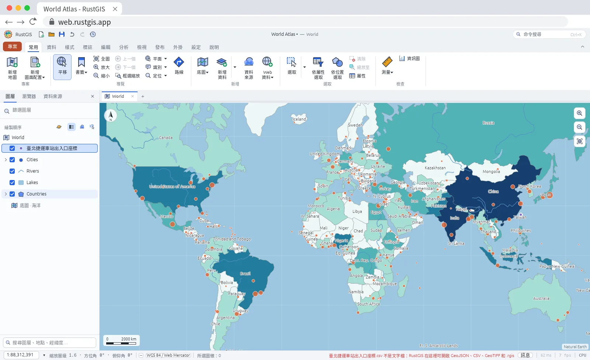
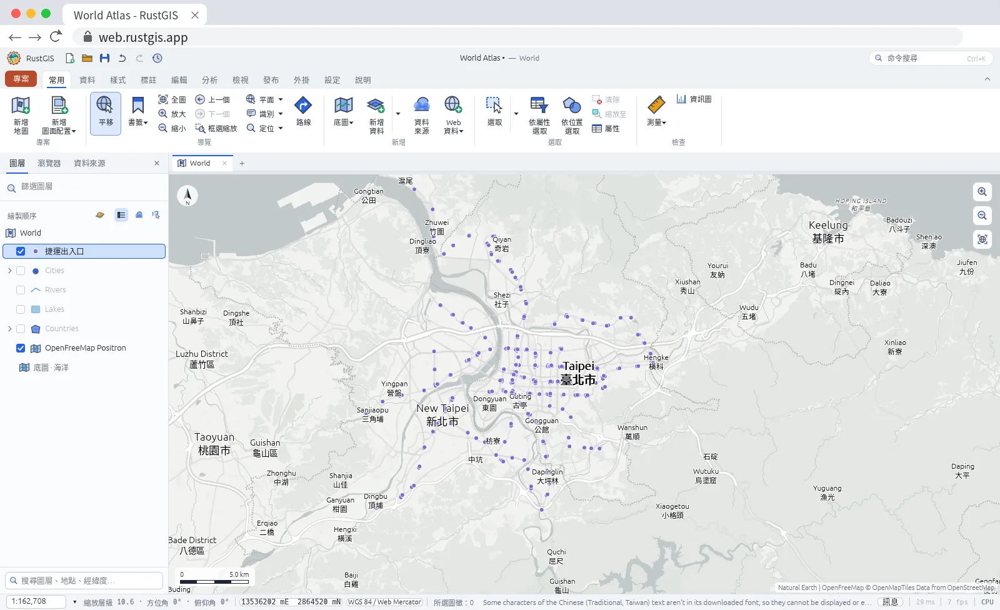
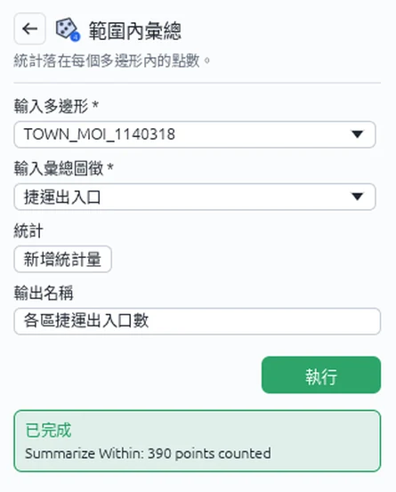
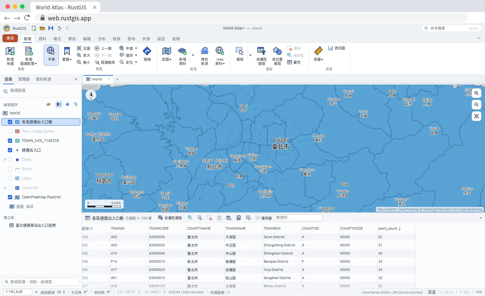
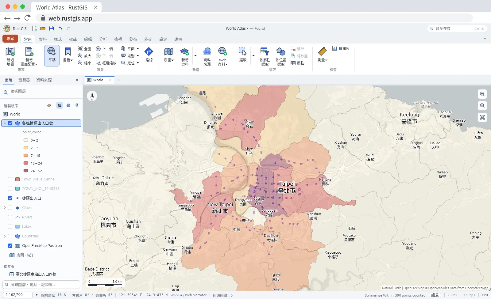

# 8. 點位與空間統計：各區有幾個捷運出入口

這一課會把一份有經緯度的 CSV 表格變成地圖上的點，再統計每個行政區裡有幾個點。用的是臺北捷運所有車站出入口的位置，最後畫出「各區捷運出入口數」的地圖。

- **需要的時間**：約 25 分鐘
- **需要的東西**：會用屬性表（[第 3 課](03-attribute-table.md)）和分級設色（[第 7 課](07-choropleth.md)）。

## 下載資料

| 資料 | 內容 | 下載 |
|---|---|---|
| 臺北捷運車站出入口座標 | 390 個出入口的名稱、經度、緯度（CSV） | [政府資料開放平臺 128428](https://data.gov.tw/dataset/128428) |
| 鄉鎮市區界線 | 第 7 課用過的鄉鎮界線 | [政府資料開放平臺 7441](https://data.gov.tw/dataset/7441)；在臺灣以外請用[本站備份](../data/files/TOWN_MOI_1140318.zip) |

捷運出入口的 CSV 長這樣：

| 項次 | 出入口名稱 | 出入口編號 | 經度 | 緯度 | 是否為無障礙用 |
|---|---|---|---|---|---|
| 1 | 頂埔站出口1 | 1 | 121.4183364 | 24.9593267 | 是 |
| 2 | 頂埔站出口2 | 2 | 121.4183575 | 24.95894725 | 否 |

`經度` 和 `緯度` 兩欄就是每個出入口的位置。

!!! note "數字會隨資料更新而改變"
    本課的 390 個出入口和各區統計，是 2026 年 11 月下載的資料。捷運有新的路線或出入口啟用後，你下載到的總數和各區數字可能不一樣，操作步驟還是相同。

## 先把 CSV 轉成 UTF-8

直接把下載的 CSV 拖進 RustGIS，右下角會出現一則紅色訊息：

訊息說這個檔案「不是文字檔」。原因是這份 CSV 用的是舊的 **Big5** 編碼，RustGIS 只讀 **UTF-8**。用 Excel 打開看起來正常，所以很容易忽略。

先把檔案轉成 UTF-8（任選一種方法）：

- **Windows 記事本**：打開 CSV，選 **檔案 › 另存新檔**，下方的「編碼」選 **UTF-8**，存檔。
- **Excel**：打開 CSV，選 **另存新檔**，檔案類型選 **CSV UTF-8（逗號分隔）**。

!!! tip "怎麼知道是不是 Big5？"
    從政府資料開放平臺下載的 CSV，很多是 Big5。如果 RustGIS 說「不是文字檔」，或打開後中文變成亂碼，先轉成 UTF-8 再試。詳見[臺灣範例資料](../data/index.md)的說明。

## 把表格變成點

1. 打開 [web.rustgis.app](https://web.rustgis.app)，把轉好的 CSV 拖進地圖（或用 **常用 › 新增資料**）。
2. 圖層面板最上方多了一個「**臺北捷運車站出入口座標**」點圖層，地圖上也出現了點。RustGIS 認得 `經度`、`緯度` 這兩個欄位名稱，自動把每一列變成一個點。

    

3. 名稱有點長，改短一點：在這個圖層上按右鍵，選 **重新命名…**，輸入 `捷運出入口`，按 **重新命名**。

!!! tip "欄位名稱 RustGIS 不認得時"
    RustGIS 認得的經緯度欄位名稱有 `經度`／`緯度`、`longitude`／`latitude`、`lon`／`lat` 等。如果 CSV 的欄位叫別的名字（例如 `X坐標`、`Y坐標`），拖進來後會放在圖層面板最下方的「**獨立表**」，地圖上看不到點。

    這時在獨立表上按右鍵，選 **XY 表轉點…**，**X 欄位** 選經度、**Y 欄位** 選緯度，按 **執行**，就會變成點圖層。

!!! warning "X 是經度，Y 是緯度"
    很多人會直覺地把「緯度」放在前面，但 GIS 的 X 是**東西**方向，也就是**經度**；Y 是南北方向，也就是緯度。放反的話，點會跑到印度洋去。

取消勾選範例專案的圖層，把底圖換成 **OpenFreeMap Positron**（[第 2 課](02-load-boundaries.md)），在左下角的搜尋列輸入 `25.04, 121.52` 按 ++enter++，再稍微縮小：

每個點是一個出入口。點連成的線，就是捷運路線的形狀。

## 統計每個區的出入口數

**範圍內彙總**會數一數每個多邊形裡有幾個點。

1. 用 **常用 › 新增資料** 加入鄉鎮市區界線的 ZIP 檔（`Town_Majia_Sanhe` 用不到，可以取消勾選）。
2. 按 **命令搜尋**（++ctrl+k++），輸入「範圍內彙總」，按 ++enter++。
3. 依下表填寫：

    | 欄位 | 填寫 | 說明 |
    |---|---|---|
    | 輸入多邊形 | `TOWN_MOI_1140318` | 要統計的範圍（預設可能選到別的，記得改） |
    | 輸入彙總圖徵 | `捷運出入口` | 要數的點 |
    | 輸出名稱 | `各區捷運出入口數` | 自己取 |

    { width="320" }

4. 按 **執行**。結果寫著「**Summarize Within: 390 points counted**」。

新圖層 `各區捷運出入口數` 有 368 個鄉鎮市區，多了一個 `point_count` 欄位，就是每個區裡的出入口數量。打開它的屬性表，點兩下 `point_count` 欄名，改成由大到小排序：

| 排名 | 行政區 | 出入口數 |
|---|---|---|
| 1 | 臺北市大安區 | 52 |
| 2 | 臺北市中正區 | 51 |
| 3 | 臺北市中山區 | 40 |
| 4 | 新北市板橋區、臺北市信義區 | 24 |

390 個出入口分布在 21 個區：臺北市 280 個、新北市 110 個。其他 347 個鄉鎮市區的 `point_count` 都是 0。

## 畫成地圖

用[第 7 課](07-choropleth.md)的方法，把 `各區捷運出入口數` 畫成分級設色：

1. 在 `各區捷運出入口數` 上按右鍵，選 **符號系統**，按 **分級設色**。
2. **欄位** 選 `point_count`，方法保留 **自然分級法（Jenks）**。
3. 在 **樣式** 頁籤把 **透明度** 改成 `40`，讓底下的捷運出入口和底圖的地名透出來。透明度的數值越大越透明，0 是完全不透明。

這次 `point_count` 本來就是數字，所以不用像第 7 課那樣先轉換欄位。

!!! question "出入口多，就代表交通最方便嗎？"
    不一定。大安區面積比較大，車站也多，出入口數量自然多。要比較「交通方便程度」，可以用第 7 課的方法，把出入口數除以面積或人口，算出密度再比較。

## 練習

1. 用 **依屬性選取**，在 `捷運出入口` 選出 `是否為無障礙用 = '是'` 的出入口。有幾個？
2. 只對無障礙出入口做範圍內彙總：先選取無障礙出入口，再執行範圍內彙總。點圖層有選取時，工具只會數**選取的點**。哪一區最多？
3. 用[第 5 課](05-buffer.md)的 **環域**，對捷運出入口做 500 公尺的環域，「融合」選 **全部**。臺北市有多少地方在捷運出入口步行 500 公尺的範圍內？

??? success "答案與提示"
    1. 195 個，剛好是全部 390 個出入口的一半。
    2. **臺北市北投區**最多，有 19 個；其次是中山區 16 個、大安區和內湖區各 15 個。出入口總數最多的大安區，無障礙出入口反而不是最多。
    3. 先按 **常用 › 選取 › 清除**，取消第 2 題的選取。圖層有選取時，環域只會對選取的圖徵做，忘了清除的話，就只會算到無障礙出入口。另外，環域的 500 公尺是**直線距離**，實際走路要沿著街道繞，所以真正「步行 500 公尺」能到的範圍會比環域小。

## 小結

- 欄位叫 `經度`／`緯度`（或 `longitude`／`latitude`）的 CSV，拖進 RustGIS 就直接變成點圖層；欄位名稱認不得時，用獨立表右鍵的 **XY 表轉點**。**X 是經度、Y 是緯度**。
- RustGIS 只讀 **UTF-8** 的 CSV；出現「不是文字檔」或亂碼時，先轉換編碼。
- **範圍內彙總** 會統計每個多邊形裡有幾個點，結果在 `point_count` 欄位。
- 統計結果可以直接用分級設色畫成地圖。

## 資料來源

本課使用臺北大眾捷運股份有限公司「臺北捷運車站出入口座標」及內政部國土測繪中心「鄉鎮市區界線(TWD97經緯度)」開放資料，依[政府資料開放授權條款－第 1 版](https://data.gov.tw/license)提供。
