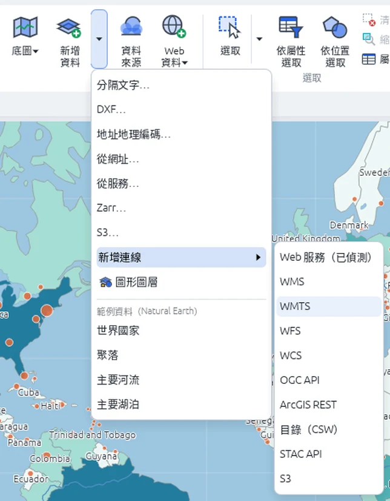
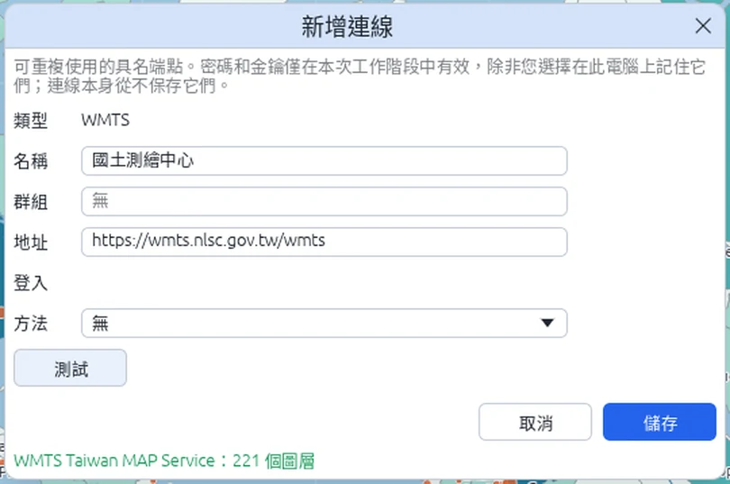
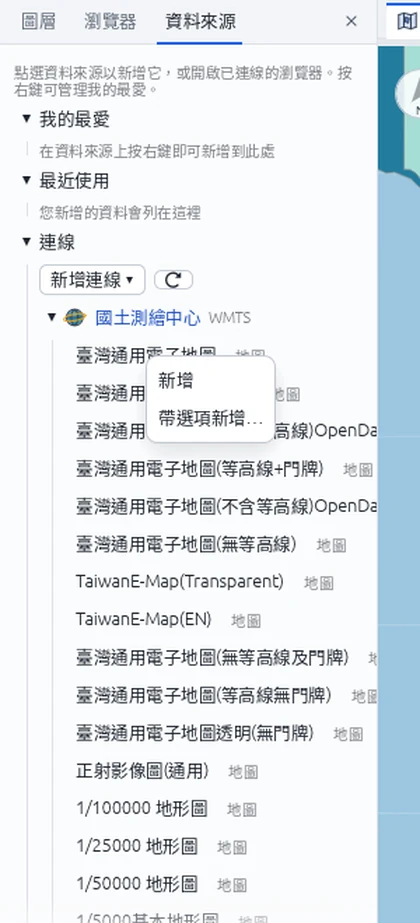
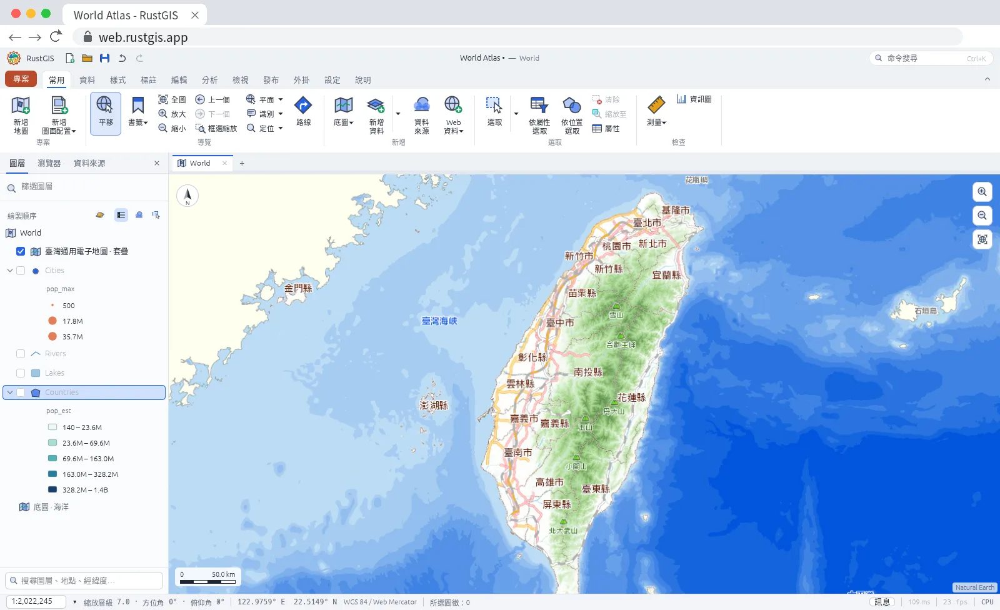
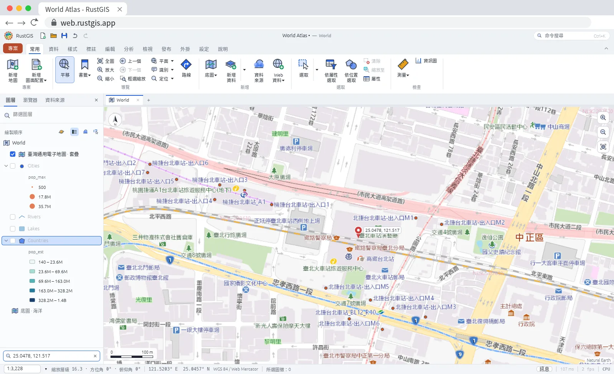
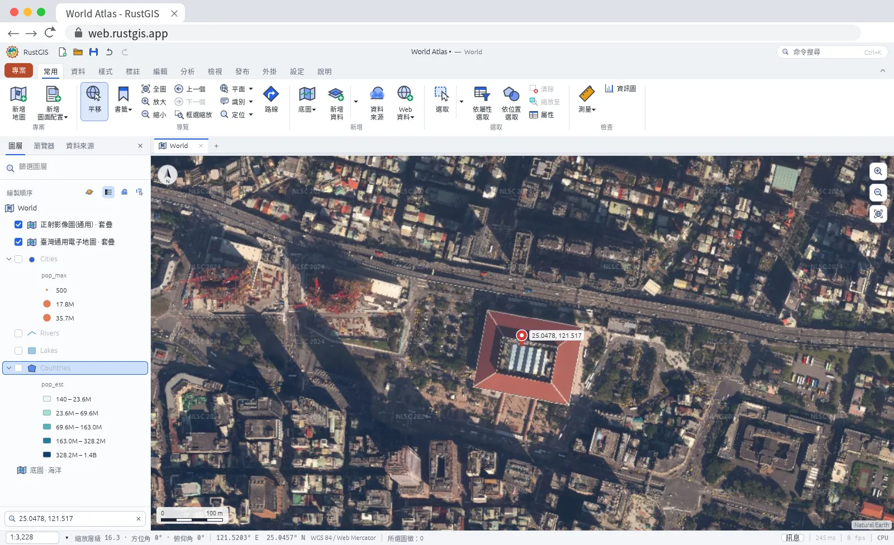
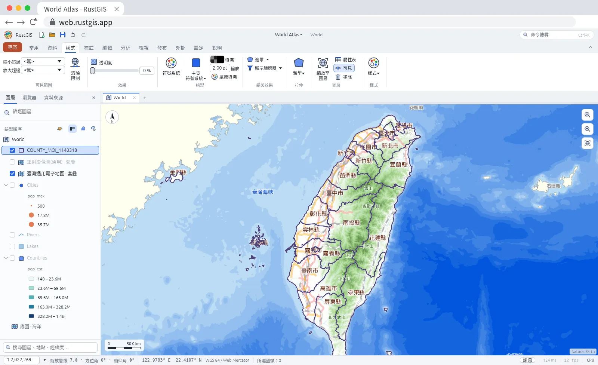

# 9. 加入國土測繪中心的電子地圖（WMTS）

前幾課用的 OpenFreeMap 底圖，地名是英文；USGS 衛星影像放大到縣市以下就沒有影像了。這一課會加入內政部國土測繪中心的線上地圖服務，換成**繁體中文地名**的「臺灣通用電子地圖」和高解析度的**正射影像**，放大到街道也很清楚。

- **需要的時間**：約 15 分鐘
- **需要的東西**：會用 RustGIS 網頁版的基本操作（[第 1 課](01-open-web-app.md)）。最後一節會用到[第 2 課](02-load-boundaries.md)的縣市界線。

## WMTS 是什麼？

**WMTS**（Web Map Tile Service，網路地圖圖磚服務）是一種提供線上地圖的標準。伺服器事先把地圖切成一張張小圖片（圖磚），GIS 軟體依你看的範圍和比例尺，只下載需要的那幾張，所以放大縮小都很快。

國土測繪中心的「國土測繪圖資服務雲」用 WMTS 提供兩百多種地圖，包括：

| 圖層 | 內容 |
|---|---|
| 臺灣通用電子地圖 | 道路、地名、地標、等高線，全部是繁體中文 |
| 臺灣通用電子地圖（無等高線） | 同上，但沒有等高線，畫面比較乾淨 |
| 正射影像圖(通用) | 航空攝影拍的影像，放大到街道也看得清楚 |
| 1/25000、1/50000 地形圖 | 傳統的地形圖 |
| TaiwanE-Map(EN) | 英文版的電子地圖 |

服務網址是：

```text
https://wmts.nlsc.gov.tw/wmts
```

!!! info "網頁版可以直接用"
    網頁版從其他網站讀取資料時，對方的伺服器必須允許網頁跨域讀取（CORS）。國土測繪中心的 WMTS 有開放，所以網頁版和桌面版都能使用。

## 新增連線

先把服務存成一個「連線」，之後就能從清單裡挑圖層。

1. 在 **常用** 頁籤，點 **新增資料** 右邊的小箭頭 ▾。
2. 選 **新增連線 › WMTS**。

    { width="560" }

3. 在「新增連線」對話框填寫：

    | 欄位 | 填寫 |
    |---|---|
    | 名稱 | `國土測繪中心`（自己取，好認就好） |
    | 地址 | `https://wmts.nlsc.gov.tw/wmts` |
    | 群組、登入 | 不用填 |

4. 按 **測試**。下方出現綠色的「**WMTS Taiwan MAP Service：222 個圖層**」，表示連線成功。圖層數量會隨國土測繪中心更新而改變，看到的數字不一樣也沒關係。

    { width="640" }

5. 按 **儲存**。

連線會記在這個瀏覽器裡，下次打開 RustGIS 不用再輸入。

!!! tip "另一個入口"
    左側 **資料來源** 頁籤的「連線」底下，也有一個 **新增連線 ▾** 按鈕，選 **WMTS** 會打開同一個對話框。

## 加入臺灣通用電子地圖

1. 點左側面板的 **資料來源** 頁籤。
2. 在「連線」底下，點 **國土測繪中心** 左邊的 ▸ 展開，會列出服務裡的所有圖層。
3. 在 **臺灣通用電子地圖** 上按右鍵，選 **新增**。

    { width="300" }

4. 點回 **圖層** 頁籤，最上方多了一個「臺灣通用電子地圖 · 套疊」圖層。

「套疊」表示它是疊在其他圖層上的線上地圖。取消勾選範例專案的 **Cities**、**Rivers**、**Lakes** 和 **Countries**，就只看得到電子地圖。

在左下角的搜尋列輸入 `23.75, 120.95`，按 ++enter++，再用滑鼠滾輪縮小，就能看到整個臺灣：



縣市名稱、山峰、海峽都是繁體中文，和第 2 課的英文底圖比起來，好讀很多。

## 放大到街道

在左下角的搜尋列輸入臺北車站的經緯度 `25.0478, 121.5170`，按 ++enter++，再用滾輪一直放大：



捷運出口、道路、公車站、地標都標得清清楚楚。電子地圖會依比例尺換成不同詳細程度的圖磚，所以放大後會顯示更多東西。

## 加入正射影像

用同樣的方法再加一個圖層：

1. 點 **資料來源** 頁籤，在 **正射影像圖(通用)** 上按右鍵，選 **新增**。
2. 點回 **圖層** 頁籤，「正射影像圖(通用) · 套疊」出現在最上方，蓋住了電子地圖。



連臺北車站的屋頂和周邊的工地都看得到。影像上淡淡的「NLSC 2024」字樣是國土測繪中心的浮水印，年份會隨著影像更新而改變。

取消勾選正射影像，就會回到電子地圖。兩個圖層可以留著，需要哪一個就勾哪一個。

## 疊上自己的資料

線上地圖也可以當成自己資料的背景。用 **常用 › 新增資料** 加入第 2 課的縣市界線，再讓它只畫邊界：

1. 在圖層面板點選縣市界線圖層。
2. 點 **樣式** 頁籤，在「繪製」群組勾選 **無填滿**。
3. 把「**輪廓**」旁邊的寬度（`0.70 pt` 那一格）改成 `2`，按 ++enter++。



縣市界線和電子地圖上的縣市範圍完全吻合。接下來做分析或製圖時，就能用這張中文地圖當背景。

## 標示資料來源

使用國土測繪中心的地圖時，要標示來源，例如在圖面配置加一段文字：

> 圖資來源：內政部國土測繪中心

各圖層的使用規定，請見[國土測繪圖資服務雲](https://maps.nlsc.gov.tw/)。

## 練習

1. 加入 **臺灣通用電子地圖(無等高線)**，和原本的電子地圖比較，看看哪一個比較適合當你的資料背景。
2. 加入 **1/25000 地形圖**，放大到你住的地方附近，和電子地圖比較看看。
3. 服務裡還有很多主題圖層，例如 **國土利用現況調查成果圖**、**各級學校範圍圖**、**村里界**。在連線的圖層清單裡找找看，加入一個你有興趣的。有些主題圖層（例如各級學校範圍圖）在看全臺灣時是空白的，要放大到縣市或鄉鎮的範圍才會出現。

## 小結

- **WMTS** 是線上地圖的標準，伺服器把地圖切成圖磚，依需要下載。
- 國土測繪中心的服務網址是 `https://wmts.nlsc.gov.tw/wmts`，網頁版可以直接使用。
- 用 **新增資料 ▾ › 新增連線 › WMTS** 存一個連線，再到 **資料來源** 頁籤，在圖層上按右鍵 › **新增**。
- **臺灣通用電子地圖**是繁體中文地名，**正射影像圖**可以放大到街道。
- 使用時要標示「內政部國土測繪中心」。
