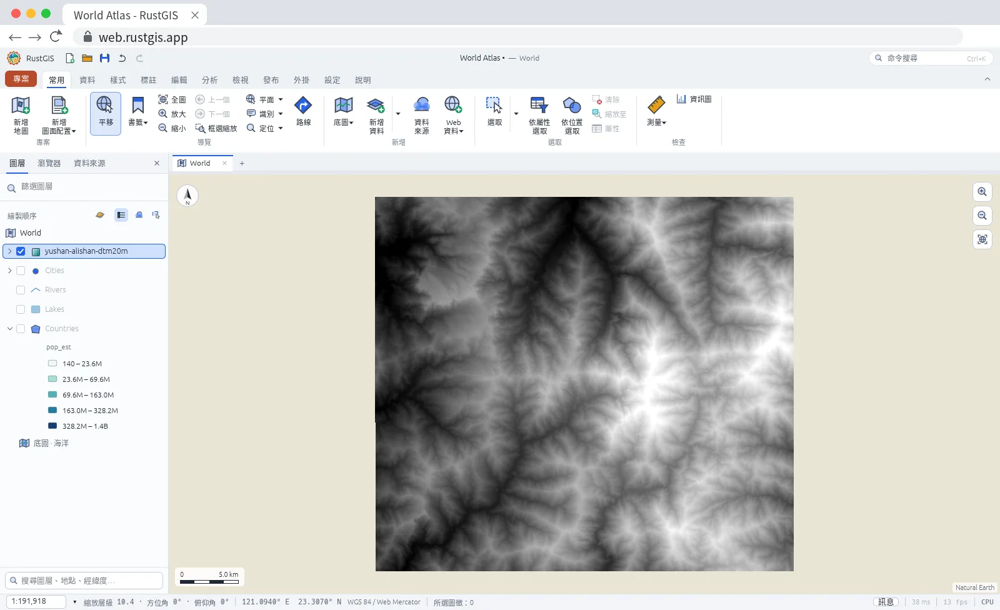
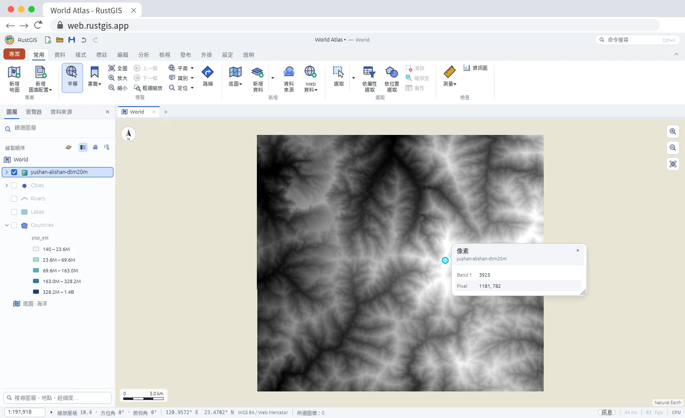
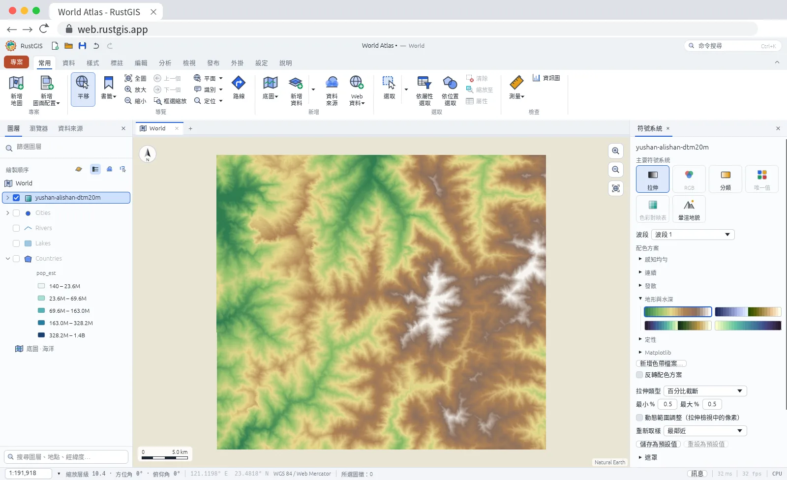
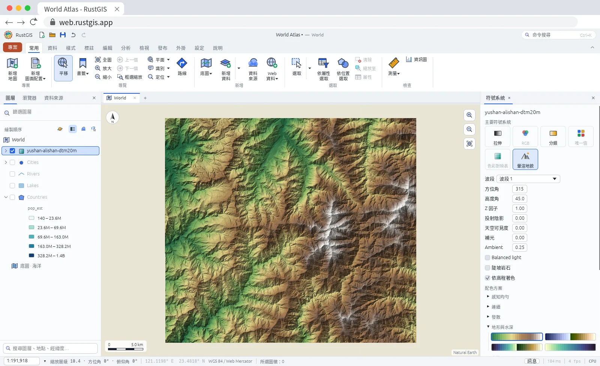
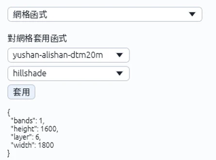
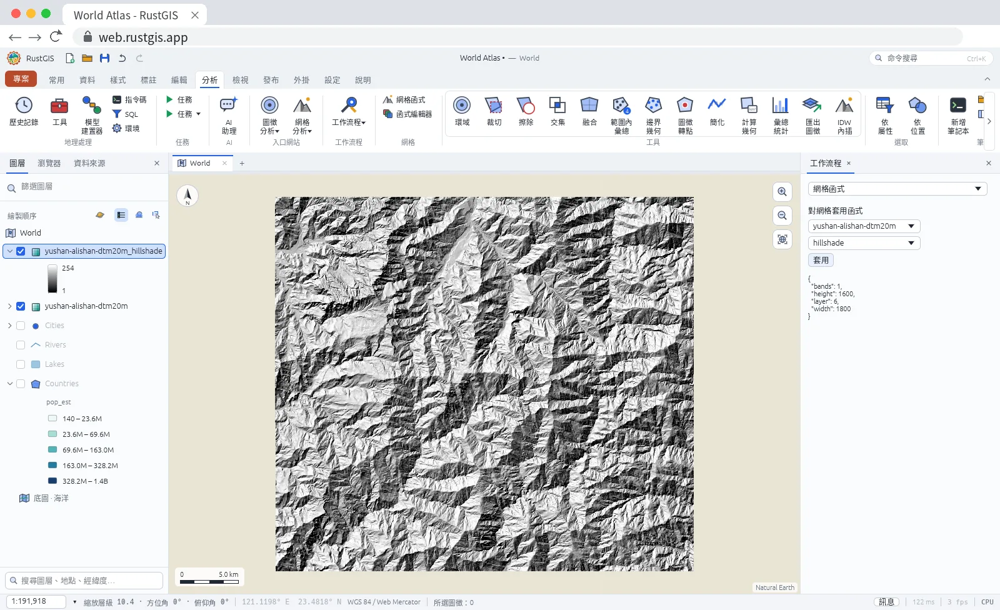
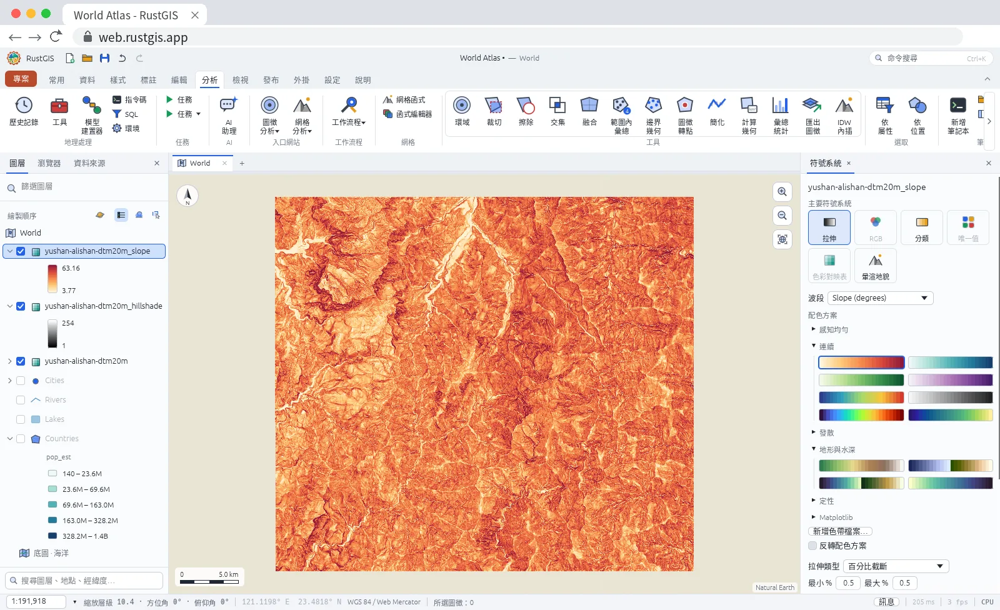

# 10. 地形分析：玉山的暈渲與坡度

這一課會開啟一份**數值地形模型**（DTM），用顏色表示高低、做出立體的**暈渲**地形圖，再算出每個地方有多陡（**坡度**）。範圍是玉山到阿里山一帶，臺灣地形起伏最劇烈的地方之一。

- **需要的時間**：約 20 分鐘
- **需要的東西**：會用符號系統（[第 4 課](04-symbols-labels.md)）。

## 網格與數值地形模型

前幾課用的資料都是**向量**：點、線、面。這一課要用的是**網格**（raster）：把地表切成一格一格的方格，每一格記錄一個數值。照片就是一種網格，每一格（像素）記錄一個顏色。

**數值地形模型**（Digital Terrain Model，DTM）是記錄**高程**的網格，每一格的數值就是那個位置的海拔高度。內政部提供全臺灣的 20 公尺網格 DTM：每 20 公尺 × 20 公尺一格。

## 下載範例資料

全臺灣的 DTM 解壓縮後有 371 MB，在瀏覽器裡處理比較慢。本站從中裁出玉山到阿里山一帶，做成一個小檔案：

**[下載範例檔：yushan-alishan-dtm20m.tif](../data/files/yushan-alishan-dtm20m.tif)**（2.3 MB）

| 項目 | 內容 |
|---|---|
| 範圍 | 東西 36 公里 × 南北 32 公里，包含玉山主峰和阿里山 |
| 網格大小 | 20 公尺，共 1,800 × 1,600 格 |
| 高程 | 574～3,947 公尺 |
| 坐標系統 | TWD97 二度分帶（EPSG:3826） |
| 格式 | GeoTIFF |

!!! info "想用全臺灣的資料？"
    原始資料在[政府資料開放平臺 35430](https://data.gov.tw/dataset/35430)。下載清單裡的「不分幅＿全台及澎湖DEM」ZIP 檔有 96 MB，解壓縮後的 `dem_20m.tif` 就是全臺灣的 DTM，RustGIS 可以直接開啟。範例檔只是從這個檔案裁出一小塊，數值完全相同。

## 開啟 DTM

1. 打開 [web.rustgis.app](https://web.rustgis.app)，把下載的 `.tif` 檔拖進地圖（或用 **常用 › 新增資料**）。
2. 在 `yushan-alishan-dtm20m` 上按右鍵，選 **縮放至圖層**。
3. 取消勾選範例專案的 **Cities**、**Rivers**、**Lakes** 和 **Countries**。

RustGIS 預設用**灰階**顯示網格：越亮的地方越高，越暗的地方越低。中間偏右那一片最亮的，就是玉山山塊；右上角的亮線是中央山脈的稜線；左上角較暗的是阿里山溪谷。

### 查一格的高度

1. 在 **常用** 頁籤的「導覽」群組，按 **識別**。
2. 點地圖上最亮的地方（玉山主峰附近）。

跳出的視窗寫著 **Band 1：3925**，就是這一格的高度：3,925 公尺。玉山主峰的高度是 3,952 公尺，這裡差了一點，因為一格代表 20 公尺 × 20 公尺的範圍，山頂的尖端會被平均掉。整個範例檔的最高格是 3,947 公尺，位置離玉山主峰的三角點不到 20 公尺。

按 **平移**（或 ++esc++）結束識別。

## 用顏色表示高低

1. 在 `yushan-alishan-dtm20m` 上按右鍵，選 **符號系統**。
2. 「主要符號系統」預設是 **拉伸**：把最低到最高的數值，對應到一條色帶的兩端。
3. 在「配色方案」展開 **地形與水深**，選第一條色帶（綠色到棕色到白色）。

低海拔的溪谷是綠色，中海拔是黃色和棕色，3,500 公尺以上的高山是白色，看起來就像一般地圖上的分層設色。

## 暈渲：讓地形變立體

在同一個符號系統面板，把「主要符號系統」換成 **暈渲地貌**：

**暈渲**（hillshade）是假設太陽從某個方向照過來，計算每一格是迎光還是背光，再用明暗表現出來。面向光的山坡亮、背光的山坡暗，地形就變立體了。

面板上可以調整：

| 設定 | 預設值 | 意思 |
|---|---|---|
| 方位角 | 315 | 光從哪個方向來。315° 是西北方，這是地圖的慣例 |
| 高度角 | 45 | 太陽離地平線多高。數字越小，陰影越長、越誇張 |
| Z 因子 | 1 | 高度要放大幾倍。地形平緩的地方可以調大 |
| 依高程著色 | 勾選 | 疊上剛才的地形色帶；取消就只剩灰階的光影 |

!!! tip "為什麼光要從西北方來？"
    人的眼睛習慣光從左上方照過來。如果光從東南方（右下）來，山脊會看起來像山谷，地形好像凹進去。所以地圖的暈渲幾乎都用 315°。

## 用網格函式計算暈渲

符號系統的「暈渲地貌」只改變**顯示方式**。如果要得到一個真正的暈渲**網格**（例如拿來和其他圖層疊合），要用**網格函式**：

1. 點上方的 **分析** 頁籤，在「網格」群組按 **網格函式**。右側會打開「工作流程」面板。
2. 「對網格套用函式」的第一個選單選 `yushan-alishan-dtm20m`，第二個選單選 **hillshade**。
3. 按 **套用**。

    { width="320" }

圖層面板最上方多了一個 `yushan-alishan-dtm20m_hillshade` 圖層，數值是 1～254 的明暗程度：

網格函式的選單裡還有 **slope**（坡度）、**aspect**（坡向）等其他計算。

## 計算坡度

**坡度**是地面傾斜的角度：0° 是平地，90° 是垂直的懸崖。

1. 在「工作流程」面板，第二個選單改選 **slope**。
2. 「Slope units」保留 **Degrees (0–90)**（單位是度）。
3. 按 **套用**。

新的 `yushan-alishan-dtm20m_slope` 圖層會用灰階顯示。照「用顏色表示高低」的方法打開它的符號系統，在 **連續** 選第一條色帶（淺黃到深紅）：

顏色越深紅，坡越陡。可以看到幾條淺色的帶狀，那是溪谷底部和稜線頂端，比較平坦；兩側的山坡則幾乎都是深色。

這個範圍的坡度平均約 36°，有 7 成的地方超過 30°。一般來說，坡度超過 30° 就不適合開發和耕作，這也是臺灣山區的典型樣貌。

!!! warning "要用公尺為單位的坐標系統"
    坡度是「高度差 ÷ 水平距離」。這份資料用 TWD97 二度分帶（EPSG:3826），水平距離和高度都是公尺，所以算出的坡度是正確的。如果 DTM 用的是經緯度（單位是「度」），水平距離和高度的單位不一樣，算出的坡度就會錯。

## 練習

1. 在暈渲地貌把 **高度角** 改成 `20`，地形有什麼變化？再把 **方位角** 改成 `135`（東南方），是不是覺得山脊和山谷顛倒了？
2. 用網格函式算 **aspect**（坡向），看看玉山主峰的四周，哪一面朝北、哪一面朝南。
3. 把坡度圖層的「主要符號系統」換成 **分類**。預設是自然分級法分成 5 級，圖例會列出每一級的坡度範圍。把 **分類** 改成 `3`，看看最平緩的那一級分布在哪裡。

## 小結

- **網格**把地表切成方格，每格記錄一個數值；**數值地形模型（DTM）**記錄的是高程。
- 網格的 **符號系統** 可以用 **拉伸** 配上地形色帶，或用 **暈渲地貌** 做出立體感。
- **分析 › 網格函式** 可以算出 **hillshade**（暈渲）、**slope**（坡度）、**aspect**（坡向）等新的網格。
- 坡度要用**以公尺為單位**的坐標系統計算。

## 資料來源

本課範例檔裁切自內政部「20公尺網格數值地形模型資料」（[政府資料開放平臺 35430](https://data.gov.tw/dataset/35430)），依[政府資料開放授權條款－第 1 版](https://data.gov.tw/license)提供。裁切範圍為 TWD97 二度分帶 E 221,990～257,990 公尺、N 2,580,010～2,612,010 公尺，數值未經修改。
