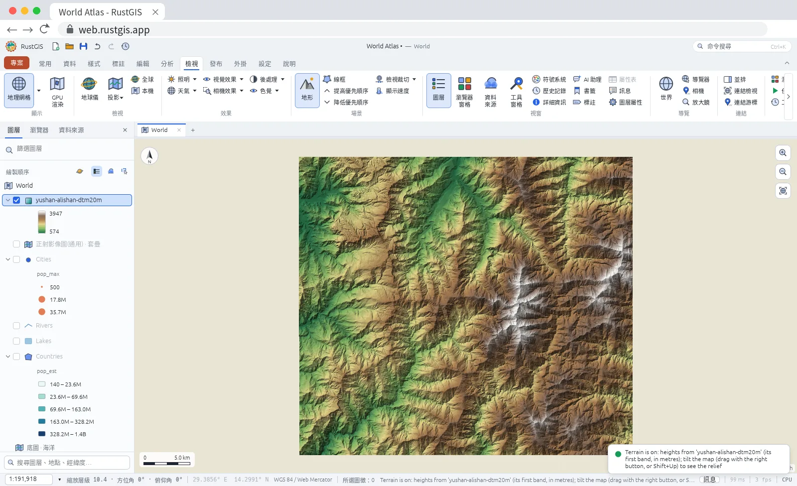
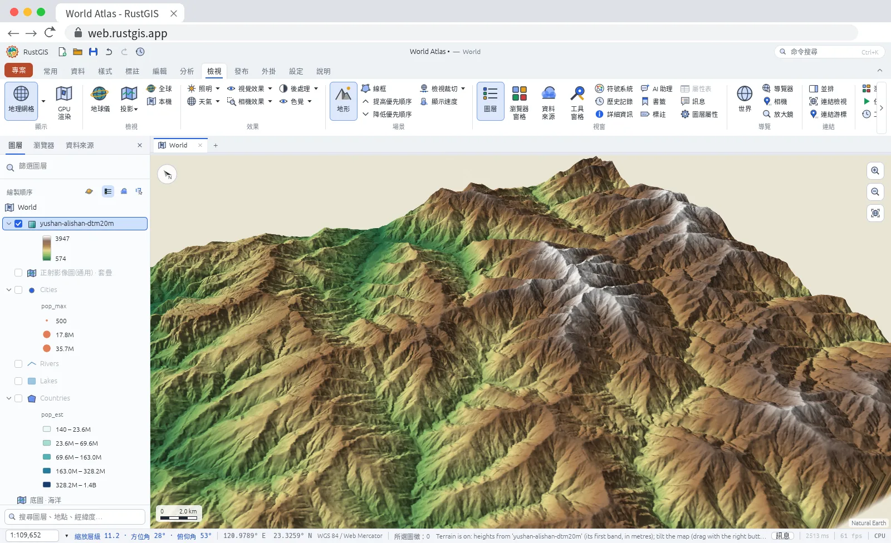
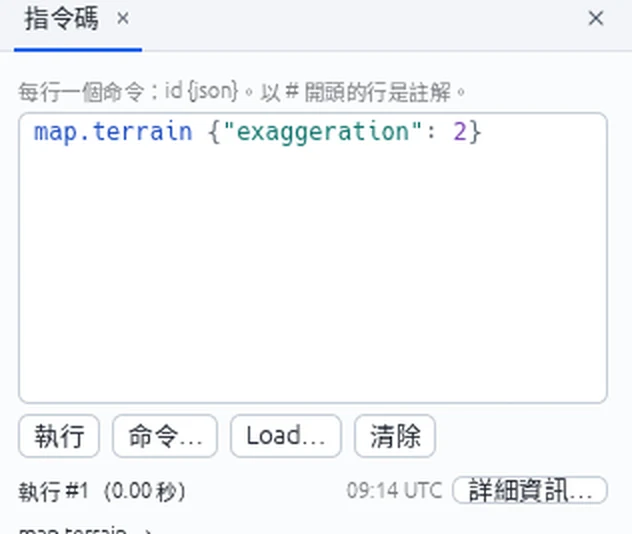
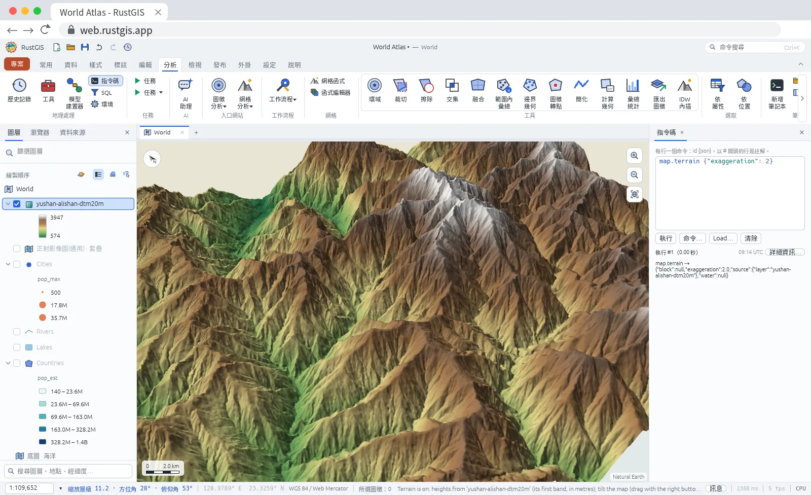
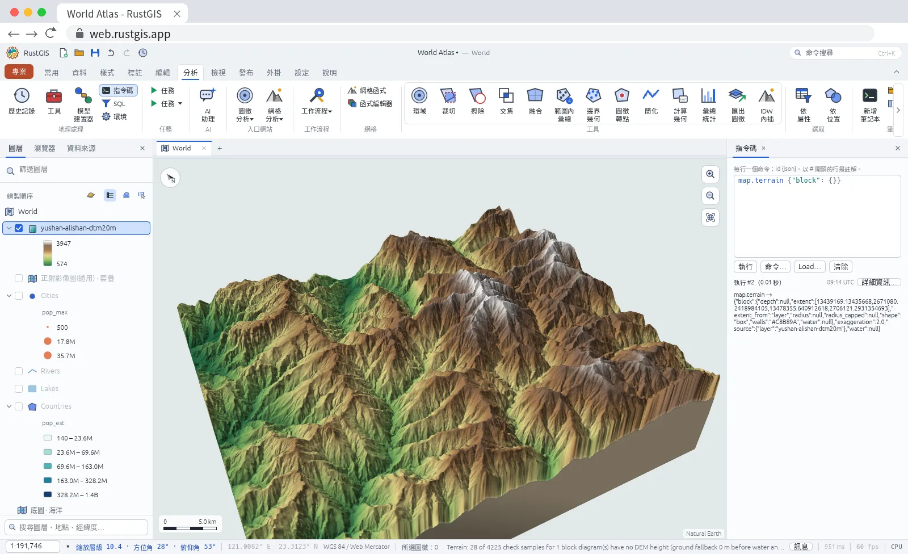
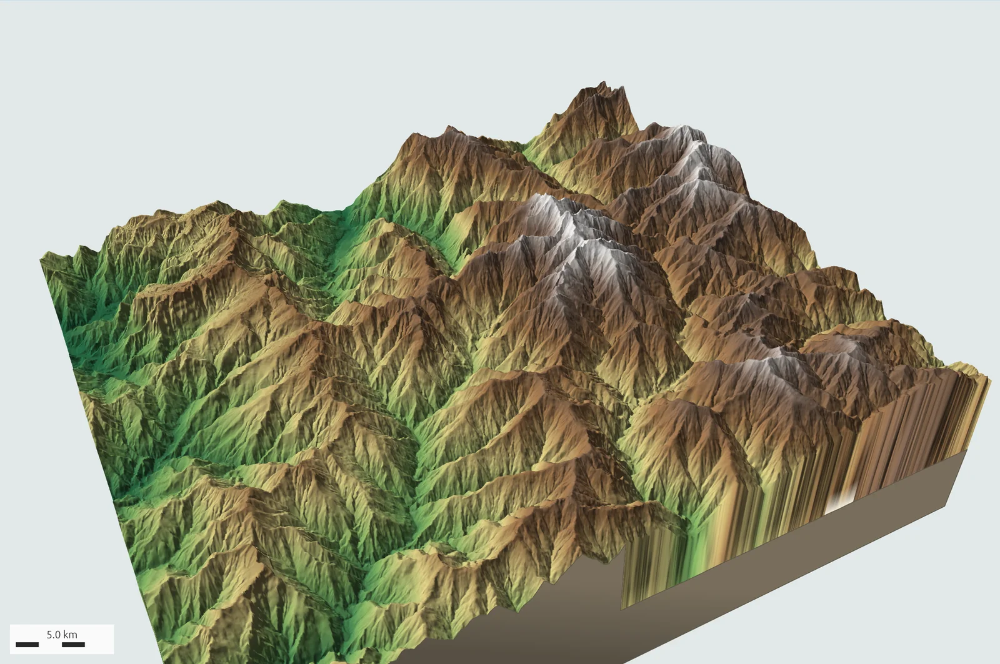
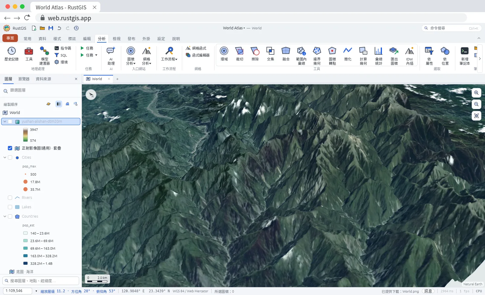

# 11. 3D 地形：立體的玉山

這一課會把[第 10 課](10-terrain.md)的玉山數值地形模型變成**立體的地形**：把地圖傾斜、旋轉，看山脊和溪谷的起伏，再做出地理課本常見的**地形剖塊圖**，最後把國土測繪中心的航空照片鋪在立體地形上。

- **需要的時間**：約 20 分鐘
- **需要的東西**：第 10 課的範例檔 [yushan-alishan-dtm20m.tif](../data/files/yushan-alishan-dtm20m.tif)；最後一節會用到[第 9 課](09-wmts.md)的國土測繪中心連線。

!!! tip "電腦比較舊也能做"
    立體地形要即時計算光影，電腦比較舊時，轉動畫面會稍微頓一下，停下來後就會畫清楚。

## 準備地形資料

1. 打開 [web.rustgis.app](https://web.rustgis.app)，把 `yushan-alishan-dtm20m.tif` 拖進地圖，在圖層上按右鍵選 **縮放至圖層**。
2. 取消勾選範例專案的 **Cities**、**Rivers**、**Lakes** 和 **Countries**。
3. 照第 10 課的方法設定符號系統：先在 **拉伸** 選 **地形與水深** 的第一條色帶（[用顏色表示高低](10-terrain.md#colour)），再把「主要符號系統」換成 **暈渲地貌**（[暈渲](10-terrain.md#relief)）。

這樣地圖上就有一張平面的暈渲地形圖。接下來要讓它真的「站起來」。

## 打開地形

1. 在圖層面板**點選** `yushan-alishan-dtm20m`，讓它成為目前的圖層。
2. 點上方的 **檢視** 頁籤，在「場景」群組按 **地形**。



右下角會出現一則英文提示（目前還沒有中文翻譯），意思是：「地形已開啟，高度來自 `yushan-alishan-dtm20m` 的第一個波段，單位是公尺；把地圖傾斜就能看到起伏。」

這時地圖看起來沒什麼變化，因為我們還是**從正上方往下看**。地形開啟後，要把地圖傾斜才看得出高低。

!!! info "地形的高度從哪裡來？"
    RustGIS 會把目前選取的網格圖層當成地面高度，每一格的數值就是那裡的海拔（公尺）。地圖上所有的圖層都會「鋪」在這個高低起伏的地面上。

## 傾斜與旋轉

1. 用滾輪在玉山主峰附近（畫面中間偏右、最白的地方）放大兩格。
2. 在地圖上**按住滑鼠右鍵**，慢慢**往上**拖，地圖就會往後傾斜。
3. 一樣按住右鍵，**往右**拖一點，地圖就會順時針旋轉。



玉山山塊和周圍的稜線、溪谷都立體地浮現出來了。

!!! warning "拖一點點就好"
    傾斜和旋轉都很靈敏：往上拖約 100 像素，就會傾斜 50° 左右；拖太多會變成從側面平視，只看得到一條山的剪影。轉過頭了就反方向拖回來。

畫面最下方的狀態列會顯示現在的角度：

| 狀態列 | 意思 |
|---|---|
| **方位角** | 畫面上方朝哪個方向，從正北順時針算。0° 是北方朝上，90° 是東方朝上 |
| **俯仰角** | 地圖傾斜了多少。0° 是從正上方往下看，最大 85° |

- 想回到平面：點地圖左上角的**指北標**，地圖會轉回正北朝上，並恢復從正上方往下看。
- 用觸控板沒有右鍵時：按住 ++ctrl++ 再用左鍵（或觸控板）拖曳，效果相同。

## 高度誇大

臺灣的山雖然高，但和東西 36 公里寬的範圍相比，起伏其實不算大。地理課本的**地形剖面圖**常常把高度放大幾倍，讓起伏更明顯，這叫做**垂直誇大**。RustGIS 也可以這樣做，不過這個設定沒有按鈕，要用**指令碼**輸入：

1. 點 **分析** 頁籤，在「地理處理」群組按 **指令碼**。右側會打開「指令碼」窗格。
2. 在輸入框輸入下面這一行（可以直接複製貼上），按 **執行**：

    ```
    map.terrain {"exaggeration": 2}
    ```

    { width="420" }



`2` 表示高度放大 2 倍。可以填 0 到 20 之間的數字，`1` 是真實的高度。

## 地形剖塊圖

地理課本常把一塊地形切成方塊，從側面看它的剖面，這叫做**地形剖塊圖**（block diagram）。在指令碼窗格輸入：

```
map.terrain {"block": {}}
```

按 **執行**，再用滾輪縮小兩格：



範例檔的範圍被切成一個方塊，四周是土黃色的剖面牆，牆的上緣就是地形的剖面線。狀態列可能會出現一行英文訊息，說邊緣有幾個點沒有高度，這是方塊邊緣剛好落在資料範圍外，不影響畫面。

想拿掉剖塊圖、回到原本的樣子，輸入：

```
map.terrain {"block": false}
```

## 匯出立體地圖

傾斜後的畫面也可以存成圖片：點 **發布** 頁籤，按 **匯出地圖**。瀏覽器會下載一張 PNG，檔名是地圖的名稱（例如 `World.png`），內容和畫面上看到的一樣是立體的。



## 立體航照：把正射影像鋪在地形上

最後把國土測繪中心的航空照片鋪在立體地形上，就像搭直升機看玉山。

1. 照[第 9 課](09-wmts.md)的步驟建立國土測繪中心的連線，加入 **正射影像圖(通用)**。
2. 如果還開著剖塊圖，先用 `map.terrain {"block": false}` 拿掉。
3. 在圖層面板**取消勾選** `yushan-alishan-dtm20m`。地形還是會用它的高度，只是不畫出顏色，下面的航空照片就露出來了。
4. 在玉山附近放大兩格。



森林覆蓋的山坡、稜線和溪谷都看得清清楚楚，溪谷裡淺色的線條多半是河床。

!!! note "範例檔範圍外是平的"
    地形的高度只來自範例檔，範例檔以外的地方沒有高度，會被當成海拔 0 公尺。所以把地圖轉到範例檔邊緣時，會看到航空照片突然變平。

## 練習

1. 把高度誇大改成 `1`（真實高度）和 `3`，和 2 倍的畫面比較。哪一個最接近你在山上看到的樣子？
2. 阿里山在玉山的西邊。如果要「從阿里山看玉山」，方位角大約要轉到幾度？轉轉看，玉山出現在畫面的哪裡？
3. 先把高度誇大改成 `3`，再做一次地形剖塊圖，剖面牆上的起伏有什麼變化？

??? success "參考答案"
    1. `1` 是真實的高度，看起來比想像中平緩，因為 36 公里寬的範圍裡，高低差「只有」約 3.4 公里。`3` 倍的山又尖又陡，看起來很壯觀，但已經不是真實的樣子。用了垂直誇大的地圖或剖面圖，要在圖上註明誇大了幾倍，讀者才不會誤會。
    2. 從西邊往東看，畫面上方要朝東，所以方位角大約是 **90°**。這時玉山山塊會出現在畫面中間偏上、比較遠的地方，前面是阿里山一帶比較低的山。
    3. 剖面牆的上緣會跟著變得更高低起伏，牆也變高了，玉山主峰附近的牆最高。

## 小結

- **檢視 › 場景 › 地形** 會用目前選取的網格圖層當地面高度，把地圖變成立體的。
- **按住右鍵拖曳**：往上拖是傾斜，往左右拖是旋轉。點**指北標**可以回到平面。
- **分析 › 指令碼** 可以輸入指令：`map.terrain {"exaggeration": 2}` 是高度誇大，`map.terrain {"block": {}}` 是地形剖塊圖。
- 地形圖層隱藏後，高度還在，可以把航空照片等其他圖層鋪在立體地形上。

## 資料來源

本課使用內政部「20公尺網格數值地形模型資料」（[政府資料開放平臺 35430](https://data.gov.tw/dataset/35430)）裁切的範例檔，以及內政部國土測繪中心的正射影像圖（[國土測繪圖資服務雲](https://maps.nlsc.gov.tw/)），依[政府資料開放授權條款－第 1 版](https://data.gov.tw/license)及其使用規定提供。
