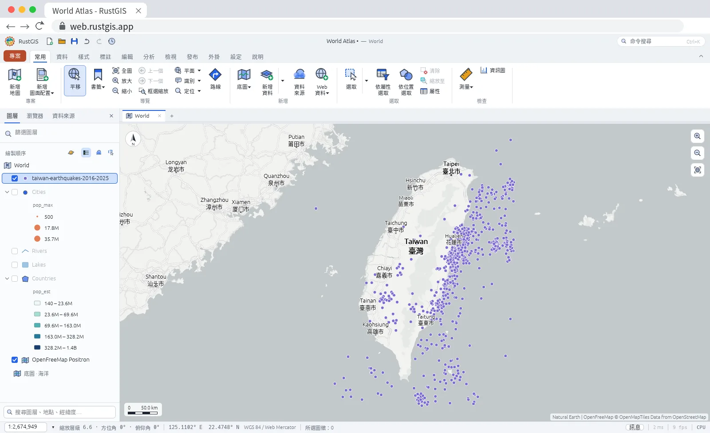
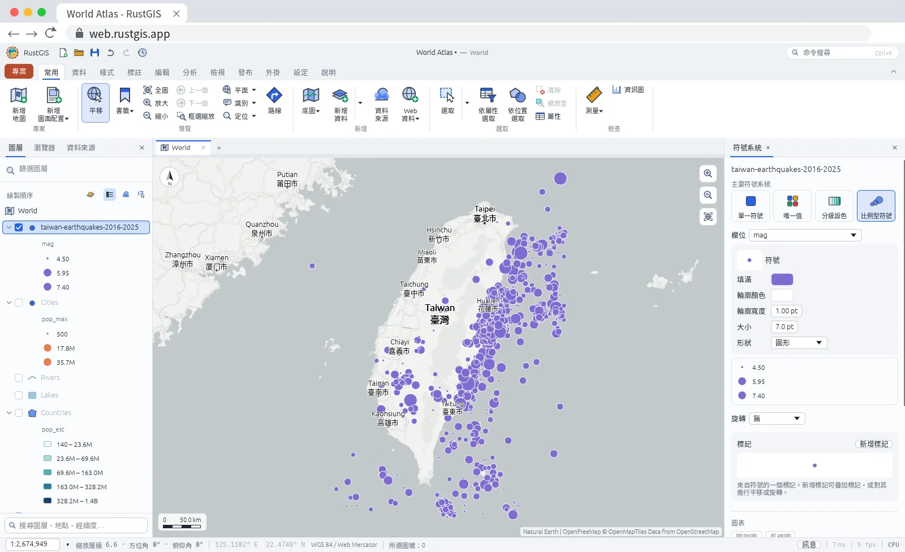
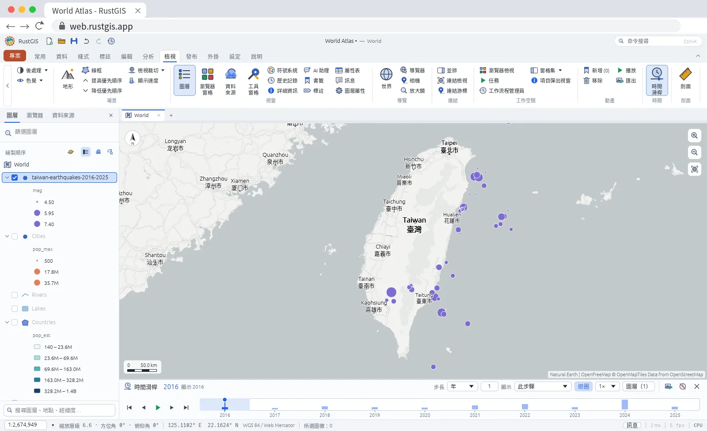
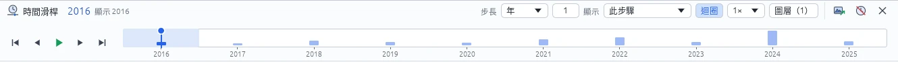
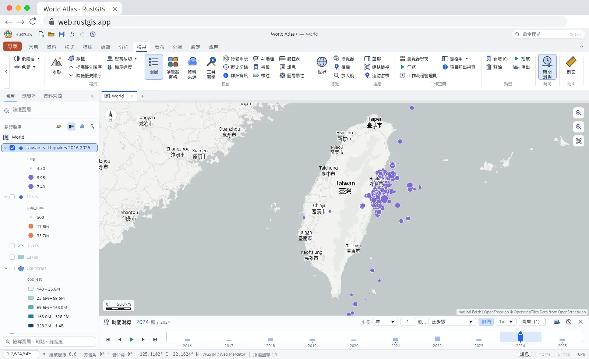
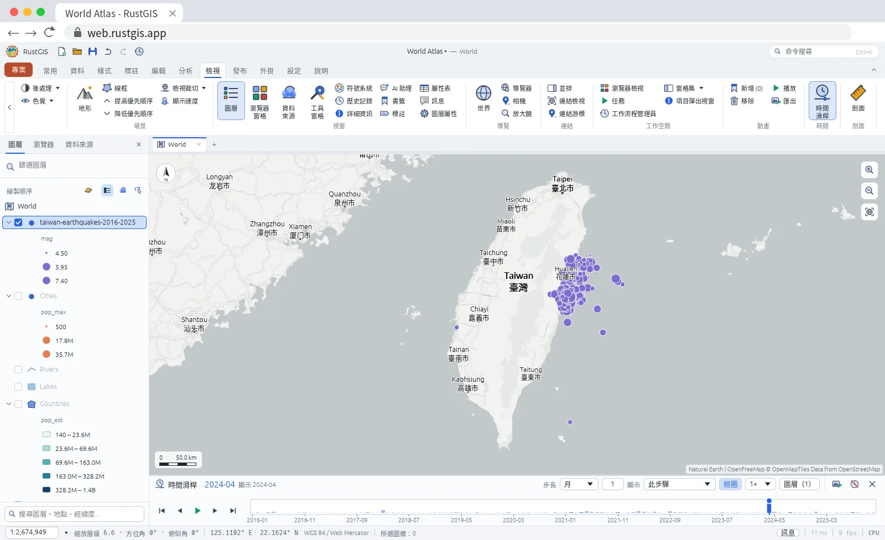
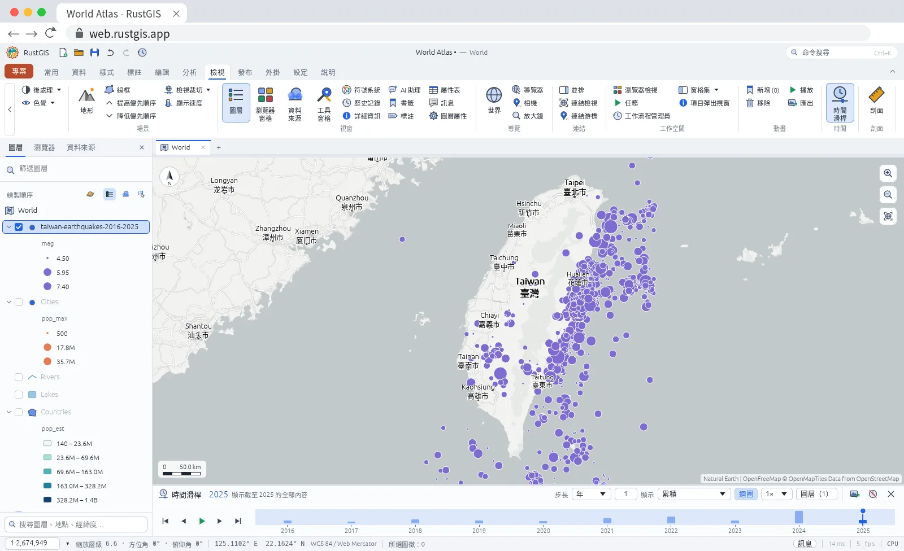

# 12. 時間滑桿：臺灣十年來的地震

這一課會開啟 2016～2025 年臺灣附近的地震資料，用**時間滑桿**讓地震一年一年、一個月一個月地出現在地圖上，看出地震在**哪裡**、**什麼時候**特別多。

- **需要的時間**：約 25 分鐘
- **需要的東西**：會用符號系統（[第 4 課](04-symbols-labels.md)）和依屬性選取（[第 3 課](03-attribute-table.md)）。

## 下載地震資料

**[下載範例檔：taiwan-earthquakes-2016-2025.csv](../data/files/taiwan-earthquakes-2016-2025.csv)**（65 KB）

這份資料來自美國地質調查所（USGS）的全球地震目錄，選出 2016～2025 年、臺灣附近（北緯 21.5°～25.8°、東經 119.3°～122.6°）規模 4.5 以上的地震，共 **789 筆**。

| 欄位 | 意思 | 例子 |
|---|---|---|
| `time` | 發生時間（世界標準時間） | `2024-04-02T23:58:12.173Z` |
| `latitude`、`longitude` | 震央的緯度、經度 | `23.8356`、`121.5976` |
| `depth` | 震源深度（公里） | `40` |
| `mag` | 規模 | `7.4` |
| `place` | 地點說明（英文） | `15 km S of Hualien City, Taiwan` |

!!! info "時間要加 8 小時"
    `time` 欄位是**世界標準時間**（UTC），最後的 `Z` 就是這個意思。臺灣時間要再加 8 小時：`2024-04-02T23:58` 是臺灣時間 **2024 年 4 月 3 日上午 7:58**，也就是花蓮大地震發生的時間。

!!! note "為什麼不用中央氣象署的資料？"
    中央氣象署的地震報告要先申請會員、取得授權碼才能下載，而且只提供最近的報告。USGS 的地震目錄免費、不用註冊，資料屬於公共領域，適合課堂使用。兩邊常用的規模算法不同：USGS 對較大的地震多採用**地震矩規模**，較小的地震常用**體波規模**（本範例檔有一半以上是體波規模）；中央氣象署對外發布的是**芮氏規模**，所以數字會有一點差異。例如 2024 年花蓮地震，USGS 的地震矩規模是 7.4，中央氣象署的芮氏規模是 7.2。

## 開啟資料

1. 打開 [web.rustgis.app](https://web.rustgis.app)，把 CSV 拖進地圖。
2. 圖層面板多了一個 `taiwan-earthquakes-2016-2025` 點圖層。在它上面按右鍵，選 **縮放至圖層**。
3. 取消勾選範例專案的 **Cities**、**Rivers**、**Lakes** 和 **Countries**，再把底圖換成 **OpenFreeMap Positron**（[第 2 課](02-load-boundaries.md)）。

和[第 8 課](08-points.md)一樣，CSV 直接變成點圖層：欄位名稱 `latitude`、`longitude` 是 RustGIS 認得的緯度、經度欄位名稱。

一眼就看得出來：地震大多集中在**臺灣東部和東部外海**。789 筆裡，有 707 筆（約 9 成）在東經 121 度以東。

## 依規模畫大小

讓規模大的地震畫得比較大：

1. 在 `taiwan-earthquakes-2016-2025` 上按右鍵，選 **符號系統**。
2. 在「主要符號系統」按 **比例型符號**。
3. **欄位** 選 `mag`。

圖例顯示 4.50、5.95、7.40 三種大小。花蓮附近那個最大的圓，就是 2024 年規模 7.4 的地震。

!!! tip "圓的大小不等於地震的威力"
    圓的大小是照規模的數字放大的，只是方便看出哪裡有大地震。地震規模每增加 1，釋放的能量大約增加 32 倍：規模 7.4 釋放的能量是規模 4.5 的兩萬倍以上，比圓看起來的差距大得多。

## 打開時間滑桿

1. 點 **檢視** 頁籤，往右找到「時間」群組。功能區太長、看不到時，按功能區右邊的 **›** 捲動。
2. 按 **時間滑桿**。

地圖下方出現時間軸，地圖上只剩 **2016 年**的地震。RustGIS 自動找到 `time` 欄位，把地震圖層綁到時間滑桿上。

| 控制項 | 用途 |
|---|---|
| ⏮ ◀ ▶ ▶ ⏭ | 依序是：第一步、上一步、播放／暫停（綠色）、下一步、最後一步 |
| 時間軸上的長條 | 每一步有幾個地震，越高越多 |
| **步長** | 每一步的長度：小時、日、月、年 |
| **顯示** | **此步驟**只顯示這一步；**累積**顯示到這一步為止的全部 |
| **迴圈** | 播到最後一步後，從頭再播 |
| **1×** | 播放速度，0.5× 到 4× |

按綠色的 **▶** 播放，年份會一年一年往前跳，地震也跟著出現、消失。再按一次就暫停。

## 2024 年發生了什麼事？

時間軸上 **2024 年**的長條特別高。點一下 2024 年的長條：

2024 年有 223 個地震，比其他年份多很多，而且都擠在花蓮附近。把 **步長** 換成 **月**，時間會跳到 **2024-01**；再按 3 次 **下一步**（綠色播放鍵右邊的 ▶），到 **2024-04**：

光是 **2024 年 4 月**就有 169 個規模 4.5 以上的地震。4 月 3 日早上的規模 7.4 主震之後，接連發生大量**餘震**；4 月 23 日凌晨（臺灣時間）又發生一波密集的地震。用「月」來看，就能看出地震在時間上也會**集中**發生。

## 累積十年

把 **步長** 換回 **年**，**顯示** 換成 **累積**，按 **⏭** 跳到最後一步：

十年的地震都疊在一起，可以清楚看出地震帶的形狀：沿著**花東縱谷**和東部海岸，一路延伸到**宜蘭東北方的外海**。

!!! question "為什麼臺灣東部的地震特別多？"
    臺灣位在**歐亞板塊**和**菲律賓海板塊**的交界。花東縱谷一帶是兩個板塊碰撞擠壓的地方；宜蘭東北方的外海，菲律賓海板塊則隱沒到歐亞板塊底下（琉球隱沒帶）。板塊互相擠壓、錯動，就會發生地震。

## 時間滑桿開著時的選取

時間滑桿開著的時候，**依屬性選取**只會選到**地圖上看得到**的地震。例如只顯示 2016 年時，選「規模 6 以上」只會選到 2 個，狀態列還會提醒「另有 18 個圖徵符合」，因為其他年份的地震被時間滑桿藏起來了。

要對全部的地震做選取，先按控制列右邊的 **⊘**（關閉時間滑桿）：時間軸會收起來，所有地震重新出現。要再用時間滑桿，再按一次 **檢視 › 時間滑桿** 就好。

!!! warning "不要按最右邊的 ×"
    **⊘** 旁邊還有一個 **×**。**×** 只會把控制列藏起來，時間滑桿其實還開著，地圖上仍然只顯示某一段時間的地震。要讓所有地震重新出現，一定要按 **⊘**。

## 練習

1. 關閉時間滑桿，用 **依屬性選取** 選出 `mag >= 6` 的地震。十年來有幾個規模 6 以上的地震？
2. 用「月」為步長，找到 **2022 年 9 月**。那個月的地震集中在哪裡？
3. 選出 `depth > 70`（震源深度超過 70 公里）的地震。它們大多分布在哪裡？為什麼？

??? success "參考答案"
    1. **20 個**。其中 5 個發生在 2024 年，都在花蓮附近。
    2. 那個月有 22 個地震，其中 20 個集中在**臺東縣池上、關山到花蓮縣南段**（花東縱谷南段）。9 月 17 日晚上（臺灣時間）先發生規模 6.5 的**前震**，18 日下午發生規模 6.9 的**主震**，之後又有許多餘震。
    3. 共 **19 個**，其中 15 個在**宜蘭東方到東北方的外海**，另外 4 個在**恆春到臺東的東方外海**。震源深度 70～300 公里的地震，在地震學上叫做**中源地震**（超過 300 公里才是深源地震），這 19 個都是中源地震。宜蘭外海是菲律賓海板塊隱沒到歐亞板塊底下的地方（琉球隱沒帶），隱沒的板塊越往北越深：宜蘭外海的中源地震約 70～80 公里，到基隆附近約 140 公里，最北的一個深達 246 公里。南邊的 4 個則可能和另一個方向的隱沒有關：在臺灣南方，歐亞板塊往東隱沒到菲律賓海板塊底下（馬尼拉隱沒帶）。

## 小結

- 欄位名稱是 `latitude`、`longitude` 的 CSV，拖進 RustGIS 就直接變成點圖層。
- **比例型符號** 可以依數值畫出大小不同的符號。
- **檢視 › 時間滑桿** 讓有日期欄位的資料隨時間播放；**步長** 可以選年、月、日，**顯示** 可以選「此步驟」或「累積」。
- 時間滑桿開著時，選取只會選到看得到的圖徵。

## 資料來源

本課範例檔整理自美國地質調查所（U.S. Geological Survey）[地震目錄](https://earthquake.usgs.gov/earthquakes/search/)，屬於公共領域。原始資料可以用這個網址重新下載：[USGS 地震目錄查詢（CSV）](https://earthquake.usgs.gov/fdsnws/event/1/query?format=csv&starttime=2016-01-01&endtime=2026-01-01&minlatitude=21.5&maxlatitude=25.8&minlongitude=119.3&maxlongitude=122.6&minmagnitude=4.5&orderby=time-asc)。範例檔只保留 6 個欄位，並刪去 1 筆山崩事件。
