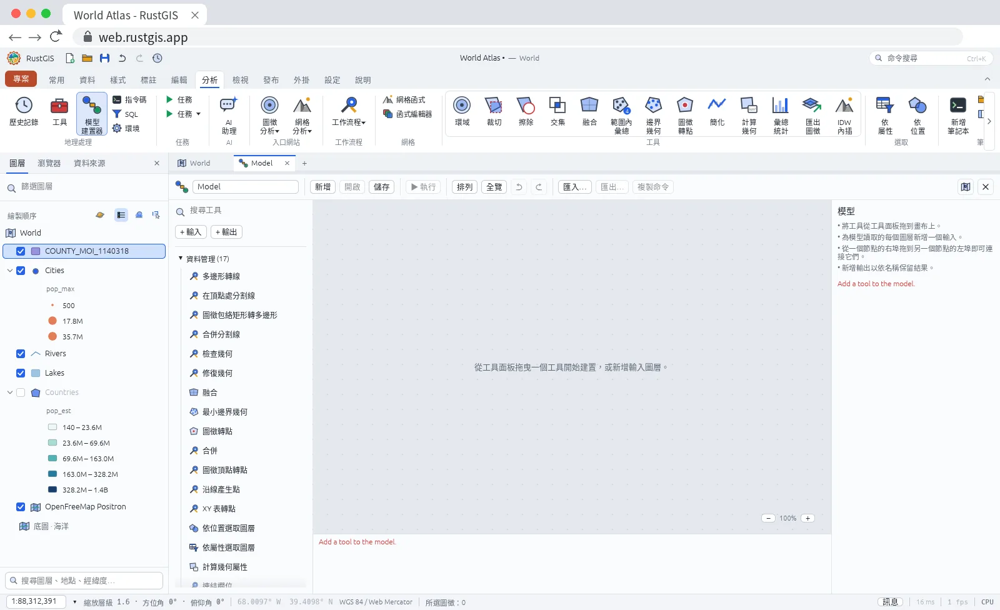
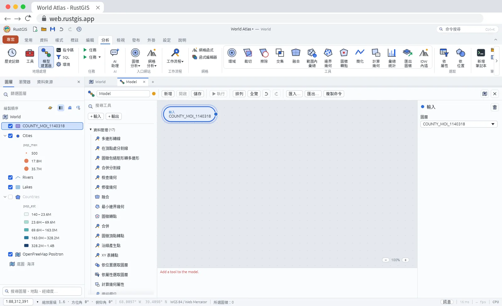
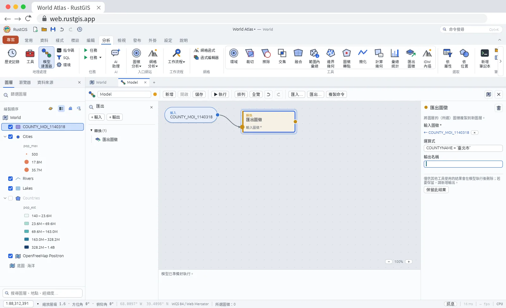
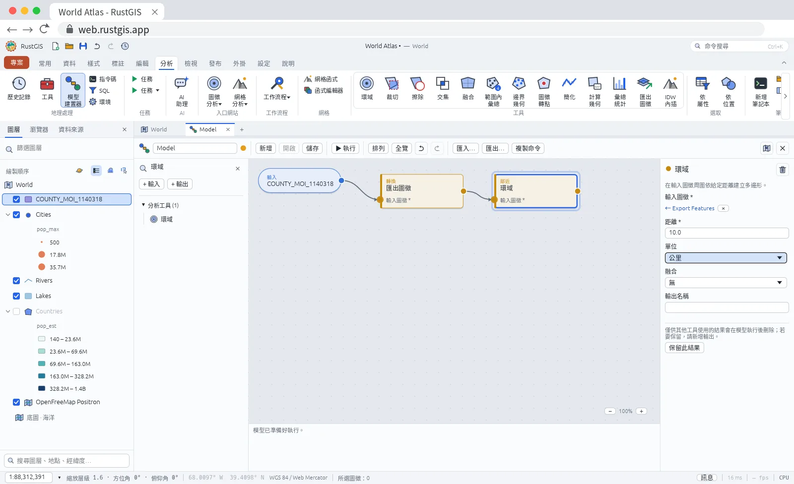
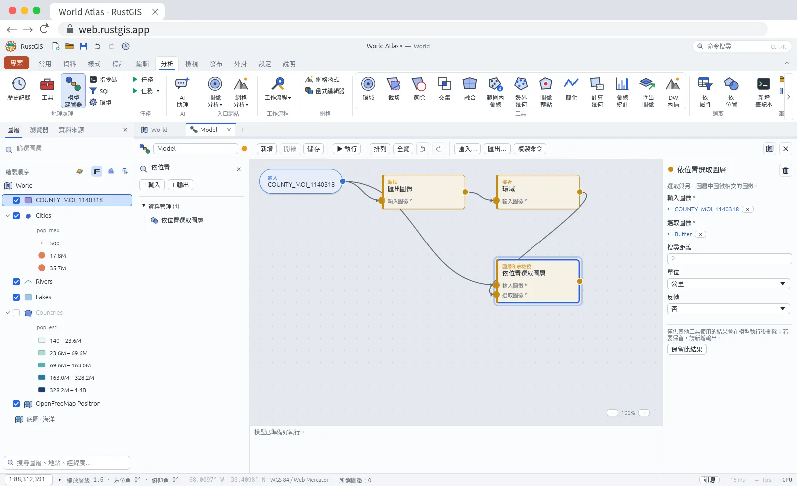
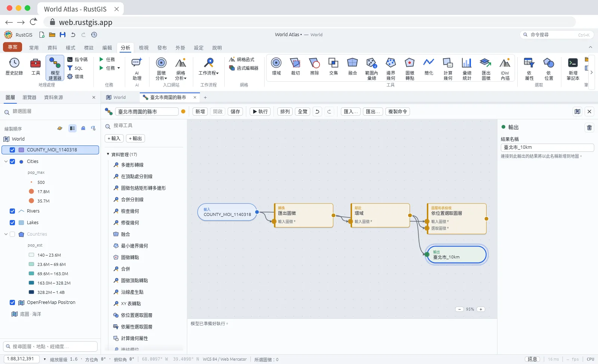
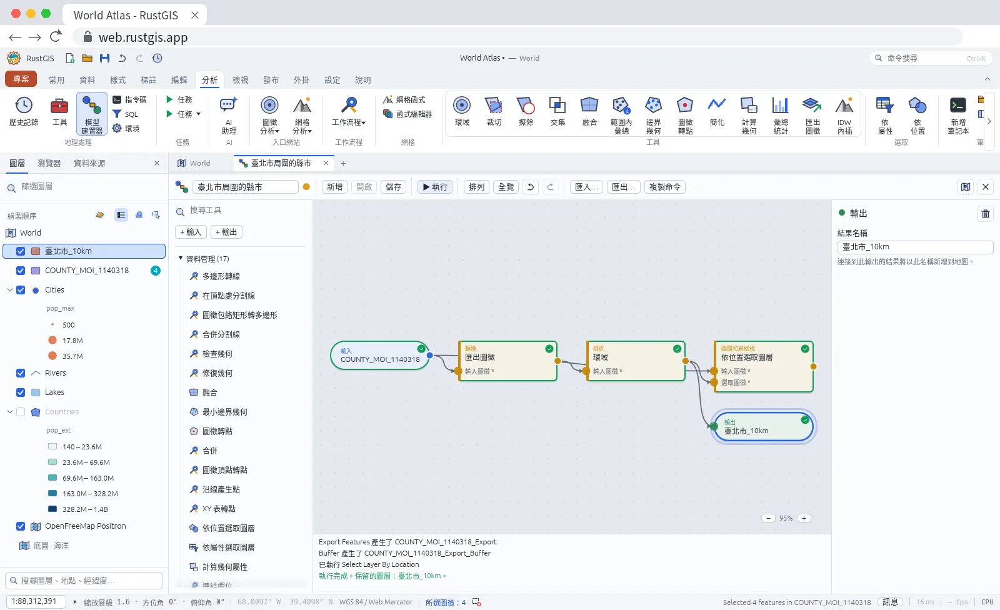
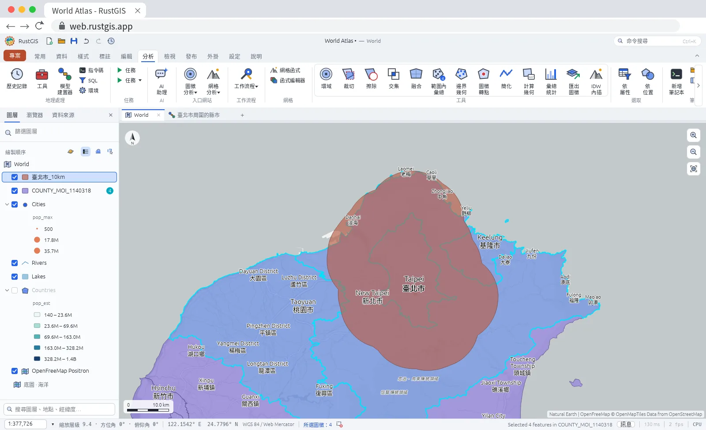
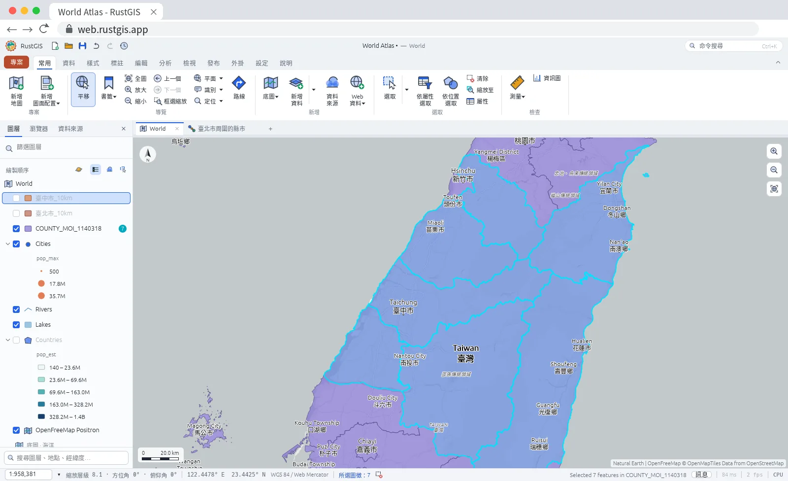
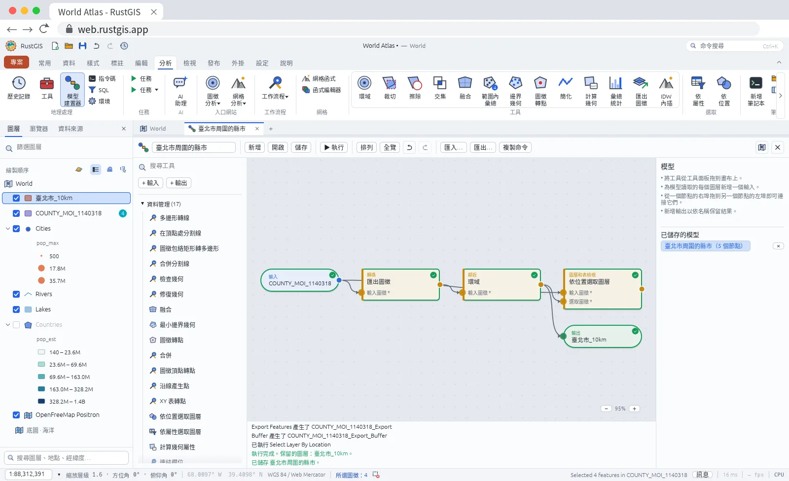

# 13. 模型建置器：把分析步驟串成流程

[第 5 課](05-buffer.md)找出「臺北市周圍 10 公里內有哪些縣市」，要做三個步驟：選出臺北市、做環域、依位置選取。想換成臺中市，或把距離改成 5 公里，就得從頭再按一遍。

**模型建置器**（Model Builder）可以把這些步驟畫成一張**流程圖**：每個工具是一個方塊，用線把它們連起來。之後按一次 **執行** 就全部跑完；改一個條件，同一個流程就能重複使用。

- **需要的時間**：約 25 分鐘
- **需要的東西**：會用環域和依位置選取（[第 5 課](05-buffer.md)）。在 RustGIS 開好 `COUNTY_MOI_1140318` 圖層，底圖換成 OpenFreeMap Positron，並取消勾選 **Countries** 圖層（[第 2 課](02-load-boundaries.md)）。

!!! warning "開始前先清除選取"
    如果接著第 5 課做，縣市界線可能還有選取的縣市。先按 **常用 › 選取 › 清除**，原因在[後面](#why-clear)說明。

## 打開模型建置器

點上方的 **分析** 頁籤，在「地理處理」群組按 **模型建置器**。地圖旁邊會多一個 **Model** 分頁：



| 位置 | 名稱 | 用途 |
|---|---|---|
| 上方 | 工具列 | 模型名稱、執行、排列、儲存、匯出等按鈕 |
| 左邊 | 工具面板 | 所有可以放進模型的工具，上方可以搜尋 |
| 中間 | 畫布 | 放工具、連線的地方 |
| 右邊 | 屬性面板 | 設定目前點選的方塊（例如環域的距離） |
| 下方 | 訊息區 | 顯示還缺什麼設定，以及執行的結果 |

這一課要做出這樣的流程：

> **縣市界線** → **匯出圖徵**（只留臺北市）→ **環域** 10 公里 → **依位置選取圖層**
>
> 縣市界線還要另外連一條線到依位置選取圖層，因為要從縣市界線裡選。

## 第一步：加入輸入圖層

1. 按工具面板上方的 **＋ 輸入**，畫布上出現一個「輸入」方塊。
2. 在右邊的「圖層」選 `COUNTY_MOI_1140318`。



## 第二步：匯出臺北市 { #export }

1. 在工具面板的「搜尋工具」輸入「匯出」，把 **匯出圖徵** 拖到畫布上，放在輸入方塊的右邊。
2. **連線**：從輸入方塊右邊的藍色圓點，按住拖到匯出圖徵左邊的「輸入圖徵」圓點，放開。兩個方塊之間會出現一條線。
3. 在右邊的 **運算式** 輸入：

    ```sql
    COUNTYNAME = '臺北市'
    ```



**匯出圖徵** 會把符合運算式的圖徵複製成一個**新圖層**，這裡就是只有臺北市的圖層。

!!! info "為什麼不用「依屬性選取圖層」？"
    第 5 課是用「依屬性選取」選出臺北市。模型建置器裡也有 **依屬性選取圖層**，但它只會改變**選取**，不會產生新圖層。把它接到環域，執行時會出現錯誤：「Buffer: the tool before it made no layer for "Input Features"」（意思是「環域前面的工具沒有產生圖層」）。所以在模型裡，要用 **匯出圖徵** 做出一個新圖層，再交給下一個工具。

方塊右上角的紅色 **!** 表示還有必填的設定沒填，下方的訊息區會列出缺什麼（這些提示目前還是英文）。全部填好後，紅色 **!** 就會消失。

## 第三步：環域 10 公里

1. 搜尋「環域」，把 **環域** 拖到匯出圖徵的右邊。
2. 從匯出圖徵右邊的圓點，連到環域的「輸入圖徵」。
3. **距離** 改成 `10`，**單位** 是 **公里**（預設），**融合** 維持 **無**。



## 第四步：依位置選取

1. 搜尋「依位置」，把 **依位置選取圖層** 拖到畫布上。
2. 這個工具要連**兩條線**：
    - 輸入方塊（縣市界線）→「**輸入圖徵**」：要從哪個圖層選。
    - 環域 →「**選取圖徵**」：用哪個範圍來選。



一個圓點可以連出好幾條線，所以輸入方塊可以同時接到匯出圖徵和依位置選取圖層。四個方塊都設定好後，訊息區會顯示「**模型已準備好執行。**」

## 保留環域的結果

模型執行時，中間產生的圖層（臺北市、環域）**只給下一個工具使用，執行完就會刪掉**。想在地圖上看到環域範圍，要把它設成「輸出」：

1. 點畫布上的 **環域** 方塊，在右邊按 **保留此結果**。畫布上多了一個綠色的「**輸出**」方塊。
2. 點這個輸出方塊，把 **結果名稱** 改成 `臺北市_10km`。
3. 按工具列的 **排列**，方塊會自動排整齊。
4. 把工具列最左邊的模型名稱 `Model` 改成 `臺北市周圍的縣市`。



## 執行模型

按工具列的 **執行**。每個方塊依序打上綠色的勾，訊息區顯示每一步的結果：



```
Export Features 產生了 COUNTY_MOI_1140318_Export
Buffer 產生了 COUNTY_MOI_1140318_Export_Buffer
已執行 Select Layer By Location
執行完成。保留的圖層：臺北市_10km。
```

訊息裡的工具名稱目前還是英文：Export Features 是匯出圖徵，Buffer 是環域，Select Layer By Location 是依位置選取圖層。最下方的狀態列顯示「**所選圖徵：4**」。

點 **World** 分頁回到地圖，圖層面板多了 `臺北市_10km`。在它上面按右鍵選 **縮放至圖層**：



結果和第 5 課一樣：**基隆市、臺北市、新北市、桃園市**。不同的是，這次只按了一次「執行」。

## 換成臺中市再跑一次

模型最方便的地方是可以**重複使用**。把臺北市換成臺中市：

1. 先按 **常用 › 選取 › 清除**。
2. 點 **臺北市周圍的縣市** 分頁回到模型，點 **匯出圖徵** 方塊，把運算式改成：

    ```sql
    COUNTYNAME = '臺中市'
    ```

3. 點輸出方塊，把結果名稱改成 `臺中市_10km`。
4. 按 **執行**。

這次狀態列顯示「**所選圖徵：7**」。回到地圖，對 `臺中市_10km` 按右鍵選 **縮放至圖層**，再把兩個環域圖層取消勾選，就能看到被選取的 7 個縣市：



答案是**臺中市、苗栗縣、新竹縣、彰化縣、南投縣、宜蘭縣、花蓮縣**，和第 5 課練習第 2 題一樣。

### 為什麼要先清除選取？ { #why-clear }

圖層有選取的圖徵時，**匯出圖徵只會處理選取的圖徵**（工具說明寫著「將圖層的（所選）圖徵複製到新圖層」），和第 5 課的環域工具一樣。

第一次執行後，縣市界線還選著基隆市、臺北市、新北市、桃園市這 4 個。如果不清除就改成臺中市，匯出圖徵只會在這 4 個裡面找臺中市，結果什麼都沒有，最後選到 **0** 個縣市。所以每次重新執行前，都要先清除選取。

## 儲存與分享模型

| 按鈕 | 做什麼 | 存在哪裡 |
|---|---|---|
| **儲存** | 把模型存到這個專案裡。點畫布的空白處，右邊會列出「已儲存的模型」；按 **開啟** 可以從清單中選一個打開 | 專案裡。要用 ++ctrl+s++ 把專案存成 `.rgis` 檔（[第 2 課](02-load-boundaries.md#save-project)），重新整理網頁後才找得回來 |
| **匯出…** | 下載模型檔，例如 `臺北市周圍的縣市.model.json` | 瀏覽器的「下載」資料夾 |
| **匯入…** | 打開別人分享的 `.model.json` 模型檔 | |
| **複製命令** | 把整個模型複製成一行 `model.run` 指令，可以貼到[第 11 課](11-3d-terrain.md)的 **指令碼** 窗格執行 | 剪貼簿 |



模型檔只記錄流程和設定，**不包含資料**，所以檔案很小，適合分享給同學。不過輸入方塊記的是**圖層名稱**：匯入後，地圖上要有一樣名稱的 `COUNTY_MOI_1140318` 圖層，模型才能執行。

## 練習

每題做之前，先按 **常用 › 選取 › 清除**，再把運算式改回臺北市或改成題目的縣市。

1. 把環域的距離改成 **5 公里**，執行。剩幾個縣市？
2. 改成**高雄市**（10 公里），會碰到幾個縣市？是哪些？
3. 改成**花蓮縣**（10 公里），會碰到幾個縣市？為什麼連嘉義縣也碰得到？

??? success "參考答案"
    1. 剩 **3 個**：基隆市、臺北市、新北市。桃園市不見了，它離臺北市界超過 5 公里，和第 5 課練習第 1 題一樣。
    2. **7 個**：高雄市、臺南市、嘉義縣、屏東縣、臺東縣、南投縣、花蓮縣。這 6 個縣市都和高雄市相鄰：高雄市的那瑪夏區、桃源區一路延伸到中央山脈，和嘉義縣、南投縣、花蓮縣、臺東縣都接在一起。
    3. **7 個**：花蓮縣、宜蘭縣、臺中市、南投縣、嘉義縣、高雄市、臺東縣。花蓮縣和嘉義縣其實**不相鄰**，但嘉義縣的最東端就在玉山主峰，離花蓮縣的西南角（卓溪鄉）只有大約 7 公里，在 10 公里的環域範圍內。

## 小結

- **分析 › 地理處理 › 模型建置器** 可以把好幾個工具連成流程圖，按一次 **執行** 就全部跑完。
- 從一個方塊右邊的圓點拖到另一個方塊左邊的圓點，就能**連線**；一個圓點可以連出好幾條線。
- 在模型裡，**匯出圖徵** 加上運算式可以做出新圖層；**依屬性選取圖層** 只改變選取，不能接給下一個工具。
- 中間結果執行完就會刪掉，按 **保留此結果** 可以留在地圖上。
- 圖層有選取時，工具只處理選取的圖徵。**重新執行前要先清除選取**。
- **儲存** 存在專案裡，**匯出…** 存成 `.model.json` 檔，**複製命令** 變成一行指令。

## 資料來源

本課使用內政部國土測繪中心「直轄市、縣市界線(TWD97經緯度)」開放資料（[政府資料開放平臺 7442](https://data.gov.tw/dataset/7442)），依[政府資料開放授權條款－第 1 版](https://data.gov.tw/license)提供。
