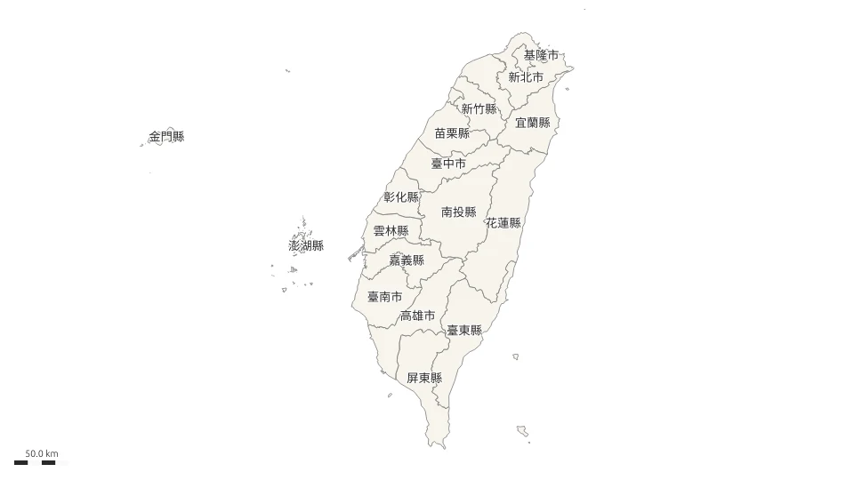
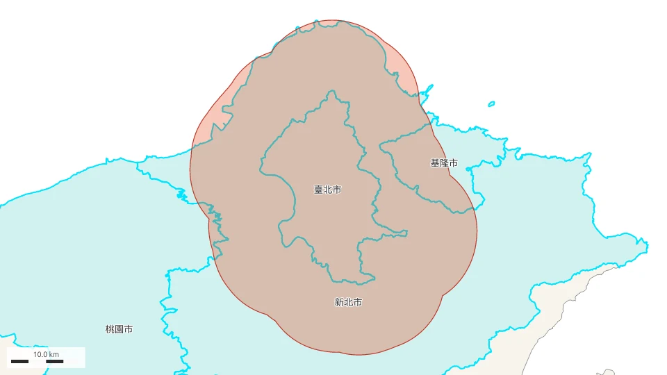
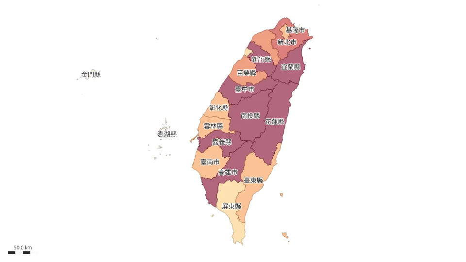

# 14. Python 套件：一次分析 22 個縣市

[第 5 課](05-buffer.md)和[第 13 課](13-model-builder.md)都在問「臺北市周圍 10 公里內有哪些縣市」。如果要把 **22 個縣市都問一遍**呢？用滑鼠要做 22 次，用模型建置器也要改 22 次條件。

這一課改用 **Python** 寫程式：RustGIS 有官方的 Python 套件 `rustgis`，網頁版裡的工具都能用程式呼叫。只要寫一個**迴圈**，不到一秒就能把 22 個縣市全部算完，最後畫成地圖、存成表格。

程式在 **Google Colab** 上執行：打開瀏覽器就能寫 Python，不用在電腦上安裝任何東西。

- **需要的時間**：約 30 分鐘
- **需要的東西**：一個 Google 帳號；會用環域和依位置選取（[第 5 課](05-buffer.md)）。看過一點 Python 更好，沒學過也可以照著執行。

!!! warning "學校的 Google 帳號"
    有些學校的 Google 帳號，管理員沒有開放 Colab。打不開的話，改用個人的 Google 帳號，或請老師確認。

## 打開練習用的筆記本

這一課的程式都寫好了，放在一份**筆記本**（notebook）裡。點下面的按鈕，用 Colab 打開：

[](https://colab.research.google.com/github/begin0808/RustGIS-TW/blob/main/docs/notebooks/14-python.ipynb)

也可以[下載筆記本檔案](../notebooks/14-python.ipynb)，在 Colab 用 **檔案 › 上傳筆記本** 打開。

筆記本由兩種格子組成：

- **文字格**：說明這一步要做什麼。
- **程式碼格**：灰色的格子。按左邊的 **▶**，或點一下格子再按 ++shift+enter++，就會執行，結果顯示在格子下方。

請**從上往下依序執行**，後面的格子會用到前面算出來的東西。也可以用 **執行階段 › 全部執行** 一次跑完。

!!! info "第一次執行時的提醒"
    - 還沒登入的話，Colab 會先要你登入 Google 帳號。
    - Colab 會提醒「這份筆記本不是 Google 寫的」，請確認來源是本站後，按 **仍要執行**。
    - Colab 的電腦閒置一段時間就會被收回，裝好的套件和算出來的結果都會消失。下次打開時，要從第一格重新執行。

## 1. 安裝

```python
!apt-get -qq update > /dev/null 2>&1 && DEBIAN_FRONTEND=noninteractive apt-get -qq install -y fonts-noto-cjk > /dev/null 2>&1
%pip install -q rustgis
```

這一格裝兩樣東西，約需 1 分鐘：

- **中文字型**：Colab 的電腦沒有中文字型，不裝的話，地圖上的中文標註會整個畫不出來。
- **rustgis 套件**：RustGIS 的 Python 版。

最後如果出現「you may need to restart the kernel」，不用理它，直接執行下一格。

## 2. 下載縣市界線

```python
import os, urllib.request

url = "https://begin0808.github.io/RustGIS-TW/data/files/COUNTY_MOI_1140318.zip"
if not os.path.exists("COUNTY_MOI_1140318.zip"):
    urllib.request.urlretrieve(url, "COUNTY_MOI_1140318.zip")
print(os.path.getsize("COUNTY_MOI_1140318.zip") // 1024, "KB")
```

從本站下載縣市界線，和[第 2 課](02-load-boundaries.md)是同一份資料。檔案存在 Colab 的電腦裡，不是你的電腦。

## 3. 開啟圖層

```python
import rustgis

s = rustgis.Session()
county = s.add_data("COUNTY_MOI_1140318.zip")
print(county.name, "有", county.count, "個圖徵")
print("欄位：", county.fields)
```

```
COUNTY_MOI_1140318 有 22 個圖徵
欄位： ['COUNTYID', 'COUNTYCODE', 'COUNTYNAME', 'COUNTYENG']
```

- `rustgis.Session()` 開出一個**看不到畫面的 RustGIS**，之後的操作都對它下指令。
- `add_data` 就是網頁版的 **新增資料**，ZIP 檔一樣不用解壓縮。
- `county` 代表縣市界線這個圖層；`county.count` 是圖徵數，`county.fields` 是欄位名稱。

## 4. 畫出地圖

```python
s.set_basemap("blank")
s.run("layer.color", layer=county.name, color="#F3EEE4")
s.run("layer.outline", layer=county.name, color="#7A7A7A", width=0.8)
s.run("labels.field", layer=county.name, field="COUNTYNAME")
s.zoom_to((119.3, 21.85, 122.1, 25.35))   # 西、南、東、北的經緯度
s
```



`s.run(...)` 執行 RustGIS 的**指令**，和[第 11 課](11-3d-terrain.md)指令碼窗格裡的指令是同一套：`layer.color` 設定填滿顏色、`layer.outline` 設定外框、`labels.field` 用 `COUNTYNAME` 欄位加上標註。格子的最後一行只寫 `s`，Colab 就會把地圖畫出來。

## 5. 用程式重做第 5 課

```python
county.select("COUNTYNAME = '臺北市'")
buf = s.run_tool("buffer", input=county, distance=10, units="Kilometers", output="臺北市_10km")
county.clear_selection()
s.run_tool("selectByLocation", input=county, select=buf)

names = [f["properties"]["COUNTYNAME"] for f in county.to_geojson(selected=True)["features"]]
print(len(names), "個縣市：", names)
```

```
4 個縣市： ['基隆市', '臺北市', '新北市', '桃園市']
```

和第 5 課一樣是 4 個縣市。每一行對應的滑鼠操作：

| 程式 | 網頁版的操作 |
|---|---|
| `county.select("COUNTYNAME = '臺北市'")` | 依屬性選取 |
| `s.run_tool("buffer", ...)` | 分析 › 環域，距離 10 公里 |
| `county.clear_selection()` | 常用 › 選取 › 清除 |
| `s.run_tool("selectByLocation", ...)` | 依位置選取 |
| `county.to_geojson(selected=True)` | 打開屬性表，只看選取的圖徵 |

`buffer`、`selectByLocation` 是工具的英文代號，參數名稱（`input`、`distance`、`select`）和模型建置器裡的設定一一對應。

下一格把環域畫成半透明的紅色，畫面移到環域範圍：



## 6. 一次分析 22 個縣市

```python
import time
import pandas as pd

if county.selected:        # 先清除第 5 步的選取，否則只會簡化選取的 4 個縣市
    county.clear_selection()
simple = s.run_tool("simplify", input=county, tolerance=0.1, output="縣市_簡化")

start = time.time()
rows = []
for f in simple.to_geojson()["features"]:
    name = f["properties"]["COUNTYNAME"]
    simple.select(f"COUNTYNAME = '{name}'")
    b = s.run_tool("buffer", input=simple, distance=10, units="Kilometers", output="暫存環域")
    simple.clear_selection()
    s.run_tool("selectByLocation", input=simple, select=b)
    hit = [g["properties"]["COUNTYNAME"] for g in simple.to_geojson(selected=True)["features"]]
    others = [h for h in hit if h != name]
    rows.append({"縣市": name, "10公里內的其他縣市數": len(others), "有哪些": "、".join(others)})
    simple.clear_selection()
    b.remove()
print(f"花了 {time.time() - start:.1f} 秒")

df = pd.DataFrame(rows).sort_values("10公里內的其他縣市數", ascending=False, ignore_index=True)
df
```

這一格是本課的重點：

- **`for f in ...:`** 是**迴圈**：對 22 個縣市，一個一個做底下縮排的那幾行，也就是第 5 步的「選取 → 環域 → 清除 → 依位置選取」。
- `others` 拿掉縣市自己，只數**其他**縣市。
- `b.remove()` 把用完的暫存環域刪掉，免得圖層越來越多。
- 最後用 `pandas` 把結果排成表格，數字由大到小。

### 為什麼要先「簡化」？

縣市界線畫得非常細，連海岸線的小彎曲都有。直接做環域的話，一個縣市要好幾秒，22 個縣市要好幾分鐘。

**簡化**（simplify）會減少邊界上的點。`tolerance=0.1` 是容許誤差 **0.1 公里**（100 公尺）：邊界的位置最多偏移 100 公尺。環域的距離是 10 公里，差 100 公尺不會改變結果，速度卻快了好幾百倍，整個迴圈不到 1 秒。我們也用沒有簡化的原始邊界算過一次，22 個縣市的結果完全一樣。

!!! warning "又是選取的問題"
    第 5 步做完時，縣市界線還選著 4 個縣市。**簡化工具和第 13 課的匯出圖徵一樣，只處理選取的圖徵**。沒有先清除的話，簡化後的圖層只剩 4 個縣市，迴圈也只會算 4 個。所以第一行先檢查：有選取（`county.selected` 不是 0），就清除。

### 結果

| 縣市 | 10 公里內的其他縣市數 | 有哪些 |
|---|---|---|
| 宜蘭縣 | 6 | 新北市、桃園市、花蓮縣、臺中市、苗栗縣、新竹縣 |
| 南投縣 | 6 | 彰化縣、雲林縣、嘉義縣、高雄市、花蓮縣、臺中市 |
| 高雄市 | 6 | 南投縣、屏東縣、臺南市、嘉義縣、臺東縣、花蓮縣 |
| 花蓮縣 | 6 | 宜蘭縣、南投縣、嘉義縣、高雄市、臺東縣、臺中市 |
| 新竹縣 | 6 | 宜蘭縣、新北市、桃園市、新竹市、臺中市、苗栗縣 |
| 嘉義縣 | 6 | 南投縣、雲林縣、臺南市、嘉義市、高雄市、花蓮縣 |
| 臺中市 | 6 | 宜蘭縣、彰化縣、南投縣、花蓮縣、苗栗縣、新竹縣 |
| 新北市 | 5 | 宜蘭縣、基隆市、臺北市、桃園市、新竹縣 |
| 桃園市 | 4 | 宜蘭縣、臺北市、新北市、新竹縣 |
| 苗栗縣 | 4 | 宜蘭縣、新竹市、臺中市、新竹縣 |
| 臺北市 | 3 | 基隆市、新北市、桃園市 |
| 臺東縣 | 3 | 屏東縣、高雄市、花蓮縣 |
| 彰化縣 | 3 | 南投縣、雲林縣、臺中市 |
| 雲林縣 | 3 | 彰化縣、南投縣、嘉義縣 |
| 臺南市 | 3 | 嘉義市、嘉義縣、高雄市 |
| 屏東縣 | 2 | 高雄市、臺東縣 |
| 新竹市 | 2 | 苗栗縣、新竹縣 |
| 基隆市 | 2 | 臺北市、新北市 |
| 嘉義市 | 2 | 臺南市、嘉義縣 |
| 連江縣 | 0 | |
| 金門縣 | 0 | |
| 澎湖縣 | 0 | |

最多的是 6 個，有 7 個縣市，大多是**跨越中央山脈**的縣市：它們的山區在稜線上和好幾個縣市碰在一起。第 13 課算過的臺中市、高雄市、花蓮縣也在這裡，數字一樣是 6（加上自己就是 7）。

## 7. 把結果畫成地圖

```python
count = dict(zip(df["縣市"], df["10公里內的其他縣市數"]))
gj = simple.to_geojson()
for f in gj["features"]:
    f["properties"]["near"] = count[f["properties"]["COUNTYNAME"]]
result = s.add_geojson(gj, name="10公里內的其他縣市數")
result.style("graduated", field="near", method="manual", breaks=[0, 2, 3, 4, 5, 6])
s.run("labels.field", layer=result.name, field="COUNTYNAME")

for layer in (county, buf, simple):
    layer.visible = False
s.zoom_to((119.3, 21.85, 122.1, 25.35))
s
```

把每個縣市的數字寫進一個新欄位 `near`，加成新圖層，再用**分級設色**（[第 7 課](07-choropleth.md)）畫出來。`breaks` 是手動設定的級距，讓 0、2、3、4、5、6 各一種顏色。



顏色越深，10 公里內的其他縣市越多。深色的縣市從北到南連成一條，大致就是中央山脈的位置。

## 8. 存檔與下載

```python
s.save("taiwan-counties.rgis")
df.to_csv("10km-neighbors.csv", index=False, encoding="utf-8-sig")
```

- `taiwan-counties.rgis`：RustGIS 專案檔。用網頁版的 **開啟專案**（[第 2 課](02-load-boundaries.md#save-project)）打開，就能在網頁版看到 Python 做出來的所有圖層，繼續用滑鼠操作。
- `10km-neighbors.csv`：結果表格，可以用 Excel 打開。`utf-8-sig` 讓 Excel 正確顯示中文。

在 Colab 執行時，筆記本裡的程式會再呼叫 `files.download`，把兩個檔案下載到你的電腦。

## 練習

改完程式後，從改的那一格開始往下重新執行。

1. 把第 6 格的 `distance=10` 改成 `distance=5`，重新執行第 6 格。哪幾個縣市最多？臺北市剩幾個？
2. 為什麼連江縣、金門縣、澎湖縣都是 0？要把距離改成多少，澎湖縣才會碰到其他縣市？
3. 把第 6 格的 `tolerance=0.1` 改成 `tolerance=100`，結果會怎樣？為什麼？

??? success "參考答案"
    1. 最多的是**南投縣、高雄市、臺中市**，各 6 個。臺北市剩 **2 個**（基隆市、新北市），桃園市不見了，和第 5 課練習第 1 題一樣。
    2. 這三個縣都是**離島**，和其他縣市隔著海。澎湖縣最近的是雲林縣，相距約 29 公里：距離改成 `28` 還是 0，改成 `30` 就會碰到雲林縣。金門縣和連江縣離其他縣市都超過 100 公里。
    3. 很多數字會變錯，例如臺北市從 3 變成 2、花蓮縣從 6 變成 4。`tolerance` 的單位是**公里**，`100` 是容許誤差 100 公里，縣市的形狀被簡化得面目全非。用簡化之前，要先確認單位，並讓容許誤差遠小於分析的距離。

## 在自己的電腦上執行

`rustgis` 也可以裝在自己的電腦上，需要 **Python 3.12 以上**：

```
pip install rustgis
```

Windows 和 macOS 已經有中文字型，不用另外安裝。筆記本裡第 1 格的 `apt-get` 只適用 Colab（Linux），在自己的電腦上執行時跳過那一行。

## 小結

- `rustgis` 是 RustGIS 的 Python 套件，網頁版的工具和指令都能用程式呼叫：`s.run_tool(...)` 執行工具，`s.run(...)` 執行指令。
- 在 Colab 執行時，要先安裝中文字型，地圖上的中文標註才畫得出來。
- 用 **迴圈** 可以把同一套分析套用到每一個縣市，這是程式最擅長的事。
- **簡化** 可以大幅加快環域，但容許誤差（單位是公里）要遠小於分析的距離。
- 和網頁版一樣，工具只處理**選取的圖徵**。執行工具前，先確認有沒有忘了清除的選取。
- 結果可以存成 `.rgis` 專案檔，回到網頁版繼續操作。

想知道更多用法，可以參考官方的 [Python 說明](https://rustgis.app/python/)（英文）。

## 資料來源

本課使用內政部國土測繪中心「直轄市、縣市界線(TWD97經緯度)」開放資料（[政府資料開放平臺 7442](https://data.gov.tw/dataset/7442)），依[政府資料開放授權條款－第 1 版](https://data.gov.tw/license)提供。
